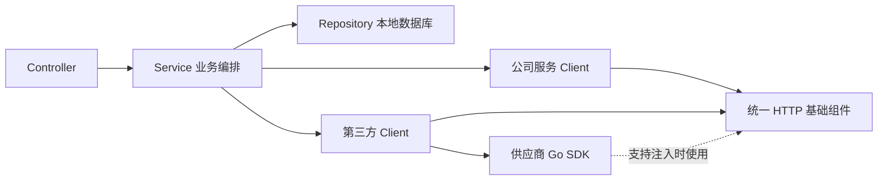

# 外部接口与第三方依赖调用规范

状态：目标规范，统一 Client 组件尚未实施。更新日期：2026 年 11 月 9 日。

本文规定当前项目如何调用其他系统。“外部依赖”包括公司内部其他服务，以及公司以外的产品或服务。两者统一经过项目自己的 Client 调用，Service 只使用明确的 Go 方法；HTTP、第三方 SDK、鉴权、请求与响应格式均封装在 Client 内部。

本文约束后续接入方式，不新增真实服务或供应商依赖。接口层继续负责本项目的入站请求和响应，Repository 继续负责本项目的数据库访问；日志及指标接入沿用[日志与可观测性体系设计](application-log.md)。

## 1 两类依赖及统一调用链

| 依赖类型 | 当前允许方式 | 调用入口 | 专属约束 |
| --- | --- | --- | --- |
| 公司内部其他服务 | HTTP 接口，包括使用 TLS 的 HTTPS | 对应服务的 Company Client | 按服务契约认证，透传标准链路上下文，校验对方接口版本和业务错误 |
| 第三方产品或服务 | 官方或明确维护的 Go SDK；自行构造 HTTP 请求 | 对应供应商的 ThirdParty Client | SDK 也必须满足超时、重试和观测要求；供应商类型不进入业务层 |



**Service 决定调用哪个业务能力，Client 决定怎样与对方通信。** 不把远程 HTTP 调用放入 Repository，也不因为调用第三方使用的是 Go 方法，就直接在 Service 中导入 SDK。

## 2 职责和代码边界

| 位置 | 应负责 | 不负责 |
| --- | --- | --- |
| Controller | 处理入站身份、请求 DTO、Service 调用及本项目响应映射 | 组装外部 URL、直接调用 SDK 或决定远程重试 |
| Service | 编排本地与远程操作、判断业务条件、组织幂等业务标识、解释明确的业务结果 | 持有供应商原始 DTO、拼 HTTP Header、解析外部响应或重复包装技术错误 |
| Company Client | 一个内部服务的具体操作、版本路径、线上 DTO、服务间认证及错误适配 | 本项目领域权限判断和本地数据库事务 |
| ThirdParty Client | SDK/HTTP 封装、供应商签名、错误与结果转换、供应商限制 | 本项目业务流程或把供应商 SDK 对象直接返回给调用方 |
| HTTP 基础组件 | Client/Transport 构建、连接池、有限大小读取、通用观测和基础网络策略 | 供应商业务码、某接口成功条件和业务幂等含义 |
| 客户端装配入口 | 按环境加载配置，构建并发布可复用 Client，管理关闭 | 每次请求重新初始化、运行中改写共享请求状态 |

客户端方法按具体能力命名，例如 `QueryAccount`、`SendMessage`、`CreatePayment`。不要向 Service 暴露 `Call(url, method, headers, body)` 一类任意远程调用入口，也不让 Service 传入签名、供应商 Token 或原始 HTTP Request。

Client 返回自己的 Params/Result 或明确的业务数据，不返回 `*http.Response`、开放的响应 Body、Gin Context、SDK Response 或外部 SDK error 类型作为静态返回契约。方法统一返回结果与 `error`，成功结果完整可用；分页或部分成功必须在该操作的 Result 中明确定义，不能隐式把失败的数据当成完整成功。

## 3 目录与依赖方向

建议目录如下，均为后续实施目标。

```text
app/integrations/
  company/<service>/       一个内部服务的 Client、Params、Result、协议适配
  thirdparty/<provider>/   一个第三方供应商的 Client、Params、Result、SDK 或 HTTP 适配
internal/
  httpclient/              HTTP Client、Transport 和通用读取能力
  clienterror/             Client 边界错误和有限分类
  clients/                 配置、共享客户端集合及初始化和关闭
config/clients/
  dev.yml
  test.yml
  prod.yml
```

`<service>` 和 `<provider>` 使用实际接入对象的稳定名称，不按调用它的 Controller 版本复制。外部接口的 v1/v2 路径由具体 Client 管理，不跟随本项目 `/api/v1` 自动变化。

沿用当前默认实例装配方式：`bootstrap` 在发布默认 Service 前构建 Client；Service 通过 `clients.Current()` 取得已发布集合，例如 `Company.Account` 和 `ThirdParty.SMS`。Client、HTTP Client 及连接池按进程复用，共享配置在发布后只读；单次调用的请求、参数、Context、签名及幂等键保存在局部变量中。

依赖方向为 `Service → internal/clients → app/integrations → internal/httpclient/clienterror`。Client 不反向导入 Service、Controller 或 composition，`internal/composition` 仍只负责 Service 装配，数据库 Runtime 不接管所有外部客户端。仅为一种客户端写一个具体类型即可；确有替换实现或消费方隔离需求时，再定义小接口，不要求预先建立通用插件框架。

## 4 公司内部服务调用

1. 每个服务有自己的 Client，路径、HTTP 方法、接口版本、请求与响应 DTO 都集中在该 Client。即使对方是同一公司的 Go 服务，也只通过 HTTP 契约交互，不导入其 Service、models 或数据库表结构。
2. 基础地址从环境配置取得，服务发现首期使用部署环境提供的 DNS 或明确地址，不在业务代码硬编码，也不按每个请求任意切换目标。调用方仅提供资源标识与业务参数，由 Client 安全构造路径和 Query。
3. 按对方契约使用服务身份认证；本项目当前用户 JWT 不自动成为其他服务的服务凭证，不因为位于内网就默认跳过认证。需要代表用户执行时，按双方约定使用受信任的委托身份，不能透传客户端自报身份头。
4. 通过标准 `traceparent/tracestate` 传递链路；请求标识和幂等标识分开管理，不直接复制所有入站 Header。对方的请求标识作为日志中的 `remote_request_id` 保存，不覆盖本服务 request_id。
5. 对响应先检查 HTTP 状态，再按该服务契约检查响应结构及业务结果。除非对方接口明确采用本项目的 `data/error` 契约，否则不假定响应格式相同；采用该格式时验证状态、`data/error` 组合及通用码的一致性。
6. 对方返回 404 只有在已确认具体业务语义后才能解释为“目标不存在”，路由不存在或版本错误属于契约故障。对方返回 401/403 通常是本服务对下游的凭证或权限问题，不能直接当作当前用户未登录。

方法调用形状如下，示例服务及类型尚不存在：

```go
account, err := clients.Current().Company.Account.QueryAccount(
    ctx,
    companyaccount.QueryAccountParams{AccountID: params.AccountID},
)
if err != nil {
    return nil, err
}
// Service 按本用例需要使用 account，或转换为自己的模型与 Result。
```

## 5 第三方 SDK 与 HTTP 调用

### 5.1 SDK 选择和封装

供应商 SDK 只在 `app/integrations/thirdparty/<provider>` 导入和使用。Client 将自己的 Params 转成 SDK Request，再把 SDK Response 转成自己的 Result；更换 SDK 版本或切换为 HTTP 时，Service 不需要跟随供应商类型修改。

| 接入条件 | 处理方式 |
| --- | --- |
| SDK 维护正常，支持 Context、明确超时及可控重试 | 优先复用 SDK，避免重复实现签名、协议和错误处理 |
| SDK 允许注入 `http.Client` 或 Transport | 优先接入项目 HTTP 观测和网络策略，保留 SDK 要求的签名及响应处理 |
| SDK 不支持注入底层 HTTP，但可满足执行预算和重试约束 | 可封装使用，明确只能观察 SDK 操作、不能完整观察内部 HTTP 尝试的范围 |
| SDK 无法满足实际执行时限、取消或副作用控制要求 | 选择符合要求的 SDK 或直接实现 HTTP，不能仅用 goroutine 加 select 假装已终止调用 |
| 没有 SDK，或 SDK 与需要的 API 版本不匹配 | 在对应 ThirdParty Client 内使用统一 HTTP 基础组件实现 |

SDK 的调用仍然是外部依赖调用，不因为表面是 Go 方法就省略执行预算、连接管理、错误分类或观测。接入时核对并固定依赖版本、实际使用的 API 版本、并发安全性、隐藏重试、后台刷新和资源关闭要求。

### 5.2 HTTP 实现

HTTP 模式同样只暴露具体 Go 方法。域名、请求路径、认证、签名、编码、响应及供应商错误码在 Client 内处理。公司服务 Client 和第三方 HTTP Client 复用通用能力，但按依赖分别持有网络策略，不共享一份可随时修改的全局配置。

使用 Provider SDK 时，不再在 Service 外额外套一层通用 HTTP 请求；注入 SDK 的 Transport 也不能修改其已经签名的内容。SDK 和手写 HTTP 是适配层内部的实现选择，不是两套业务调用入口。

## 6 Context 与执行预算

所有外部操作方法的第一个参数为非 nil 的标准 `context.Context`。Client 从调用 Context 派生本次操作的有限预算，不使用 `context.Background()` 替换调用方 Context，不把某次 Context 存入共享 Client。

| 预算 | 范围 |
| --- | --- |
| 业务执行预算 | Service 在本次业务流程中组织多个步骤时的上界，与 HTTP 响应等待时间独立 |
| 单次 Client 操作预算 | 一次 Go 方法从进入到结果可用的总预算，包括并发等待、所有尝试、退避、读响应和解码检查 |
| 单次 HTTP 尝试预算 | 只限制一个 HTTP 执行尝试，不在重试时重新分配完整操作预算 |
| 网络阶段上限 | 连接、TLS、响应头等上限，仅作为子阶段限制，不能代替完整操作预算 |

本次操作的有效截止时间取调用方剩余执行预算与操作配置的较早者。每次尝试和重试等待都从同一总预算扣除；数据大小检查和本地解码需要保证工作量有界，并在适当边界检查取消，不能承诺 Context 会自动抢占普通 CPU 代码。

HTTP 使用 `http.NewRequestWithContext`；SDK 有 Context 方法时传入同一个操作 Context。HTTP 请求 Context 能控制获取连接、发送和响应读入，[Go HTTP Context 说明](https://pkg.go.dev/net/http@go1.25.0#NewRequestWithContext)。没有真正取消能力的 SDK 不能靠结束等待证明底层操作已停止。

**继续沿用当前响应等待超时语义。** HTTP 入口已通过 `context.WithoutCancel` 隔离等待超时和客户端断开；Service 传入的是内部执行 Context。Client 应增加自己的有限执行预算，而不是重新绑定已经结束的入站等待 Context。响应返回 503 后外部调用可能仍在其独立预算内继续，后续结果仍需记录。

当前 Service 尚未普遍接收标准 Context；首次落地 Client 时须同步调整相关调用签名，不用全局变量传递 Trace 或执行预算。涉及多个串行外部步骤时，应同时明确整个用例预算，避免每一步单独有限但总耗时仍无明确上界。

## 7 HTTP 基础规则

| 项目 | 规范 |
| --- | --- |
| 生命周期 | 启动时构建，运行中并发复用；禁止逐请求创建 Transport 或修改全局 `http.DefaultClient/DefaultTransport` |
| 调用方式 | 统一使用已配置 Client 与 `NewRequestWithContext`；业务层不直接使用 `http.Get/http.Post` |
| 连接与容量 | 配置连接、空闲连接及 Header 上限；按依赖设置并发上限，并发等待须受操作 Context 控制，不能建立无界等待队列 |
| 总时限 | 每个操作配置有限超时；Client.Timeout 可提供网络兜底，但不能替代包含重试的操作总预算 |
| 目标与重定向 | 默认不自动跟随重定向，将 3xx 交给具体协议处理；有确切需求时限制目标、次数、认证和重新签名规则 |
| 传输安全 | 第三方生产接口使用 HTTPS 并校验证书；公司内 HTTP/TLS 按部署信任边界显式配置，不以跳过证书校验处理故障 |
| 代理与 Cookie | 代理来源和 Cookie 行为明确配置，不依赖环境中的意外默认值，不把一个用户的 Cookie 写入共享 Client |
| Header | 白名单构造 Content-Type、Accept、服务认证、签名及允许的观测头，不整包复制入站 Header |
| 响应大小 | 普通结构化响应设置上限，初始可采用 1MiB；按解压后的数据执行上限检查，超限返回明确错误 |
| 响应关闭 | 成功、错误、超限等分支都关闭 Body；正常响应在有限范围内读取到 EOF，异常大响应不为复用连接而无限排空 |
| 协议验证 | 校验允许的状态、必要 Header、内容格式、响应结构和业务码；JSON 成功解码不等于业务成功 |

`http.Client.Do` 对 4xx/5xx 不会自动返回 Go error，必须由 Client 完成状态和响应判断。连接复用也依赖响应读取与关闭行为。[Go Client.Do](https://pkg.go.dev/net/http@go1.25.0#Client.Do)

首期普通 Client 只承诺有界请求和响应。流式响应、长轮询、超大下载或上传需要各自的明确资源与超时契约，不套用普通 JSON 读取和自动重试策略。

## 8 重试与副作用

### 8.1 默认只做一次应用层尝试

所有操作初始 `max_attempts=1`，包含第一次执行。SDK、Client、HTTP 包装器和 Service 不得各自独立重试；实际采用哪一层重试，由对应 Client 明确，其他可配置的重试关闭。单个操作开启重试前，同时满足以下条件。

1. 对方契约或实际业务语义证明重复执行安全；不能仅凭方法名含 Query，或 HTTP 使用 GET/PUT 就推断业务实现安全。
2. 对当前错误确认存在恢复可能，例如受支持的限流、网关故障或临时网络问题；参数、签名、权限、解码和版本契约错误默认不重试。
3. 剩余操作预算足够，尝试次数、退避及并发有界，请求体可以安全重放。
4. 对有副作用操作，对方支持所需范围和有效期的幂等保障，或已能可靠确认此前没有产生效果。

符合条件时，可按操作启用有限次数、指数退避和随机抖动；429/502/503/504 也不构成无条件重试许可。遵守合法 Retry-After，但其等待超过剩余预算时应停止本次重试，不在 Handler 中无限等待。[HTTP 幂等与重试语义](https://www.rfc-editor.org/rfc/rfc9110.html#section-9.2.2)、[Retry-After](https://www.rfc-editor.org/rfc/rfc9110.html#section-10.2.3)

Go Transport 对某些可重放请求可能进行内部透明网络重试。因此 `max_attempts=1` 表示一次应用层尝试，不承诺线上恰好发送一次；必须检查 SDK 和 Transport 的实际行为。尤其不能为未提供服务端幂等保障的请求，随意添加 `Idempotency-Key` 头来“启用幂等”。[Go Transport 重试规则](https://pkg.go.dev/net/http@go1.25.0#Transport)

### 8.2 幂等键与结果确认

发送消息、创建订单、扣款等操作在超时、断连或解码失败时，远端可能已经执行成功。此时把结果标记为未知，按业务键查询或使用对方认可的同一幂等键重试，不能直接重新发起另一笔操作。

幂等键来源于稳定的业务操作标识，例如已保存的支付请求号；同一业务重试沿用，服务重启后仍能恢复。不要用每次变化的 trace_id、request_id 或重试序号代替。幂等是否成立还取决于对方的去重范围、保存期、请求一致性和冲突语义，不是本地生成一个字符串即可保证。

## 9 错误适配与业务解释

### 9.1 Client 是错误适配边界

外部服务和 SDK 的错误首先转成项目 Client 的明确 Go 契约，不直接把 HTTP 响应正文、供应商对象或原始 SDK 错误文案暴露给 Controller。推荐由 `internal/clienterror` 提供有限的结构化错误；此类型属于基础设施边界，不在 Service 或 models 中声明。

| 信息 | 用途 |
| --- | --- |
| `dependency_type/dependency/operation/kind` | 明确哪个依赖、哪个操作、哪类故障 |
| `remote_status/remote_code/remote_request_id` | 内部诊断信息，按白名单和长度限制保留，不作为本项目接口错误码 |
| `outcome` | `confirmed_success/confirmed_failure/unknown`，说明远端效果是否已确认；不能仅由本地 HTTP 状态机械推断 |
| 原始 cause | 如需保留，通过 Unwrap 供受控内部诊断及类型识别；不在 Error() 中拼接原始正文、URL、凭证或 SDK 对象 |
| `Error()` | Client 定义的可公开英文说明，例如 `account service request timed out`，描述失败事实，不虚构远端是否提交 |

错误 `kind` 初期限定为 `timeout/canceled/network/unavailable/rate_limited/authentication/authorization/remote_business/remote_server/decode/contract/response_too_large/other`。错误分类基于协议状态、已登记的供应商码和实际错误类型，不比较任意错误文案；是否重试继续由第 8 节判定，不由一个简单 retryable 布尔值单独决定。

本节是新增外部服务接入的协议适配约定，不改变现有数据库驱动、ORM 及发号错误的传递方式。Client 完成边界转换后，Service 对收到的技术错误仍原样返回，不重新包装、换成统一失败错误或在 Service 声明新 error 类型。详见[错误文案的责任](api-error.md#23-错误文案的责任)。

### 9.2 业务和对外响应映射

Service 只将已确认的远端业务结果解释成本用例的业务含义，例如明确的账户不存在；技术超时、远端鉴权故障和未知结果不能伪装成“不存在”“余额不足”等确定业务结果。

Controller 选择本项目已有通用错误码和可选业务码，消息仍直接使用收到的 `err.Error()`。已登记的临时依赖不可用、限流或超时可映射 `SERVICE_UNAVAILABLE`（503）；未预期故障仍按 `INTERNAL_ERROR`（500）处理，不机械转发远端状态，也不新增 502/504 响应体系。远端 401 不能直接变成要求本项目用户重新登录的 401。

协议确认成功、业务确认成功和调用成功需要分别定义：例如远端 202 只证明已受理，不证明消息已送达或支付已完成；本地发生超时是一次调用失败，但其远端副作用可能为 unknown。Client Result 及日志必须保留这种区别。

## 10 与本地事务及资源隔离的关系

默认不在持有数据库事务、行锁或全局互斥锁时等待外部网络。Service 应缩短本地事务，把业务状态与远端调用按一致性需求分阶段组织；确实必须等待时，要明确等待上限、并发影响及失败恢复办法。

本地事务无法回滚已成功的第三方扣款或消息发送，也不能保证远端调用与数据库提交同时成功。需要可靠联动时，按具体用例设计业务状态、幂等请求、结果查询或补偿；适用时引入事务消息表和异步任务，但不把这些行为隐藏在通用 HTTP Client 内。

一个依赖出现慢调用时，按该依赖的并发上限隔离，不能占满全部 goroutine 或连接。限流、熔断、缓存降级按实际流量和业务可接受性显式启用；不能将依赖故障自动伪装为正常空结果，也不默认对同一个写操作并行发送多次请求。

## 11 链路日志与统计

### 11.1 公司服务和第三方的传播边界

公司内 HTTP 使用当前 Context 创建网络 Span，并注入标准 Trace Context；不以新建根 Trace 的方式切断上下游。第三方默认只保留本地调用 Span，不发送 `traceparent/tracestate/baggage` 或内部用户身份；只有对方接口明确支持且允许时才启用相关头，链路跟踪不能改变对方签名契约。

自有 Client 方法可创建一个 INTERNAL 操作 Span，包含重试和解码；实际 HTTP 尝试由 Transport 创建 CLIENT Span，不重复把同一次 HTTP 请求记录为两层相同 CLIENT Span。SDK 可以注入 HTTP 观测时采用相同方式；不可见其底层请求时，仅创建明确标注为 SDK 操作的 CLIENT Span，不虚构内部请求次数或远端 Span。[HTTP CLIENT Span 约定](https://opentelemetry.io/docs/specs/semconv/http/http-spans/)

### 11.2 指标与事件

| 指标 | 类型 | 标签与口径 |
| --- | --- | --- |
| `app_dependency_calls_total` | Counter | `dependency_type,dependency,operation,result`，一次 Client Go 方法完成计一次 |
| `app_dependency_duration_seconds` | Histogram | `dependency_type,dependency,operation`，覆盖整个操作预算范围 |
| `app_dependency_errors_total` | Counter | `dependency_type,dependency,operation,error_kind`，一次失败操作只记最终类别 |
| `app_dependency_in_flight` | Gauge | `dependency_type,dependency`，表示真正执行中的操作，并发等待另行观察 |
| `app_dependency_http_attempts_total` | Counter | `dependency_type,dependency,operation,result`，仅在可观察的 HTTP 尝试边界计数，不表示 Transport 内部物理发送次数 |

`dependency_type` 为 `company/thirdparty`，`dependency/operation` 为配置注册名和固定方法名；`result` 为 `success/rejected/failed`，按操作契约判定，202 受理可为调用 success，但不等同最终业务完成。调用失败后的远端结果 unknown 另作为日志和 Trace 字段保留，不把每个远端错误码、URL、用户标识或请求号加入指标标签。耗时桶沿用观测方案中的用例桶，按实际依赖目标调整固定边界。

Client 记录一次 `dependency.call.completed` 摘要，失败或慢操作附必要上下文；协议适配边界和网络 Span 记录其各自信息，Service 只补充业务需要的信息，不复制响应 Body 或整份 SDK 对象。记录当前 trace_id/span_id、依赖、操作、方式、耗时、可见尝试次数、结果及远端效果确认状态；SDK 内部尝试不可见时标记未知，不填假值 1。

日志、Span 和异常事件均沿用英文、字段白名单、脱敏及大小限制，特别保护认证头、签名、短信内容、支付信息、供应商 Secret 和可能含敏感信息的 URL/错误原因。第三方内部服务不可见时，只展示已有本地观测，不宣称完整获得供应商全链路日志。

## 12 配置初始化与验收

### 12.1 配置及生命周期

按 `config/clients/<environment>.yml` 加载声明的依赖，沿用项目环境选择与严格配置校验方式；只有显式启用的依赖才要求凭证和构建 Client。基础地址、执行预算、连接及并发限制、认证来源与操作级策略集中配置，未知字段和无效数值在启动时失败。

配置形状示例，服务和供应商名称仅用于说明，配置文件与加载器尚未创建：

```yaml
company:
  account:
    enabled: true
    base_url: https://account.service.example
    default_timeout: 1500ms
    max_attempts: 1
    max_response_body_bytes: 1048576
    authentication:
      scheme: bearer
      token: "${ACCOUNT_SERVICE_TOKEN}"
thirdparty:
  sms:
    enabled: true
    default_timeout: 3s
    max_attempts: 1
    api_key: "${SMS_API_KEY}"
```

SDK 或 HTTP 的实现选择在对应 Client 代码中确定，不根据每次请求临时切换。密钥通过环境占位符或受控凭证提供器加载，不写死在仓库；运行中需要刷新凭证时使用并发安全的提供器，不改写共享请求对象。

配置及 Client 构建必须在 Service 发布前完成，但不在构造函数中发起收费、写入或不可逆远端操作。是否以只读探测检查关键依赖由部署契约明确，可选供应商暂时不可达不自动拖垮整个进程启动。认证和配置错误应明确报告，且不打印凭证。

Client 装配返回独立的资源关闭句柄，由应用启动入口持有；首次落地时同步扩展当前 bootstrap 的清理返回，不能只返回数据库 Runtime 而丢失 SDK 后台资源和 HTTP 连接的关闭责任。

停机先停止新工作并等待普通及晚到工作结束，再关闭 SDK 后台资源和 HTTP 空闲连接；仅关闭空闲连接不代表取消在途请求。未确认工作结束时遵守共享收尾预算和现有退出规则，不宣称远端操作已取消或回滚。

### 12.2 接入验收

每新增一个外部操作，至少确定目标契约、调用者、输入输出、成功条件、操作预算、重试及幂等规则、鉴权来源和可观测范围，并保存可复用的请求与响应样例。没有选择具体服务或供应商前，不猜测其地址、签名和错误码，也不创建空的 API 工程脚手架。

验收覆盖正常返回、HTTP 错误、200 携带业务失败、空或畸形响应、超大响应、读入中断、超时与取消、限流和 Retry-After、重试预算、写操作结果未知、重定向及 Header 边界、SDK 隐藏重试、并发安全和关闭。业务编排测试隔离外部依赖；协议验证对真实 Client 使用本地受控 HTTP 服务或依赖模拟，验证实际请求与故障行为，不能仅替换 Client 方法就认为已验证 HTTP/SDK 配置。

本次仅确立调用规范；后续先实现公共 HTTP、Client 错误和装配能力，再按真实依赖接入具体 Client，并将其纳入观测方案。
