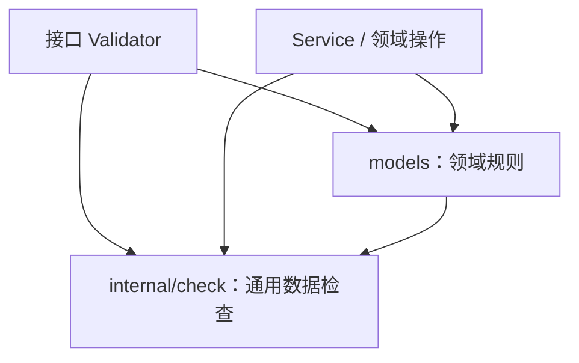
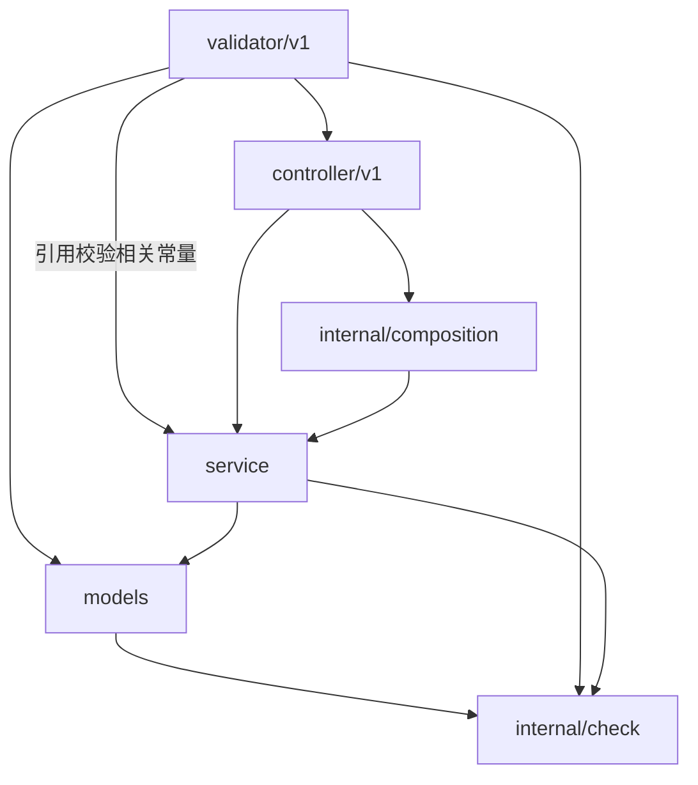

# 接口与业务校验的职责及调用规范

## 1. 目的与适用范围

本文规定 HTTP 参数进入系统后，通用数据检查、接口输入校验、领域规则和业务状态检查分别由谁负责，以及这些规则如何在 Validator、models 和 Service 之间复用。

核心原则是：**规则按业务含义确定归属，同一规则维护一份实现，各调用入口复用该实现。** 接口 Validator 完整组织本接口的输入校验，Service 保证业务入口和业务操作有效，models 承载领域对象自身的共同规则。

接口命名、Request DTO 与绑定约定见[接口路由与命名规范](api-routing.md)，统一响应及错误映射见[接口返回规范](api-response.md)，HTTP 请求的整体处理流程见[接口处理流程](api-handle.md)。本文中的用户资料用于说明规则归属，不规定具体昵称长度、头像长度或图片供应商。

## 2. 校验的四个维度

| 维度 | 负责位置 | 解决的问题 | 示例 |
| --- | --- | --- | --- |
| 通用数据有效性 | 公共检查包 | 一个值在格式、编码或数值范围上是否有效 | 文本能否表示正 int64、是否为合法 UTF-8、URL 是否具有合法结构 |
| 接口输入约束 | 对应用例的 Validator | 这次 HTTP 请求是否满足接口契约 | 字段必填或可选、数组数量、筛选条件互斥、字段组合 |
| 领域对象的共同规则 | 所属领域的 models | 一个业务字段或对象本身需要满足什么规则 | 合法用户昵称、合法头像地址、实体字段之间的关系 |
| 依赖业务状态的规则 | Service、领域操作及数据库事务 | 基于实际业务状态，这次操作是否允许执行 | 用户是否存在、账户是否重复、是否有权限、用户状态及实际版本 |

### 2.1 根据语义确定归属

不能仅根据字段类型或校验语句的形式判断规则属于哪一层：

- “计算字符串有多少个 Unicode 码点”是通用能力；“昵称最多允许多少个长度单位”是领域规则。
- “本次批量查询最多提交 3 个 ID”是接口或业务用例的输入限制；“一个用户最多拥有 3 张展示图片”是业务对象的约束。
- “两个筛选条件不能同时出现”通常是接口约束；“实体中的两个字段必须满足某种关系”属于领域规则。
- “版本必须是可支持的非负整数”是输入规则；“提交的版本与数据库中的版本一致”是业务状态检查。

通用包提供算法和检查能力。业务阈值、适用条件及允许的取值由规则所属方决定，不因使用了公共方法就转移到公共包中维护。

### 2.2 接口约束与用例约束的区别

仅与 HTTP 表达有关的规则由 Validator 负责，例如 Query 中的布尔文本格式、JSON 字段是否提供。

不依赖 HTTP、对所有业务调用都成立的用例限制，还必须由 Service 保证，例如一次批量业务操作允许处理的最大数量。Validator 可以提前检查，但不能因此省略 Service 的入口保障。

同一校验相关常量只集中声明一次。领域规则的校验相关常量归属 models；接口专属的校验相关常量归属对应 Validator；业务用例输入契约的校验相关常量归属 Service Params。各包需要复用时，引用所属包公开的契约或调用其规则函数，不重新声明同义常量。

### 2.3 三类校验相关常量的声明位置

**声明位置由业务归属决定；是否导出由跨包使用需求决定。** 下表说明各类常量的典型使用方式，不按所在层统一规定该包内所有常量的可见性。

| 校验相关常量类别 | 声明文件 | 可见性与示例 | 引用方式 |
| --- | --- | --- | --- |
| 领域规则 | `app/domains/<domain>/models/<entity>_validation.go`，与对应实体的领域规则放在一起 | 只供规则内部使用时保持包内可见，例如 `minUserNameRuneCount`、`userNamePattern`；需要跨包公开规则元数据时可以导出，例如 `MaxUserNameRuneCount` | models 的规则函数引用同包声明；Validator 和 Service 调用领域规则函数。需要规则元数据的调用方可以读取公开常量，不重复实现已有领域规则 |
| 接口专属 | `app/domains/<domain>/validator/v<version>/<use_case>_validator.go`，与该用例 Validator 放在一起 | 仅供本包使用时采用包含完整用例名的包内常量，例如 `maxQueryOrderPageConditionCount`；同一 HTTP 适配层确有合法跨包使用需求时可以按需导出 | 私有校验函数引用约束和格式常量，入口方法在绑定前引用默认值；Service 不反向引用这些接口专属常量 |
| 业务用例输入契约 | `app/domains/<domain>/service/<object>_params.go`，与该业务对象的 Service Params 放在一起 | 需要 Validator 等其他包直接引用时导出，例如 `MinUserProfilePageNumber`、`MaxUserProfileBatchSize`；只在 Service 包内部使用时保持包内可见 | 跨包调用方通过 Service 包名引用导出常量；Service 在同包内引用所属声明，不重复定义 |

1. **用例输入契约描述 Service 接受的参数及其共同约束。** 它由 Service 的 Params 及其配套校验相关常量组成。相关常量与所属 Params 放在一起，不为这类常量额外增加目录。

2. **校验相关常量覆盖上下限、默认值和固定格式等固定值。** 上下限和固定格式用于判断输入是否符合要求，默认值用于准备未提供的输入，本身不执行有效性判断。具体使用步骤见第 2.5 节。

3. **命名与注释统一遵守第 2.5 节。** 常量的前缀、业务对象、计量单位和格式后缀按同一套规则组合；注释补充边界、默认值应用条件等信息，不因声明位置不同而另设命名方式。

4. **常量可见性由合法的跨包使用需求决定。** 小写开头表示整个包内可见，而非仅在声明文件内可见；大写开头表示允许其他包引用，不按 Service、Validator 或 models 统一规定可见性。具体导出判断和引用方式见第 2.4 节。

5. **业务含义不同的常量应分别声明。** 例如，批量数量限制与分页大小即使都为 100，也保留各自的常量。“集中声明一次”针对同一条规则或默认约定，不要求合并所有取值相同的数值或字符串。

### 2.4 校验相关常量的可见性与引用方式

**本节统一说明常量如何公开、规则如何复用，以及各层从哪里引用常量。** 先按业务含义确定归属，再按合法的跨包使用需求决定是否导出；只需执行规则时调用规则函数，不额外公开其全部实现常量。

1. **领域校验统一调用完整的领域规则函数。** 例如，`models.ValidateUserName` 在内部引用昵称长度边界和字符格式常量，完成统一检查。Validator 和 Service 都调用该函数，不各自重新实现昵称的长度或格式判断；规则可以在不同入口执行，实现只维护一份。

2. **领域常量按合法的跨包使用需求公开。** 仅供领域规则内部使用的常量保持包内可见；其他包确实需要直接读取规则元数据或使用领域枚举时，导出相应标识符。是否导出不改变领域规则的归属，也不要求公开实体的所有限制或状态。

   **规则元数据用于说明输入要求，实际校验仍调用领域规则函数。** 例如，Controller 可以读取 `models.MaxUserNameRuneCount` 生成输入规则说明，但 Validator 和 Service 校验昵称时仍调用 `models.ValidateUserName`，不各自重新实现长度判断。

   **领域枚举作为领域类型的公开契约，供其他包表达业务状态。** 例如，Service 可以使用 `MembershipStatusActive` 这样的会员状态常量，不各自声明同义字符串或数字。枚举按所属模型类型组织，不因可以参与校验就全部放入字段校验文件。

   **Go 标识符导出不等于通过 HTTP 公开。** 是否向调用方提供规则元数据，仍由 Controller 和 DTO 显式映射；领域枚举与对外业务错误码也分别按各自契约维护。

3. **只属于 HTTP 接口输入约定的常量，由对应 Validator 声明和使用。** 例如，某个接口约定一个数组参数最多提交 3 项，且这个数量限制只适用于该 HTTP 入口，就在其 Validator 中声明数量常量，由私有校验函数检查数组长度。仅供本包使用的常量保持包内可见；如果“最多 3 项”是所有调用入口都必须遵守的业务用例约束，则应归属 Service 输入契约。

   **接口元数据需要被合法的 HTTP 上层读取时，可以按需导出。** 例如，Router 或其他 HTTP 适配代码需要读取接口约束时，可以引用对应公开常量。Service 需要同一个值时，应检查它是否实际属于领域规则或用例输入契约，不能通过导出 Validator 常量让 Service 反向依赖 HTTP 层。

4. **需要跨包共享的用例输入契约常量，由 Validator 和 Service 引用同一份声明。** 这些常量与 Params 放在同一个 Service 包，需要被其他包引用时使用导出名称，只供 Service 内部使用时保持包内可见。Validator 读取输入契约，不在校验过程中调用 Service 的业务方法。

   **声明示例：Service 集中声明需要跨入口共享的常量。** 下例同时展示下限、默认值和上限；数值仅用于说明声明方式，实际取值由相应用例契约确定。

   ```go
   package service

   const (
       // MinUserProfilePageNumber 表示有效页码的下限，允许等于该值。
       MinUserProfilePageNumber = 1
       // DefaultUserProfilePageNumber 表示入口未指定页码时采用的默认值。
       DefaultUserProfilePageNumber = 1
       // DefaultUserProfilePageSize 表示入口未指定每页条数时采用的默认值。
       DefaultUserProfilePageSize = 20
       // MaxUserProfileBatchSize 表示单次提交的 ID 数量上限，包含重复项，允许等于该值。
       MaxUserProfileBatchSize = 100
       // MaxUserProfilePageSize 表示每页返回条数的上限，允许等于该值。
       MaxUserProfilePageSize = 100
   )
   ```

   **引用示例：Validator 按输入准备和校验步骤使用导出常量。** 假设调用方将 Service 包命名为 `userservice`，分页入口在绑定前用 `userservice.DefaultUserProfilePageNumber`、`userservice.DefaultUserProfilePageSize` 初始化 DTO。分页校验使用 `request.PageNumber < userservice.MinUserProfilePageNumber` 判断下限；批量校验使用 `len(request.UserIDList) > userservice.MaxUserProfileBatchSize` 判断上限。这里引用的是包的公开标识符，不依赖具体代码文件。

   **同包引用：Service 直接使用已有声明，不再定义同义常量。** 例如，Service 使用 `MinUserProfilePageNumber`、`MaxUserProfileBatchSize` 执行用例输入检查。其他入口使用同一组默认值准备 Params，默认值的应用条件见第 2.5 节。

5. **共享常量仍按业务含义确定归属，并保持单向依赖。** 约束、默认值或固定格式属于业务用例输入约定，且适用于 HTTP、脚本、后台任务等入口时，与 Service Params 放在一起。领域对象自身规则的常量仍归 models，HTTP 接口专属常量仍归对应 Validator；Service 不反向导入 Validator 取得常量。HTTP 接口有更严格的约束或独立默认约定时，另行维护接口专属常量，并说明其适用范围。

6. **常量从包内可见改为导出后，仍只维护一份声明。** 所属包内部和外部调用方都引用同一名称。例如，公开昵称长度元数据后，`models.ValidateUserName` 和元数据调用方均引用 `MaxUserNameRuneCount`，不同时维护一个 `maxUserNameRuneCount` 副本。导出只改变可见性，不改变业务归属和既定依赖方向。

### 2.5 校验相关常量的命名与使用规范

**本节统一规定校验相关常量如何命名、注释和使用。** 上下限、默认值和固定格式分别采用表达自身含义的名称；声明归属遵守第 2.3 节，可见性与引用方式遵守第 2.4 节。以下名称仅用于说明命名方式，不增加新的业务规则或字段。

1. **名称应表达业务对象或字段及其用途，并遵循 Go 命名习惯。** 导出名称使用 PascalCase，包内名称使用 lowerCamelCase，不使用全大写下划线风格。缩写沿用 `ID`、`URL`、`HTTP`、`UTF8` 等 Go 写法，例如 `maxAvatarURLByteCount`、`requestIDPattern`；缩写位于名称开头时按可见性处理，例如 `URLPattern` 与 `urlPattern`。接口专属常量包含完整用例限定，避免同包不同接口重名；领域共用常量围绕领域概念命名，不附加某个 HTTP 接口名。

2. **上下限与默认值采用统一的语义前缀。** 数值类名称按“前缀 + 业务对象或字段 + 指标或单位”组合：下限使用 `Min`，上限使用 `Max`，默认值使用 `Default`；包内名称相应以 `min`、`max`、`default` 开头。同一语义是否导出只影响名称的可见性写法，不改变其含义。

   | 含义 | 包内名称示例 | 导出名称示例 |
   | --- | --- | --- |
   | 下限 | `minUserNameRuneCount` | `MinUserNameRuneCount` |
   | 上限 | `maxUserNameRuneCount` | `MaxUserNameRuneCount` |
   | 默认值 | `defaultUserProfilePageSize` | `DefaultUserProfilePageSize` |

3. **计量名称必须明确数量的计算方式。** 集合元素个数使用 `Count`；文本码点数、字节数、加权长度分别使用 `RuneCount`、`ByteCount`、`WeightedLength`。批量数量和分页大小沿用 `BatchSize`、`PageSize`，并在注释中明确表示条数。避免缺少对象或单位的 `maxLength`、`maxSize`，名称中的计量方式必须与实际检查算法一致。

4. **固定格式按实际匹配或解析方式使用后缀。** 正则模式字符串使用“对象或字段 + `Pattern`”，Go 时间布局使用“对象或字段 + `Layout`”，不为它们增加表示数值边界的 `Min`、`Max` 前缀。其他固定字符串按自身用途命名，不一律命名为 `Pattern` 或含义模糊的 `Format`。

   | 固定格式 | 包内名称示例 | 导出名称示例 | 使用约定 |
   | --- | --- | --- | --- |
   | 字段的正则模式 | `userNamePattern` | `UserNamePattern` | 校验字段整体合法性时，匹配完整输入，不仅判断某个片段是否命中 |
   | Go 时间布局 | `inputDateLayout` | `InputDateLayout` | 使用对应布局解析，例如布局字符串 `"2006-01-02"` 表示日期文本 |

   **固定格式的声明位置仍由其业务含义决定。** 领域字段的字符模式归属 models，仅用于某个接口日期文本的布局归属该 Validator；属于跨入口业务用例输入约定的格式，与 Service Params 放在一起。选择 `Pattern` 或 `Layout` 后缀不改变归属和依赖方向。

5. **默认值显式用于输入准备，不能覆盖非法输入。** 默认值只处理未提供或契约视为未提供的输入，不能掩盖绑定失败或显式非法值。例如，分页大小缺失时可以采用默认值，显式传入 `0` 时仍按分页约束处理。缺失与 `null` 等状态按第 8 节的标准绑定及输入语义约定处理。

   **声明默认值不代表 Service 自动改写参数。** 跨入口共享的默认值与 Service Params 放在一起，HTTP 入口在绑定前初始化 DTO，其他入口在构造 Params 时显式采用。声明 `DefaultUserProfilePageSize` 不表示 Service 收到 `0` 后会自动替换它；各入口采用的默认值本身也必须满足领域和用例约束。

6. **注释补足名称不能完整表达的规则条件。** 数量、长度常量说明计量单位、边界是否包含及数量按去重前还是去重后计算；默认值说明何时应用；格式常量说明完整匹配、解析方式及适用范围。允许等于下限时，用 `<` 判断无效值；允许等于上限时，用 `>` 判断无效值，不能只靠 `Min`、`Max` 名称推断边界行为。

7. **常量与编译后的规则对象、运行期策略分别组织。** Go `const` 用于可编译期确定的数值、字符串等值。正则模式字符串可以是常量，编译后的正则对象、切片、map 和运行期来源策略不属于常量；这些对象按所属规则或策略的职责维护，不因统一命名规范而改变其性质。

## 3. 完整调用链与规则依赖

### 3.1 一次 HTTP 请求的处理顺序

```text
Router 匹配接口
  → 用例 Validator 创建独立的 Request DTO
  → Bind 将 HTTP 参数映射到 DTO
  → validateXxxRequest 组合接口规则、通用检查和领域规则
  → Controller 将已校验 DTO 映射为 Service Params
  → Service 检查用例输入，并复用领域规则
  → Service 加载业务状态、判断操作条件并组织事务
  → Repository 执行数据库操作
  → Service 返回业务结果或内部 error
  → Controller 构造 Response DTO 或映射接口错误
  → response.Success / response.Fail 写出响应
```

绑定或请求校验失败时，Validator 输出参数错误并立即返回，不调用 Controller。Service 失败时返回内部 `error`，由 Controller 复用领域接口适配层进行映射。

### 3.2 规则的复用关系

下图表示校验规则的调用关系，不表示 HTTP 处理的先后顺序：



Validator 和 Service 可以在不同入口执行同一份领域规则。重复执行一次纯检查，与在两处复制规则实现是两回事：前者保护不同调用边界，后者容易造成规则不一致。

脚本、后台任务或其他业务入口直接调用 Service 时，仍经过用例和领域校验。Service 不以“HTTP 已经校验”为前提跳过这些保障。

### 3.3 校验相关常量引用与循环依赖

**Validator 引用 Service 输入契约中的校验相关常量不会自行产生循环依赖，前提是 Service 的直接和间接依赖都不返回 Validator。**

Go 按包管理依赖。即使只引用与 Params 放在一起的某个常量，实际导入的仍是整个 Service 包，并不存在只依赖某一个文件或某一条常量的独立边界。将常量移动到同包的另一个文件，也不能解决包循环问题。Go 禁止包直接或间接导入自身，见 [Go 语言规范：导入声明](https://go.dev/ref/spec#Import_declarations)。

允许的包依赖方向如下，箭头表示导入关系：



Validator 通过 Controller 已经可以间接依赖 Service，直接引用其输入契约中的校验相关常量增加的是同一方向的依赖。Service 的依赖链没有返回 Validator 的路径时，不形成环。

为保持这一方向，各包遵守以下边界：

1. Service 不依赖 Validator、Controller、HTTP Request DTO 或对外错误映射组件；Service Params 使用业务输入类型。
2. models 不依赖 Service、Validator 或 Controller。领域字段规则所需的常量和策略类型放在 models，不从 Service 反向取得。
3. `internal/check` 不依赖任何具体 domain、Service 或 HTTP 组件。
4. `internal/composition` 依赖 Service 完成装配，Service 不反向调用 composition 获取自身或其他默认服务；需要的策略通过参数或构造依赖传入。

以下反向引用会形成循环：

```text
Validator → Service → Validator
Service → models → Service
composition → Service → composition
```

不能为了复用上层的校验相关常量或请求校验方法破坏这些边界。确实需要多方共享一个更低层的业务契约时，应按业务含义重新确定契约的归属及单向依赖，而不是把所有常量移入公共工具包。上述依赖关系下，业务用例输入契约的校验相关常量保留在 Service Params 文件即可。

## 4. 公共数据检查包

### 4.1 目录与职责

公共纯数据检查统一放在 `internal/check`，按数据类型或能力组织文件：

```text
internal/
  check/            # 按数值、文本、URL 等能力组织纯检查方法
  validator/        # HTTP 参数到 Request DTO 的通用绑定入口
```

`internal/validator` 是 HTTP 参数绑定入口，依赖 Gin；`internal/check` 只处理普通 Go 值，不依赖 HTTP。二者分别承担数据映射和纯数据检查，不将业务字段规则放入通用绑定器。

### 4.2 公共方法的约束

公共检查方法应当满足以下要求：

1. 输入为普通 Go 值及明确的检查参数，不接收 Request DTO 或领域实体。
2. 不认识“用户昵称”“头像”等业务概念，不保存具体业务的校验相关常量，例如字段长度上下限、业务默认值或昵称格式模式。
3. 不访问数据库、网络、全局运行时或部署配置，不保存单次请求状态。
4. 不依赖 Gin、Controller、`response`、`apierror` 或任何具体领域。
5. 不修改输入值，不隐式执行去空格、大小写转换或字符规范化。
6. 方法名和注释明确说明检查含义、计量单位、范围边界和错误含义。

方法形式例如：

```go
func ParsePositiveInt64(value string) (int64, error)
func ValidUTF8(value string) error
func RuneCountAtMost(value string, maximum int) error
```

这些名称用于说明方法契约。公共方法按实际需要增加，不预先建设覆盖所有数据类型的校验框架，也不为标准库的每个函数增加一层同义包装。

### 4.3 数字文本需要同时检查格式、范围和数值

正 int64 文本检查必须同时保证：

- 输入能够按约定的十进制格式解析。
- 数值在 int64 范围内，没有溢出。
- 解析结果大于零。

仅用“全部由数字组成”的检查不能保证数值未溢出。带正号、前导零等文本表示是否允许，应在通用解析方法的契约中统一说明；接口要求更严格的规范文本时，再明确其附加约束。

已经是 `int64` 的 Service 参数只检查其数值约束，不重新转成字符串校验。解析方法返回的值供调用方使用，不通过修改 DTO、添加辅助字段或存入 Gin Context 来隐式传递。

## 5. models 中的领域规则

### 5.1 按业务概念组织规则

领域规则放在所属 domain 的 `models` 中，与对应实体保持一致的文件组织：

```text
app/domains/<domain>/
  models/
    <entity>.go
    <entity>_validation.go
  validator/v<version>/
    <use_case>_validator.go
```

`<entity>_validation.go` 只包含对应实体的共同规则，不成为整个项目的校验工具集合。其他领域维护自己的规则，不因字段都叫“名称”或“URL”就共用另一个领域的业务规则。

适合独立检查的字段使用明确命名的纯函数，例如：

```go
func ValidateUserName(value string) error
func ValidateAvatarURL(value string, policy AvatarURLPolicy) error
```

这些方法组合公共检查，并加入业务含义。例如，昵称规则选择长度算法、长度范围和允许的字符格式；头像规则选择允许的协议及来源策略。

`AvatarURLPolicy` 表达只读的领域来源约束，由应用装配层根据配置创建并验证，再交给 Validator 和 Service 使用。需要此类依赖的规则通过参数明确接收，不依赖配置的字段规则只接收待检查的值。策略不包含 HTTP 请求或单次请求状态。

### 5.2 字段规则与实体操作规则

单字段校验不要求先创建完整实体。校验昵称时，不需要为尚未生成的 ID、时间或版本填充占位值，也不通过整实体 `Validate()` 强迫每个调用场景提供所有字段。

涉及实体多个字段关系或状态变化的规则，可以由实体的构造、修改等操作保证。Service 负责加载需要的业务状态并调用这些操作。依赖外部查询或多个业务对象的判断，由 Service 组织，不让单字段检查函数访问 Repository。

实体修改应先验证本次变更的全部条件，再应用变更，避免一个字段已经修改、另一个字段失败后留下部分修改状态。

仅将函数放入 models 并不能自动保证所有写入合法。所有业务写入入口都必须调用相应规则或受规则保护的领域操作；不能直接构造字段后绕过业务入口写入。

### 5.3 models 的依赖边界

models 可以依赖公共数据检查和领域内部错误定义，不依赖 Service、Validator、Gin、Request DTO、Controller、`response` 或对外业务错误码。

领域规则返回内部错误，只表达违反了什么规则。HTTP 字段名、字段明细布局、通用响应码和 `business_code` 的选择，由接口适配层决定。

## 6. 接口 Validator 的组织与执行方式

### 6.1 每个文件采用一致结构

每个用例拥有独立 Validator 文件，按以下顺序组织：

```text
<UseCase>Validator 结构体
New<UseCase>Validator 构造函数
<UseCase>(ctx) 请求入口方法
validate<UseCase>Request(request) 私有校验函数
```

Validator 对象只保存调用所需依赖，不保存本次 DTO、校验结果或其他请求状态。入口方法依次创建 DTO、绑定、校验、调用 Controller；默认值引用所属位置的校验相关常量，在绑定前显式设置，具体应用约定见第 2.5 节。

私有校验函数需要来源策略等依赖时，由入口方法通过参数明确传入，例如 `validateUpdateUserProfileRequest(request, avatarPolicy)`。没有相应依赖的接口不接收无关参数，文件的四段组织方式保持一致。

### 6.2 私有函数完整组合本接口规则

**“完整实现本接口的校验”指完整组织规则，不要求在私有函数中复制所有底层算法。** `validateXxxRequest` 可以调用公共检查和 models 规则，但必须能在一个函数中看清本接口有哪些字段、适用哪些规则、执行顺序及错误归属。

私有函数负责：

1. 判断字段在本接口中是否必填、是否允许空值以及何时参与校验。
2. 调用公共方法处理数字文本、编码等通用约束。
3. 调用所属领域的字段规则，保证相同业务含义使用相同实现。
4. 检查接口独有的数量、互斥条件、字段组合等约束。
5. 将已知校验问题转换成接口字段明细，交给入口方法统一输出。

私有函数不查询数据库，不调用 Service 执行业务操作，也不调用其他接口的 `validateXxxRequest` 来间接复用规则。共享逻辑向公共包或 models 提取，各接口独立组合。

允许引用 Service 输入契约中导出的数量上下限、默认值、固定格式等校验相关常量，并在输入准备或校验步骤中使用；这是读取输入契约，不是执行业务操作。常量引用遵守第 2.4 节的方式和第 3.3 节的单向包依赖。

### 6.3 集合与跨字段检查

集合输入先检查集合本身的约束，再逐项执行适用的公共规则或领域规则。需要明确数量按去重前还是去重后计算，不能依赖后续 Service 的处理方式猜测。

例如，一个接口接收昵称数组，组合过程为：检查是否提供、检查数组数量、对每个昵称调用同一份领域昵称规则。数组上限由该接口或用例契约维护，昵称规则由 models 维护。

相互独立的字段可以汇总错误。某个字段绑定或基础类型检查失败后，不执行依赖该字段有效值的后续操作，避免二次错误或异常。

字段明细按 DTO 的约定顺序稳定输出，同一字段默认保留一条最直接的原因。数组需要定位到具体下标时，在接口契约中明确字段路径格式；不让公共包决定 HTTP 字段路径。

## 7. Service 的入口保障与业务状态检查

### 7.1 Service 复用同一份纯规则

Service 接收自身的 Params，不接收 Gin Context 或 Request DTO。它检查用例输入，并复用 models 中的领域规则，不重新写一套昵称、头像算法。

Service 不重复 HTTP 表达层的检查。例如，布尔 Query 文本已经映射为 `bool`，Service 不再判断原文本是否为 `true`；但用户 ID 是否为正数、字段值是否符合领域规则等业务输入约束仍然成立。

接口专属必填性与业务用例的可空语义可以有差异。Service 必须明确自己的输入契约，不能仅凭某个 HTTP 接口不传 `nil`，就默认其他入口也不会传。

### 7.2 状态检查需要真实业务数据

以下判断由 Service 组织，并在需要时放入同一事务：

- 目标用户是否存在，当前是否允许执行操作。
- 发起方是否具有操作权限。
- 账户身份是否已被使用。
- 客户端提交的版本与实际版本是否一致。
- 涉及其他对象或外部依赖的条件是否成立。

基于已经加载的实体状态能够判断的规则，可以封装进领域操作；Service 仍负责取得该状态、调用操作及管理事务边界。

权限检查需要可信身份来源。请求中的发起方 ID 只是输入声明，格式合法不代表已经完成身份认证；比较两个 ID 相等也不能代替认证。

### 7.3 预检查不能代替并发保障

“先查询账户不存在，再创建”不能保证并发时不重复，最终由数据库唯一约束保证。版本及状态等并发条件，需要事务、锁或带条件的更新来保障。

Repository 执行数据库操作并返回结果或存储错误。Service 解释未命中、重复键、影响行数和事务结果，将可识别的业务失败转换为内部领域错误；未知技术错误继续向上传递。

数据库字段长度、非空和唯一约束提供持久化保障，不能代替应用对调用方给出清晰的输入校验结果。

## 8. 必填、可空与值合法性

一个字段必须分别说明“本次请求是否需要它”和“一个有效值需要满足什么条件”。不能把某个接口的必填规则直接塞进所有场景共用的字段规则。

以头像为例：

| 问题 | 归属 |
| --- | --- |
| 有值的头像地址需要满足哪些协议、长度和来源要求 | 领域字段规则 |
| 创建接口能否不提供头像 | 创建接口及创建用例契约 |
| 更新接口是否必须提交头像 | 更新接口及更新用例契约 |
| 该操作是否支持清空已有头像 | 业务用例语义及接口契约 |
| 查询没有头像的资料时如何表达 | 响应 DTO 契约 |

创建允许不提供头像，更新要求有效非空头像时，各 Validator 分别处理可选与必填分支，有效值部分复用同一份头像规则。创建是否允许空字符串，也须单独明确，不能由调用方自行猜测。

缺失、`null`、空字符串和零值的含义遵守以下约定：

1. Request DTO 使用标准绑定，不自定义 `UnmarshalJSON`，也不增加仅用于记录字段是否出现的辅助字段。
2. 标准绑定不能区分的输入状态，在接口语义上保持一致；确需表达不同操作时，调整请求结构或用例。
3. 零值本身合法时，可以使用标准指针字段区分“未提供或 `null`”与显式零值。例如版本 `0` 合法，缺失版本不合法。
4. 字段在一个用例中可选，不代表该用例能够接受任意非空值；字段必填，也不代表通过非空检查后就已满足领域规则。

## 9. 校验结果与接口错误

### 9.1 各层的错误表达

| 位置 | 返回内容 | 不承担的职责 |
| --- | --- | --- |
| 公共检查 | 可识别的基础值检查错误，或解析后的值与错误 | 不生成 HTTP 字段明细或业务码 |
| models | 领域内部校验错误 | 不输出 HTTP 响应，不决定对外业务码 |
| Validator 私有函数 | 当前接口的 `[]response.FieldError` | 不解释数据库状态或执行业务操作 |
| Service | 用例、领域或技术 `error` | 不构造 `ErrorInfo` |
| Controller 与领域 apierror | 通用码、可选业务码、对外文案及字段明细 | 不重新实现底层校验算法 |

校验错误使用明确的类型、标识或错误包装表达语义，通过 `errors.Is`、`errors.As` 识别，不比较 `Error()` 文本。无需为每条字段规则新增对外业务错误码。

Validator 将已知输入问题映射成实际参数名和可公开的英文原因。模型内部字段标识与 HTTP 字段名之间的对应由接口适配层处理，公共包不硬编码 `user_name`、`avatar_url` 等请求字段。

私有校验函数保持返回 `[]response.FieldError` 的简单契约：进入请求处理前，规则及策略已经完成装配检查；纯规则只返回可识别的输入违反问题，不承担运行期外部依赖或业务状态错误。不能将一个可能返回网络、数据库或配置错误的方法接入这条字段校验链，再把所有错误都转换成参数明细。

### 9.2 输出与终止

绑定错误以及已知输入约束失败返回 HTTP 400 和 `INVALID_ARGUMENT`。字段校验失败可以在 `details` 中汇总原因；绑定失败不能把部分绑定结果当成有效 DTO 继续执行。

Validator 入口通过 `response.Fail` 输出错误后立即 `return`。私有校验函数只返回问题，不直接写响应。

Service 返回的领域错误由统一的领域接口映射处理，未预期的 Service 或外部依赖错误按统一规范输出安全的内部错误，并记录原始原因。

无效的规则参数及策略配置在应用装配阶段拒绝，不能带着无效配置进入请求校验，也不返回给调用方作为字段错误。请求处理中的未处理 `panic` 进入统一异常恢复流程，不作为正常输入校验的返回通道。

## 10. 文本与 URL 规则必须具备明确含义

### 10.1 文本长度的计量方式

“至少或至多多少个字符”必须说明具体算法：

| 计量方式 | 含义 | 使用时需要明确的事项 |
| --- | --- | --- |
| 字节数 | 编码后占用的字节数量 | 编码方式；不能将中文默认等同于两个字节 |
| Unicode 码点数 | 按码点计数 | 组合字符可能包含多个码点 |
| 用户可见字符数 | 按约定的字素簇边界计数 | 使用的分段规则及版本 |
| 加权长度 | 按业务定义为不同字符赋予权重 | 中文、英文、全角标点、组合字符等的权重 |

“中文算 2，英文算 1”属于加权长度。例如，按中文每字权重 2、ASCII 字母每字权重 1 计算，`小明A` 的长度为 5；其他字符的权重仍需明确，不能简单用字节长度或码点数量替代。

公共包提供实际需要的计量能力，领域规则决定采用哪种计量方式和长度范围。输入错误提示、接口说明及持久化容量要与该规则协调。Unicode 的宽度属性可以作为制定规则的参考，不自动等同于完整的业务长度算法，见 [Unicode 字符宽度说明](https://www.unicode.org/reports/tr11/)。

### 10.2 允许的字符集合

“不能包含特殊字符”必须具体化为允许或禁止的字符集合，明确空格、数字、下划线、连字符、间隔号、组合标记等如何处理。

禁止表情时，也需要明确采用的识别规则及覆盖范围。优先用明确的允许集合描述业务需求，不能用随意选取的一段 Unicode 范围声称覆盖所有表情或所有特殊字符。

编码检查针对方法实际收到的值。绑定后的字符串检查不等于对原始 HTTP 字节进行检查；如果解码器已经替换了非法输入，后续规则不能恢复原始字节。原始请求解码政策属于绑定入口的契约，不由领域字段规则承担。

### 10.3 头像来源与部署配置

“头像只允许使用平台认可的图片来源”可以是领域规则。具体允许的 OSS、CDN 或自定义域名，应由明确的来源策略提供，不把某个部署环境的域名写死进通用包。

URL 检查应解析结构后分别判断协议、主机名及适用的端口、路径等约束。不能仅使用字符串前缀或包含关系判断来源，例如包含可信域名文本不代表 URL 的实际主机就是该域名。

需要配置的来源策略由应用装配层准备，并明确传入规则调用链。Validator 与 Service 使用相同策略，models 不自行读取全局配置。策略应只读，错误配置在装配阶段处理。

仅验证 URL 形式及来源，不能证明远端文件存在、内容确实为图片或属于发起方。需要这些保障时，由 Service 组织对应业务检查，纯字段检查不发起网络请求。

## 11. 查询、历史数据与规则演进

### 11.1 写入校验与读取处理

新创建或修改字段时执行适用的写入规则。读取已经持久化的数据时，不自动套用最新的写入校验并拒绝返回，否则规则收紧可能使历史资料突然无法查询。

历史数据不符合新规则时，通过明确的数据治理、迁移或兼容策略处理。必要的一致性检查可以发现和报告问题，但不能把存储中的异常直接归因于本次查询参数错误。

查询筛选值也不一定适用完整写入规则。例如，精确查找历史昵称时，不应仅因为旧昵称不满足新的创建规则就拒绝查询。查询参数仍需有自己的编码、长度及查询契约约束。

### 11.2 版本与适用范围

同一领域概念的共同规则集中维护。V1、V2 的 HTTP 表达和必填性可以不同；某个版本的额外限制由该版本 Validator 组织，不能悄悄修改共用规则并意外改变其他接口。

全领域规则变更时，同时评估已有接口、非 HTTP 入口、历史数据、数据库容量及配置策略。不同用例确有不同业务含义时，提供明确命名的规则或策略，不在一个通用方法中通过接口名猜测执行分支。

### 11.3 校验与值转换分开

校验默认不改变输入。去空格、大小写转换、Unicode 规范化等操作属于明确的数据转换决策，应在用例中统一约定，并保证校验的值就是实际参与业务处理和持久化的值。

不能让 Validator 检查原值、Service 静默修改后保存；也不能让 HTTP 与后台入口使用不同的规范化方式改变同一业务字段的含义。

## 12. 用户资料接口的规则组合示例

以下示例说明规则如何组合，校验相关常量的具体取值由所属规则及接口契约维护。

| 用例 | Validator 负责的组合 | Service 负责的保障 |
| --- | --- | --- |
| `createUser` | 注册身份必填性、昵称领域规则、头像可选分支及头像领域规则 | 复用身份和资料规则，分配内部 ID，处理账户唯一性及持久化结果 |
| `updateUserProfile` | 目标与发起方 ID、版本输入范围、昵称规则、头像必填性及头像规则 | 复用资料规则和用例约束，校验权限、实际状态及版本，在事务中更新 |
| `queryUserProfileByUserId` | 将 ID 文本按通用正 int64 规则检查 | 对内部 ID 做数值约束检查，读取资料并解释未命中 |
| `batchQueryUserProfiles` | 集合是否提供、数量限制及每项 ID 的通用规则 | 保证批量用例的输入限制，执行去重、读取及缺失结果处理 |
| `queryUserProfilePage` | 默认分页值、分页范围、查询筛选值及其组合 | 保证分页用例约束，组织查询及结果，不将读取当成新的资料写入 |

规则可以在多个用例中复用，但用例自己的 Request DTO、Response DTO、Validator 和校验组合仍各自独立。Controller 负责参数及结果映射，不再承担一套重复的字段规则；Repository 负责数据访问和约束结果返回，不成为 HTTP 校验层。
