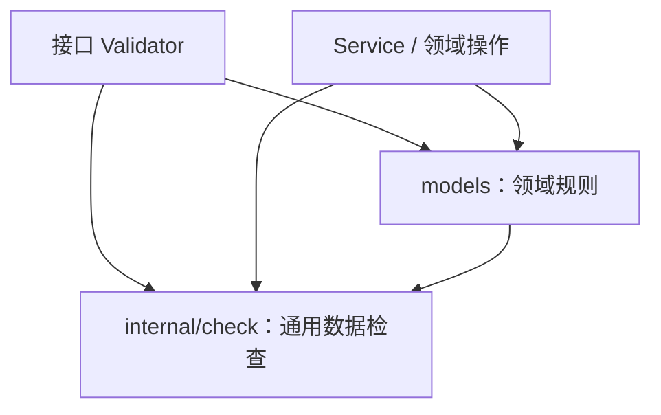
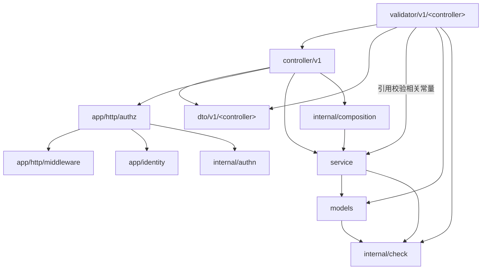

# 接口与业务校验的职责及调用规范

## 1. 目的与适用范围

本文规定 HTTP 参数进入系统后，通用数据检查、接口输入校验、领域规则和业务状态检查分别由谁负责，以及这些规则如何在 Validator、models 和 Service 之间复用。

核心原则是：**规则按业务含义确定归属，同一规则维护一份实现，各调用入口复用该实现。** 接口 Validator 完整组织本接口的输入校验，Service 保证业务入口和业务操作有效，models 承载领域对象自身的共同规则。

接口命名、Request DTO 与绑定约定见[接口路由与命名规范](api-routing.md)，统一响应结构见[接口返回规范](api-response.md)，错误声明位置、传递与映射见[错误处理规范](api-error.md)，HTTP 请求的整体处理流程见[接口处理流程](api-handle.md)。本文中的用户资料用于说明规则归属，不规定具体昵称长度、头像长度或图片供应商。

## 2. 校验的四个维度

| 维度 | 负责位置 | 解决的问题 | 示例 |
| --- | --- | --- | --- |
| 通用数据有效性 | 公共检查包 | 一个值在格式、编码或数值范围上是否有效 | 文本能否表示正 int64、是否为合法 UTF-8、URL 是否具有合法结构 |
| 接口输入约束 | 对应用例的 Validator | 这次 HTTP 请求是否满足接口契约 | 字段必填或可选、数组数量、筛选条件互斥、字段组合 |
| 领域对象的共同规则 | 所属领域的 models | 一个业务字段或对象本身需要满足什么规则 | 合法用户昵称、合法头像地址、实体字段之间的关系 |
| 依赖业务状态的规则 | Service、领域操作及数据库事务 | 基于实际业务状态，这次操作是否允许执行 | 用户是否存在、账户是否重复、是否有权限、用户状态及实际版本 |

**身份认证与接口访问检查独立于请求字段校验。** HTTP 中间件负责验证已经提供的凭证，Controller 负责接口是否允许匿名、接受哪些身份及访问范围；Validator 不承担这些判断。Service 接收入口根据可信身份构造的业务参数，继续保障用例自身的操作约束。具体认证链路见[身份认证规范](api-authentication.md#7-http-认证适配层)，本节的四个维度用于组织数据及业务规则，不将身份认证当作字段有效性检查。

### 2.1 根据语义确定归属

不能仅根据字段类型或校验语句的形式判断规则属于哪一层：

- “计算字符串有多少个 Unicode 码点”是通用能力；“昵称最多允许多少个长度单位”是领域规则。
- “本次批量查询最多提交 3 个 ID”是接口或业务用例的输入限制；“一个用户最多拥有 3 张展示图片”是业务对象的约束。
- “两个筛选条件不能同时出现”通常是接口约束；“实体中的两个字段必须满足某种关系”属于领域规则。
- “版本必须是可支持的非负整数”是输入规则；“提交的版本与数据库中的版本一致”是业务状态检查。

通用包提供算法和检查能力。业务阈值、适用条件及允许的取值由规则所属方决定，不因使用了公共方法就转移到公共包中维护。

### 2.2 接口约束与用例约束的区别

仅与 HTTP 表达有关的规则由 Validator 负责，例如 Query 中的布尔文本格式、JSON 字段是否提供。

不依赖 HTTP、对所有业务调用都成立的用例限制，还必须由 Service 保证，例如一次批量业务操作允许处理的最大数量。Validator 可以提前检查，但不能因此省略 Service 的入口保障。

同一校验相关常量只集中声明一次。领域规则的校验相关常量归属 models；接口专属的校验相关常量归属对应 Validator；业务用例输入契约的校验相关常量归属 Service Params。各包需要复用时，引用所属包公开的契约或调用其规则函数，不重新声明同义常量。

### 2.3 三类校验相关常量的声明位置

**声明位置由业务归属决定；是否导出由跨包使用需求决定。** 下表说明各类常量的典型使用方式，不按所在层统一规定该包内所有常量的可见性。

| 校验相关常量类别 | 声明文件 | 可见性与示例 | 引用方式 |
| --- | --- | --- | --- |
| 领域规则 | `app/domains/<domain>/models/<entity>_validation.go`，与对应实体的领域规则放在一起 | 只供规则内部使用时保持包内可见，例如 `minUserNameRuneCount`、`userNamePattern`；需要跨包公开规则元数据时可以导出，例如 `MaxUserNameRuneCount` | models 的规则函数引用同包声明；Validator 和 Service 调用领域规则函数。需要规则元数据的调用方可以读取公开常量，不重复实现已有领域规则 |
| 接口专属 | `app/domains/<domain>/validator/v<version>/<controller>/<use_case>_validator.go`，与该用例 Validator 放在一起 | 仅供本包使用时采用包含完整用例名的包内常量，例如 `maxQueryOrderPageConditionCount`；同一 HTTP 适配层确有合法跨包使用需求时可以按需导出 | 私有校验函数引用约束和格式常量，入口方法在绑定前引用默认值；Service 不反向引用这些接口专属常量 |
| 业务用例输入契约 | `app/domains/<domain>/service/<object>_service.go` 的对应用例区域，与该用例的 Params 放在一起 | 需要 Validator 等其他包直接引用时导出，例如 `MinUserProfilePageNumber`、`MaxUserProfileBatchSize`；只在 Service 包内部使用时保持包内可见 | 跨包调用方通过 Service 包名引用导出常量；Service 在同包内引用所属声明，不重复定义 |

1. **用例输入契约描述 Service 接受的参数及其共同约束。** 它由 Service 的 Params 及其配套校验相关常量组成。相关声明放在 Service 文件的对应用例区域；需要用例专属 Result 时，紧接 Params 声明，再组织输入常量、私有 Params 校验函数和用例处理方法。不再拆成独立的 Params、Result 或校验文件。

2. **校验相关常量覆盖上下限、默认值和固定格式等固定值。** 上下限和固定格式用于判断输入是否符合要求，默认值用于准备未提供的输入，本身不执行有效性判断。具体使用步骤见第 2.5 节。

3. **命名与注释统一遵守第 2.5 节。** 常量的前缀、业务对象、计量单位和格式后缀按同一套规则组合；注释补充边界、默认值应用条件等信息，不因声明位置不同而另设命名方式。

4. **常量可见性由合法的跨包使用需求决定。** 小写开头表示整个包内可见，而非仅在声明文件内可见。Validator 中，同一领域、同一版本、同一 Controller 分组的文件属于同一个包；其他 Controller 分组属于不同包，不能直接访问其包内常量。大写开头表示允许其他包引用，不按 Service、Validator 或 models 统一规定可见性。具体导出判断和引用方式见第 2.4 节。

5. **业务含义不同的常量应分别声明。** 例如，批量数量限制与分页大小即使都为 100，也保留各自的常量。“集中声明一次”针对同一条规则或默认约定，不要求合并所有取值相同的数值或字符串。

### 2.4 校验相关常量的可见性与引用方式

**本节统一说明常量如何公开、规则如何复用，以及各层从哪里引用常量。** 先按业务含义确定归属，再按合法的跨包使用需求决定是否导出；只需执行规则时调用规则函数，不额外公开其全部实现常量。

1. **领域校验统一调用完整的领域规则函数。** 例如，`models.ValidateUserName` 在内部引用昵称长度边界和字符格式常量，完成统一检查。Validator 和 Service 都调用该函数，不各自重新实现昵称的长度或格式判断；规则可以在不同入口执行，实现只维护一份。

2. **领域常量按合法的跨包使用需求公开。** 仅供领域规则内部使用的常量保持包内可见；其他包确实需要直接读取规则元数据或使用领域枚举时，导出相应标识符。是否导出不改变领域规则的归属，也不要求公开实体的所有限制或状态。

   **规则元数据用于说明输入要求，实际校验仍调用领域规则函数。** 例如，Controller 可以读取 `models.MaxUserNameRuneCount` 生成输入规则说明，但 Validator 和 Service 校验昵称时仍调用 `models.ValidateUserName`，不各自重新实现长度判断。

   **领域枚举作为领域类型的公开契约，供其他包表达业务状态。** 例如，Service 可以使用 `MembershipStatusActive` 这样的会员状态常量，不各自声明同义字符串或数字。枚举按所属模型类型组织，不因可以参与校验就全部放入字段校验文件。

   **Go 标识符导出不等于通过 HTTP 公开。** 是否向调用方提供规则元数据，仍由 Controller 和 DTO 显式映射；领域枚举与对外业务错误码也分别按各自契约维护。

3. **只属于 HTTP 接口输入约定的常量，由对应 Validator 声明和使用。** 例如，某个接口约定一个数组参数最多提交 3 项，且这个数量限制只适用于该 HTTP 入口，就在其 Validator 中声明数量常量，由私有校验函数检查数组长度。仅供本包使用的常量保持包内可见；如果“最多 3 项”是所有调用入口都必须遵守的业务用例约束，则应归属 Service 输入契约。

   **接口元数据需要被合法的 HTTP 上层读取时，可以按需导出。** 例如，Router 或其他 HTTP 适配代码需要读取接口约束时，可以引用对应公开常量。Service 需要同一个值时，应检查它是否实际属于领域规则或用例输入契约，不能通过导出 Validator 常量让 Service 反向依赖 HTTP 层。

4. **需要跨包共享的用例输入契约常量，由 Validator 和 Service 引用同一份声明。** 这些常量与 Params 放在同一个 Service 包，需要被其他包引用时使用导出名称，只供 Service 内部使用时保持包内可见。Validator 读取输入契约，不在校验过程中调用 Service 的业务方法。

   **声明示例：Service 集中声明需要跨入口共享的常量。** 下例同时展示下限、默认值和上限；数值仅用于说明声明方式，实际取值由相应用例契约确定。实际组织时，分页常量和批量常量分别位于所属用例的 Params 区域，不集中到独立文件。

   ```go
   package service

   const (
       // MinUserProfilePageNumber 表示有效页码的下限，允许等于该值。
       MinUserProfilePageNumber = 1
       // DefaultUserProfilePageNumber 表示入口未指定页码时采用的默认值。
       DefaultUserProfilePageNumber = 1
       // DefaultUserProfilePageSize 表示入口未指定每页条数时采用的默认值。
       DefaultUserProfilePageSize = 20
       // MaxUserProfileBatchSize 表示单次提交的 ID 数量上限，包含重复项，允许等于该值。
       MaxUserProfileBatchSize = 100
       // MaxUserProfilePageSize 表示每页返回条数的上限，允许等于该值。
       MaxUserProfilePageSize = 100
   )
   ```

   **引用示例：Validator 按输入准备和校验步骤使用导出常量。** 假设调用方将 Service 包命名为 `userservice`，分页入口在绑定前用 `userservice.DefaultUserProfilePageNumber`、`userservice.DefaultUserProfilePageSize` 初始化 DTO。分页校验使用 `request.PageNumber < userservice.MinUserProfilePageNumber` 判断下限；批量校验使用 `len(request.UserIDList) > userservice.MaxUserProfileBatchSize` 判断上限。这里引用的是包的公开标识符，不依赖具体代码文件。

   **同包引用：Service 直接使用已有声明，不再定义同义常量。** 例如，Service 使用 `MinUserProfilePageNumber`、`MaxUserProfileBatchSize` 执行用例输入检查。其他入口使用同一组默认值准备 Params，默认值的应用条件见第 2.5 节。

5. **共享常量仍按业务含义确定归属，并保持单向依赖。** 约束、默认值或固定格式属于业务用例输入约定，且适用于 HTTP、脚本、后台任务等入口时，与 Service Params 放在一起。领域对象自身规则的常量仍归 models，HTTP 接口专属常量仍归对应 Validator；Service 不反向导入 Validator 取得常量。HTTP 接口有更严格的约束或独立默认约定时，另行维护接口专属常量，并说明其适用范围。

6. **常量从包内可见改为导出后，仍只维护一份声明。** 所属包内部和外部调用方都引用同一名称。例如，公开昵称长度元数据后，`models.ValidateUserName` 和元数据调用方均引用 `MaxUserNameRuneCount`，不同时维护一个 `maxUserNameRuneCount` 副本。导出只改变可见性，不改变业务归属和既定依赖方向。

### 2.5 校验相关常量的命名与使用规范

**本节统一规定校验相关常量如何命名、注释和使用。** 上下限、默认值和固定格式分别采用表达自身含义的名称；声明归属遵守第 2.3 节，可见性与引用方式遵守第 2.4 节。以下名称仅用于说明命名方式，不增加新的业务规则或字段。

1. **名称应表达业务对象或字段及其用途，并遵循 Go 命名习惯。** 导出名称使用 PascalCase，包内名称使用 lowerCamelCase，不使用全大写下划线风格。缩写沿用 `ID`、`URL`、`HTTP`、`UTF8` 等 Go 写法，例如 `maxAvatarURLByteCount`、`requestIDPattern`；缩写位于名称开头时按可见性处理，例如 `URLPattern` 与 `urlPattern`。接口专属常量包含完整用例限定，避免同包不同接口重名；领域共用常量围绕领域概念命名，不附加某个 HTTP 接口名。

2. **上下限与默认值采用统一的语义前缀。** 数值类名称按“前缀 + 业务对象或字段 + 指标或单位”组合：下限使用 `Min`，上限使用 `Max`，默认值使用 `Default`；包内名称相应以 `min`、`max`、`default` 开头。同一语义是否导出只影响名称的可见性写法，不改变其含义。

   | 含义 | 包内名称示例 | 导出名称示例 |
   | --- | --- | --- |
   | 下限 | `minUserNameRuneCount` | `MinUserNameRuneCount` |
   | 上限 | `maxUserNameRuneCount` | `MaxUserNameRuneCount` |
   | 默认值 | `defaultUserProfilePageSize` | `DefaultUserProfilePageSize` |

3. **计量名称必须明确数量的计算方式。** 集合元素个数使用 `Count`；文本码点数、字节数、加权长度分别使用 `RuneCount`、`ByteCount`、`WeightedLength`。批量数量和分页大小沿用 `BatchSize`、`PageSize`，并在注释中明确表示条数。避免缺少对象或单位的 `maxLength`、`maxSize`，名称中的计量方式必须与实际检查算法一致。

4. **固定格式按实际匹配或解析方式使用后缀。** 正则模式字符串使用“对象或字段 + `Pattern`”，Go 时间布局使用“对象或字段 + `Layout`”，不为它们增加表示数值边界的 `Min`、`Max` 前缀。其他固定字符串按自身用途命名，不一律命名为 `Pattern` 或含义模糊的 `Format`。

   | 固定格式 | 包内名称示例 | 导出名称示例 | 使用约定 |
   | --- | --- | --- | --- |
   | 字段的正则模式 | `userNamePattern` | `UserNamePattern` | 校验字段整体合法性时，匹配完整输入，不仅判断某个片段是否命中 |
   | Go 时间布局 | `inputDateLayout` | `InputDateLayout` | 使用对应布局解析，例如布局字符串 `"2006-01-02"` 表示日期文本 |

   **固定格式的声明位置仍由其业务含义决定。** 领域字段的字符模式归属 models，仅用于某个接口日期文本的布局归属该 Validator；属于跨入口业务用例输入约定的格式，与 Service Params 放在一起。选择 `Pattern` 或 `Layout` 后缀不改变归属和依赖方向。

5. **默认值显式用于输入准备，不能覆盖非法输入。** 默认值只处理未提供或契约视为未提供的输入，不能掩盖绑定失败或显式非法值。例如，分页大小缺失时可以采用默认值，显式传入 `0` 时仍按分页约束处理。缺失与 `null` 等状态按第 8 节的标准绑定及输入语义约定处理。

   **声明默认值不代表 Service 自动改写参数。** 跨入口共享的默认值与 Service Params 放在一起，HTTP 入口在绑定前初始化 DTO，其他入口在构造 Params 时显式采用。声明 `DefaultUserProfilePageSize` 不表示 Service 收到 `0` 后会自动替换它；各入口采用的默认值本身也必须满足领域和用例约束。

6. **注释补足名称不能完整表达的规则条件。** 数量、长度常量说明计量单位、边界是否包含及数量按去重前还是去重后计算；默认值说明何时应用；格式常量说明完整匹配、解析方式及适用范围。允许等于下限时，用 `<` 判断无效值；允许等于上限时，用 `>` 判断无效值，不能只靠 `Min`、`Max` 名称推断边界行为。

7. **常量与编译后的规则对象、运行期策略分别组织。** Go `const` 用于可编译期确定的数值、字符串等值。正则模式字符串可以是常量，编译后的正则对象、切片、map 和运行期来源策略不属于常量；这些对象按所属规则或策略的职责维护，不因统一命名规范而改变其性质。

## 3. 完整调用链与规则依赖

### 3.1 一次 HTTP 请求的处理顺序

```text
Router 匹配接口
  → 全局可选认证：无 Authorization 头匿名继续，存在凭证时必须验证成功
  → 用例 Validator 创建独立的 Request DTO
  → Bind 将 HTTP 参数映射到 DTO
  → validateXxxRequest 组合接口规则、通用检查和领域规则
  → Controller 根据接口规则检查身份及访问范围
  → Controller 将已校验 DTO 和可信发起方标识映射为 Service Params
  → Service 检查用例输入，并复用领域规则
  → Service 加载业务状态、判断操作条件并组织事务
  → Repository 执行数据库操作
  → Service 返回业务结果或内部 error
  → Controller 构造 Response DTO 或映射接口错误
  → response.Success / response.Fail 写出响应
```

已提供的凭证格式错误或认证失败，由中间件先行终止，不进入 Validator；完全没有 Authorization 头时匿名继续。绑定或请求字段校验失败时，Validator 输出参数错误并立即返回，不调用 Controller；因此匿名请求参数非法时可以先收到 400，参数通过后才由受保护 Controller 返回缺少身份的 401。规则错误或未知校验失败走内部错误出口。Service 失败时返回 `error`，由 Controller 在本文件维护的映射中选择通用码和业务码，消息直接取 `err.Error()`，已有字段明细原样传递。

HTTP 入口按统一默认值和接口覆盖配置选择响应等待时间，上述内部调用链仍按原有规则执行。HTTP 外层统一决定发送完整业务响应还是超时响应；等待期限到达不主动取消已经开始的业务，后到响应由外层丢弃。具体配置、输出及停机收尾见[接口处理流程第 5.4、7 节](api-handle.md#54-响应等待超时不取消内部业务)，业务层边界见第 7.5 节。

Controller 的输入映射遵守以下约定：

1. **Controller 的业务入参只使用对应用例的 Request DTO。** HTTP 上下文可以作为独立参数传入；Validator 完成绑定和校验后传入 DTO，不提前构造 Service Params，也不把业务字段拆成多个参数。

2. **Service Params 由 Controller 在方法内部构造，发起方标识来自可信身份。** Controller 根据 Service 的输入类型完成字段赋值和必要的类型转换；需要身份的接口复用 `app/http/authz` 的身份要求与项目标识转换方法，再执行本接口的目标访问检查，将可信发起方标识填入 Params。共用方法只返回值或错误，Controller 仍负责错误响应和立即返回，不能从请求自报字段取得身份。Service 公开业务方法统一以标准 `ctx context.Context` 为首参，Controller 传入当前 `ctx.Request.Context()`，业务输入仍使用显式 Params；不接收 Request DTO、Gin Context、Token 或 HTTP 层保存的认证对象。

3. **已经由 Validator 保证成功的纯类型转换，Controller 可以忽略其错误返回值。** 例如，Validator 已确认某个未修改的 ID 文本能够按十进制解析为正 int64，Controller 构造 Params 时可以再次按相同语义解析并使用 `userID, _ := strconv.ParseInt(request.UserID, 10, 64)`。该约定只覆盖已被前置校验保证成功的转换，不适用于未经校验的转换、不同解析规则或数据库等执行操作。

4. **认证身份中的标识转换必须单独检查，不适用 DTO 的前置校验保证。** 公共 Principal 使用字符串表达主体；认证器确认该凭证可信，不代表其标识一定满足具体业务的整数范围等要求。项目共用转换放在 `app/http/authz`，在内部完整检查解析结果和业务标识范围；Controller 必须处理其错误，不能绕过检查或重新复制同一段解析逻辑。Validator 只校验 Request DTO，不隐式校验 Principal；具体目标的访问关系仍由 Controller 判断，不放入通用标识转换方法。

### 3.2 规则的复用关系

下图表示校验规则的调用关系，不表示 HTTP 处理的先后顺序：



Validator 和 Service 可以在不同入口执行同一份领域规则。重复执行一次纯检查，与在两处复制规则实现是两回事：前者保护不同调用边界，后者容易造成规则不一致。

脚本、后台任务或其他业务入口直接调用 Service 时，仍经过用例和领域校验。Service 不以“HTTP 已经校验”为前提跳过这些保障。

### 3.3 校验相关常量引用与循环依赖

**Validator 引用 Service 输入契约中的校验相关常量不会自行产生循环依赖，前提是 Service 的直接和间接依赖都不返回 Validator。**

Go 按包管理依赖。即使只引用与 Params 放在一起的某个常量，实际导入的仍是整个 Service 包，并不存在只依赖某一个文件或某一条常量的独立边界。将常量移动到同包的另一个文件，也不能解决包循环问题。Go 禁止包直接或间接导入自身，见 [Go 语言规范：导入声明](https://go.dev/ref/spec#Import_declarations)。

允许的包依赖方向如下，箭头表示导入关系：



Validator 通过 Controller 已经可以间接依赖 Service，直接引用其输入契约中的校验相关常量增加的是同一方向的依赖。Service 的依赖链没有返回 Validator 的路径时，不形成环。

为保持这一方向，各包遵守以下边界：

1. Service 不依赖 Validator、Controller、`app/http/authz`、HTTP Request DTO 或对外错误映射组件；Service Params 使用业务输入类型。
2. models 不依赖 Service、Validator 或 Controller。领域字段规则所需的常量和策略类型放在 models，不从 Service 反向取得。
3. `internal/check` 不依赖任何具体 domain、Service 或 HTTP 组件。
4. `internal/composition` 依赖 Service 完成装配，Service 不反向调用 composition 获取自身或其他默认服务；需要的策略通过参数或构造依赖传入。
5. `app/http/authz` 只向下读取认证中间件保存的身份，并引用项目身份名称和公共身份类型；不依赖 Controller、Service 或 models。中间件、`app/identity` 和 `internal/authn` 不反向导入 `authz`。

以下反向引用会形成循环：

```text
Validator → Service → Validator
Service → models → Service
composition → Service → composition
```

不能为了复用上层的校验相关常量或请求校验方法破坏这些边界。确实需要多方共享一个更低层的业务契约时，应按业务含义重新确定契约的归属及单向依赖，而不是把所有常量移入公共工具包。上述依赖关系下，业务用例输入契约的校验相关常量保留在 Service 文件中，与对应用例的 Params 放在一起即可。

## 4. 公共数据检查包

### 4.1 目录与职责

公共纯数据检查统一放在 `internal/check`，先按能力组组织子包，再按数据类型组织文件：

```text
internal/
  check/            # 根包只定义共享错误契约
    scalar/         # 整数、浮点、十进制、布尔
    text/           # 文本、长度、Unicode、模式
    collection/     # 集合、唯一性、枚举
    relation/       # 存在性与组合关系
    datetime/       # 时间与时长
    format/         # 标准格式与编码
  validator/        # HTTP 参数到 Request DTO 的通用绑定入口
```

`internal/validator` 是 HTTP 参数绑定入口，依赖 Gin；`internal/check` 只处理普通 Go 值，不依赖 HTTP。二者分别承担数据映射和纯数据检查，不将业务字段规则放入通用绑定器。公共 `Bind` 不调用自动校验器，Request DTO 禁止使用 `binding` 等校验标签；请求字段规则由所属 Validator 显式调用和组织。

Go 的普通目录构成独立的包，能力目录通过子包组织；不将同一个包的源码分散到多个普通目录。子包依赖根包的错误契约，根包不反向导入子包。不同能力的详细方法和边界见[公共数据检查说明](../../internal/check/README.md)。

### 4.2 公共方法的约束

公共检查方法应当满足以下要求：

1. 输入为普通 Go 值及明确的检查参数，不接收 Request DTO 或领域实体。
2. 不认识“用户昵称”“头像”等业务概念，不保存具体业务的校验相关常量，例如字段长度上下限、业务默认值或昵称格式模式。
3. 不访问数据库、网络、全局运行时或部署配置，不保存单次请求状态。
4. 不依赖 Gin、Controller、`response` 或任何具体领域。
5. 不修改输入值，不隐式执行去空格、大小写转换或字符规范化。
6. 方法名和注释明确说明检查含义、计量单位、范围边界和错误含义。

方法形式例如：

```go
func ParsePositiveInt64(value string) (int64, error)
func ValidUTF8(value string) error
func RuneCountAtMost(value string, maximum int) error
```

这些名称用于说明方法契约。公共方法按实际需要增加，不预先建设覆盖所有数据类型的校验框架，也不为标准库的每个函数增加一层同义包装。

### 4.3 数字文本需要同时检查格式、范围和数值

正 int64 文本检查必须同时保证：

- 输入能够按约定的十进制格式解析。
- 数值在 int64 范围内，没有溢出。
- 解析结果大于零。

仅用“全部由数字组成”的检查不能保证数值未溢出。带正号、前导零等文本表示是否允许，应在通用解析方法的契约中统一说明；接口要求更严格的规范文本时，再明确其附加约束。

已经是 `int64` 的 Service 参数只检查其数值约束，不重新转成字符串校验。解析方法返回的值供调用方使用，不通过修改 DTO、添加辅助字段或存入 Gin Context 来隐式传递。

## 5. models 中的领域规则

**models 统一定义领域字段和实体自身需要满足的共同规则。** 本节分别说明规则如何组织、各入口如何调用，以及 models 与 Service、HTTP 层之间的边界。

| 规则类型 | models 提供的能力 | 调用与组织方式 |
| --- | --- | --- |
| 独立字段的合法性 | 接收字段值及必要策略的纯校验函数 | Validator 和 Service 调用同一份规则 |
| 实体内部的字段关系或状态变化 | 构造、修改等领域操作中的约束检查 | Service 取得所需实体后调用对应操作 |
| 依赖数据库、外部服务或其他业务对象的条件 | 不在单字段规则中直接查询 | Service 组织数据加载、业务判断和事务 |

### 5.1 领域规则的归属与组织方式

**领域规则按业务概念归属到对应实体，公共检查提供其内部使用的基础能力。** 文件组织、函数和策略应能直接说明这条规则属于哪个领域、约束哪个对象。

1. **规则按业务含义归属，不按字段的数据类型归属。** “合法昵称”属于对应领域，“字符串有多少个码点”属于公共检查。其他领域即使也有“名称”或“URL”字段，也维护自己的业务规则；只有含义一致的基础算法才放入公共包复用。

2. **每个领域使用一个 `models` 包，按实体或领域值对象组织文件。** 文件名用小写下划线形式表达业务概念。同一实体拆出多个文件时，使用相同的实体名前缀，文件仍在同一个包内。

   | 文件 | 内容与创建条件 |
   | --- | --- |
   | `<entity>.go` | 放实体定义及其专属类型和枚举，随后组织构造函数和依赖实体字段或状态的领域操作。仅承载字段的实体使用这个文件即可。 |
   | `<entity>_validation.go` | 实体有可独立调用的字段规则或可复用的实体校验时创建。先声明规则使用的常量和本层命名错误值，再组织校验函数。私有辅助函数集中在文件末尾。 |
   | `<entity>_<responsibility>.go` | 一组领域操作具有明确的业务职责，且适合独立阅读和维护时拆出。例如会员订单形成一组状态迁移规则后，可以使用 `membership_order_transition.go`。 |

   具有独立业务含义的领域值对象可以用自身的业务名称命名文件。校验相关常量遵守第 2.3 节，本层命名错误值遵守[错误声明规范](api-error.md#11-service-与-models-的错误声明和返回约束)。

   用户资料的实体定义、字段规则和测试分别放在 `user_profile.go`、`user_profile_validation.go` 和 `user_profile_validation_test.go`。`UserFollow` 和 `MembershipChangeRecord` 当前仅声明字段，各自使用实体文件。HTTP 请求的校验组合由 Validator 组织。 [用户资料实体](../../app/domains/user/models/user_profile.go) · [用户资料字段规则](../../app/domains/user/models/user_profile_validation.go) · [领域模型单测规范](../test/unit-test.md#34-领域模型单测)

3. **独立字段规则通过明确命名的纯函数提供。** 函数只接收待检查的字段及必要策略，不要求调用方先构造完整实体。校验昵称时，不需要给尚未生成的 ID、时间或版本填充占位值，也不强制调用全字段的实体 `Validate()`。

   **函数示例：名称直接表达被检查的业务字段。** 不依赖策略的规则只接收字段值，需要来源等约束的规则显式接收策略参数。

   ```go
   func ValidateUserName(value string) error
   func ValidateAvatarURL(value string, policy AvatarURLPolicy) error
   ```

4. **领域函数组合公共检查，并确定业务约束。** 例如，昵称规则选择长度的计量方式、范围和允许字符，再调用公共文本检查；头像规则组合 URL 结构检查及领域允许的协议、来源。常量的归属、可见性和命名遵守第 2 部分，调用方不在各接口中重复实现这些判断。

5. **领域规则依赖配置时，由启动代码准备好策略，再显式传给领域校验函数。** 例如，假设头像必须使用 HTTPS，但允许的来源域名由部署配置决定。HTTPS 要求由头像领域规则保证，配置只提供允许的域名：

   ```yaml
   avatar:
     allowed_hosts:
       - images.example.com
       - static.example.com
   ```

   **应用装配层在启动时，把配置转换为有效的领域策略。** 应用装配层指负责创建对象、连接依赖的启动代码。它读取上述配置，创建保存域名约束的 `AvatarURLPolicy`，并检查域名格式等配置要求是否满足。“策略已验证”指配置本身有效，不代表用户提交的头像 URL 已经通过校验；配置错误应在启动时发现并报错，不作为请求字段错误返回。

   **Validator 和 Service 使用统一的领域策略。** 应用装配层根据配置创建策略，并交给两者使用。两者都调用 `models.ValidateAvatarURL(value, policy)`，确保不同入口执行一致的头像 URL 校验规则。

   **策略类型由 models 定义，创建后按只读方式使用。** `AvatarURLPolicy` 表达头像的领域约束，可以只是一个结构体。应用装配层负责从配置构造它，校验函数只读取其中的约束，不在处理请求时修改。策略不包含 Gin Context、Request DTO、单次请求缓存或数据库连接；领域函数通过参数接收策略，不从全局运行时临时查找。

   **只有确实依赖外部配置的领域规则，才需要接收这类策略。** 如果头像规则始终固定，且没有可配置的来源约束，直接由 `ValidateAvatarURL(value)` 实现即可，不为统一形式额外引入策略参数。

### 5.2 领域规则的调用与操作保障

**各调用入口复用领域规则，Service 保证业务操作实际经过这些规则。** 将函数放进 models 只确定了实现归属，调用链仍须明确执行它的时机。

1. **Validator 和 Service 分别检查自己的输入，复用同一份领域函数。** 例如，Validator 调用 `models.ValidateUserName(request.UserName)`，Service 调用 `models.ValidateUserName(params.UserName)`。前者便于尽早汇总请求字段问题，后者保证脚本、后台任务等非 HTTP 入口也受到约束；规则可以执行多次，实现只维护一份。

2. **用例对输入的提供要求，与字段本身的合法值规则分别处理。** 以模型允许没有头像为例，创建用例可以允许省略，更新接口可以要求提交有效的非空头像。各入口按自身契约处理缺失、可空和清空语义，有值时复用同一份头像规则；不能把某个接口的“本次必须提供”直接变成所有场景共用的字段要求。输入状态的表达遵守第 8 节。

3. **依赖实体已有数据的约束，适合封装在对应领域操作中。** 例如，多个字段必须保持一致，或某种实体状态不允许执行修改，可以基于已加载的实体统一判断。Service 负责取得实体及其他必要数据，再调用领域操作；独立字段函数不查询 Repository，也不根据一个字段值推断对象是否存在。

4. **实体修改先验证本次变更的全部条件，再更新相关字段。** 新昵称、头像及相关条件全部通过后，才应用本次变更，避免昵称已经改写、头像检查失败后留下部分修改状态。字段检查和条件判断应针对本次操作需要的数据，不为此要求每次都校验所有无关字段。

5. **Service 负责外部业务条件与持久化一致性。** 账户是否重复、依赖对象是否存在等条件，由 Service 组织查询和判断；数据库写入需要的事务、唯一约束、锁和版本条件也由相应业务流程保证。实体先校验再赋值只保障该次内存操作的完整性，不能代替数据库事务，也不代表持久化已经提交成功。

6. **所有业务写入入口都必须执行适用的领域规则。** 可以通过受规则保护的实体构造、修改操作实现，也可以由 Service 显式调用领域校验函数后组织写入。不能因为 HTTP 已校验就跳过 Service 的保障，也不能直接拼装字段后绕过业务入口写入。

### 5.3 models 的依赖与错误边界

**models 保持与 HTTP 适配和外部资源访问分离，只表达领域数据及其规则。** 它接受明确输入、返回内部结果，调用方负责取得外部数据和选择对外表达。

1. **models 依赖基础能力，不反向依赖上层调用者。** 可以使用标准库、公共检查子包、自身的领域类型和本层错误值，以及显式传入的只读策略；不依赖 Service、Validator、Controller、Gin、Request DTO 或 `response`。本层错误值与对应领域规则放在一起，不另设领域错误汇总包。依赖方向遵守第 3.3 节。

2. **规则函数只判断已传入的数据，不主动获取运行时资源。** models 不读取全局配置、数据库或网络来补齐校验条件。所需配置由装配层形成策略，所需业务状态由 Service 加载；传入数据不足以完成的外部判断，由 Service 组织执行。

3. **models 不声明新的 error 类型，下层返回的错误必须原样返回。** 调用公共检查等方法得到非 `nil` 错误时，直接 `return err`，不包装、不改写消息，也不替换成领域错误。只有本层独立判断出的领域规则失败，才允许使用 `errors.New` 预先声明本层错误值并返回；不能根据下层错误的类型或内容另外创建错误。Validator 负责将已知输入问题关联到请求字段，Controller 负责选择响应错误码，具体约定见第 9 节及错误处理规范。

4. **输入违反规则与规则定义错误必须分别处理。** 例如，昵称超长属于输入问题；长度边界颠倒、模式无法编译或来源策略无效属于内部定义问题。公共检查的 `Violation` 与 `RuleError` 保持各自语义，不能把所有底层错误都转换成字段错误。固定规则和策略的有效性在装配阶段保证，具体错误出口遵守第 9 节。

## 6. 接口 Validator 的组织与执行方式

**Validator 负责把 HTTP 输入转换成完成请求校验的 DTO，再交给 Controller。** 本部分规定文件结构、入口执行顺序和规则组合方式；不在 Validator 中读取 Principal 或决定匿名调用资格，接口访问检查由 Controller 执行，依赖业务状态的判断交给 Service。

### 6.1 Validator 的结构与入口顺序

**每个用例采用相同的文件结构和入口步骤，单次请求数据独立创建。** 读者应能从入口直接看清默认值、绑定、校验及后续调用的顺序。

1. **Validator 先按版本和 Controller 分组，一个用例对应一个独立文件。** 文件位于 `validator/v<version>/<controller>/<use_case>_validator.go`，对应 DTO 位于 `dto/v<version>/<controller>/<use_case>.go`；每个 Controller 分组分别构成 Go 包，Controller 文件仍放在 `controller/v<version>/`。完整命名和 DTO 共享规则遵守[接口路由与命名规范](api-routing.md)。

   **各 Validator 文件内部采用固定顺序。** 按结构体、构造函数、请求入口和私有校验函数组织，不把多个用例藏在一个通用入口中分发。以下名称只表示方法结构，不指向具体项目文件。

   ```text
   <UseCase>Validator 结构体
   New<UseCase>Validator 构造函数
   <UseCase>(ctx) 请求入口方法
   validate<UseCase>Request(request) 私有校验函数
   ```

2. **Validator 对象只保存共享依赖，不保存请求状态。** 构造函数接收 Controller 和所需的只读策略，不在构造时绑定请求或执行业务操作。DTO、字段明细和中间结果在每次请求中创建；私有校验函数需要策略时，由入口通过参数明确传入，没有该依赖的用例不接收无关参数。

3. **请求入口按照固定步骤向下调用。** 先创建 DTO 并设置适用的默认值，再调用只做映射的公共 Bind，绑定成功后调用私有校验函数，全部通过才调用 Controller。必填、非空、长度、范围等字段检查在私有函数中显式执行，不通过 DTO 标签提前触发。DTO 作为显式参数传递，不先存入 Context 再由下游取出。

   ```text
   创建 DTO、设置默认值
     → Bind 映射 HTTP 参数
     → validateXxxRequest 组合并执行校验
     → Controller 接收已校验 DTO
   ```

4. **默认值在绑定前显式准备，不覆盖绑定后的非法值。** 默认值引用所属规则或输入契约的常量，绑定可以覆盖这些初始值。例如，未提供分页大小时使用默认值，显式传入非法的零值时仍返回输入问题。具体应用条件及标准绑定无法区分的状态，遵守第 2.5、8 节。

5. **绑定或校验失败时，由入口输出错误并立即返回。** JSON 语法错误、输入与 DTO 字段类型不兼容等仍属于绑定失败，此时 DTO 可能只填充了一部分，不能继续使用它执行字段检查或调用 Controller。字段校验失败时，入口统一输出字段明细；调用 `response.Fail` 后仍须显式 `return`，不能只依靠 Gin 的 Abort 结束当前 Go 函数。错误输出遵守第 9 节。

### 6.2 私有校验函数的规则组合

**私有函数完整组织本接口的规则，底层判断复用公共检查和领域函数。** “完整”要求能看清字段、适用条件、顺序和错误归属，不要求把所有算法复制到这个函数中。

1. **先确定字段何时参与校验，再执行对应规则。** 根据本接口契约判断必填、可选、可空、条件必填和互斥要求。字段省略时是否跳过有值检查、显式空值是否有效，都需要明确，不能由某个通用工具默认推断。

2. **通用格式与范围检查调用公共能力。** 例如，数字文本的解析和范围由公共标量检查完成，集合数量由相应范围检查完成。输入只读，不在校验时去空格、改变大小写、补默认值或修改 DTO；明确的数据转换另按用例约定处理。

3. **领域字段直接调用所属 models 的完整规则。** 例如，昵称和头像复用相应领域函数，依赖策略时显式传入同一份只读策略。接口还可以组织自身额外的输入约束，但不能复制一套领域规则或放宽领域对象本身的约束。

4. **跨入口共享的输入约束引用 Service 的公开契约。** 数量上下限、默认值、固定格式等常量遵守第 2.4 节的引用方式；读取这些声明不等于调用 Service 执行业务操作。仅属于本接口的组合规则由本函数组织，不反向放入公共包或 models。

5. **私有函数统一返回字段明细和内部错误，不直接输出响应。** 返回类型为 `([]response.FieldError, error)`：已知输入违规返回 `details, nil`，校验通过返回 `nil, nil`；遇到无效规则或未知错误立即返回 `nil, err`，丢弃已经收集的字段明细。入口先检查内部错误，再处理字段明细，只有全部通过才继续调用 Controller；错误表达与出口遵守第 9 节。

6. **本接口独立组合规则，不跨用例调用请求校验函数。** 需要共享的基础算法和领域语义分别提取到公共包或 models，不通过调用另一个 `validateXxxRequest` 间接复用。私有函数不访问 Repository、不查询存在性或权限，也不调用 Service 的业务方法。

### 6.3 集合、字段依赖与错误汇总

**规则按数据依赖关系执行，只有能够独立判断的问题才一起汇总。** 集合和跨字段检查需要明确前置条件、数量口径及错误定位方式。

1. **集合先检查整体约束，再逐项检查元素。** 先判断是否提供、是否允许空集合及数量是否满足要求，再对元素执行通用或领域规则。例如，昵称数组的数量按接口或用例契约判断，每个昵称调用同一份领域函数。

2. **集合数量口径由契约明确，校验不擅自改变集合。** 数量按去重前还是去重后计算必须写清，不能依赖后续 Service 的处理方式猜测。Validator 不为绕过数量限制而先去重，也不在校验过程中改变元素顺序。

3. **依赖其他字段的检查，必须等待前置条件通过。** 例如，比较两个已解析的值前先确认两者解析成功，使用数组首项前先确认数量有效，执行除法前先确认分母满足要求。前置失败时跳过依赖它的检查，仍可继续判断其他独立字段。

4. **绑定成功后，独立字段分别检查并汇总错误；绑定失败时，立即返回绑定错误。** 一个字段校验失败，不影响继续检查其他独立字段；只记录各字段实际发现的问题，按 DTO 的约定字段顺序、集合元素顺序输出，同一字段默认保留一条最直接的原因。绑定失败时 DTO 可能不完整，不再调用 `validateXxxRequest`，避免将未成功绑定的零值误判为字段问题。

5. **公共检查指出哪个集合元素出错，Validator 补充它属于哪个请求字段。** 例如，请求为 `{"user_ids": ["123", "abc", "456"]}`，要求每个用户 ID 都是正整数字符串，其中第二个元素不合法。

   **公共检查返回元素位置和失败原因。** 它检查的是数组，不知道请求字段叫 `user_ids`，因此只需返回“下标为 `1` 的元素不是合法正整数”；下标从 `0` 开始。检查 map 时，同样可以返回出错元素的键。

   **Validator 根据请求字段组织对外错误明细。** Validator 知道正在检查 `user_ids`，可以把字段名与元素下标组合为 `user_ids[1]`。对外是否返回元素位置、使用什么字段路径格式，以及最终汇总多少条明细，由接口统一约定，公共检查不负责这些响应规则。

## 7. Service 的入口保障与业务状态检查

**Service 独立保障业务用例的输入、实际操作条件和持久化结果。** 无论由 HTTP、后台任务还是其他业务入口调用，都经过相同的业务约束；请求层通过校验不代表业务操作一定能够执行。

### 7.1 Service 的输入契约与领域规则复用

**Service 根据自己的业务输入契约检查参数，不依赖调用方已经完成 HTTP 校验。** 输入保障复用公共和领域规则，HTTP 文本的解析工作留在对应适配层。

1. **Service 公开业务方法统一接收标准 Context 和业务 Params，不接收 HTTP 对象或响应等待状态。** 首个参数固定为 `ctx context.Context`，查询、创建、修改和批量等用例均遵守，不以是否调用外部依赖为条件。Controller 将 Request DTO 映射为 Params，并传入内部 `ctx.Request.Context()`；其他入口也按同一契约构造输入。在 Service 文件中，每个用例依次组织 Params、需要时紧接声明的 Result、输入常量、`validate<UseCase>Params` 和用例处理方法；本 Service 的错误声明放在文件顶部，多用例共用的私有逻辑放在文件尾部 `shared` 区域。不将 Gin Context、HTTP 请求体、Request DTO 或“是否已返回超时响应”传入业务逻辑；HTTP 等待期限也不作为 Service、Repository 的取消信号。独立业务执行控制的边界见第 7.5 节。

2. **业务入口继续保证参数取值满足用例约束。** 例如，已经是整数的内部标识仍需符合正数要求，批量数量和版本值仍需位于允许范围。布尔文本已经映射为 `bool` 时，不重新判断原文本是否为 `true`；整数也不转回字符串再检查格式。

3. **领域字段复用 models 的同一份规则。** 昵称、头像等约束调用第 5 部分规定的领域函数，不在 Service 中重新编写长度或格式算法。规则所需的只读策略由装配或明确参数提供，不能与 Validator 使用另一套隐式配置。

4. **Service 明确自己的可空与默认值语义。** 某个 HTTP 接口不传 `nil`，不代表其他入口也不会传；Service 仍按用例契约处理缺失和可空值。默认值由入口准备 Params 时显式采用，不把非法的零值或空值无条件替换成默认值，具体约定见第 2.5、8 节。

5. **纯输入检查失败时尽早原样返回错误。** 调用公共检查或 models 得到非 `nil` 错误后，Service 直接返回该错误，不继续执行依赖这些值的查询或写入，也不使用本层错误替换它。Service 自身独立判断出的输入条件失败，才可以返回本层通过 `errors.New` 预先声明的错误值。Service 不声明新的 error 类型；最终对外映射遵守第 9 节，不能因为错误来自 Service 就一律归为 HTTP 500。

#### Service 执行结构

**Service 的公开业务方法直接组织完整用例，按业务顺序完成参数校验、状态读取、权限判断、依赖调用和结果返回。** 保持执行链路清晰，只有具备独立职责或复用价值的逻辑才提取私有辅助函数。

1. **Service 保持无状态，构造函数不接收 Client 或 Repository。** `NewXxxService()` 只创建服务对象。业务执行时通过项目已有的 `appruntime.Current()`、`company.Current()`、`thirdparty.Current()` 等共享入口取得已初始化的依赖；不保存请求 Context 或单次执行状态。
2. **不为单元测试引入额外的执行层或依赖入口。** 不强制拆分公开外层和私有内层，不逐个将 Client、Repository 方法改成函数参数，也不增加仅供 mock 的接口、事务执行器或回调类型。已有纯领域规则与公共检查直接复用。
3. **事务在业务流程中直接组织。** 使用真实数据库的事务回调，在回调内构造绑定当前事务的 Repository，依次执行锁读、状态与版本检查、写入和回读。事务内操作使用同一事务，提交成功后才返回成功结果；回调或提交失败时原样返回错误，不返回部分结果。
4. **日志与追踪遵循原有执行边界。** 公开方法建立操作作用域和 Service Span，业务发生位置记录日志并标记失败，使用 `defer span.End()` 收尾。辅助函数按实际需要接收 Context，不创建重复的业务 Span。

Service 和 Controller 的业务流程由真实依赖环境中的集成测试覆盖；领域规则、Validator 和公共组件保留单元测试。测试方式不能反向要求生产业务代码增加 mock 装配结构，详见[Service 与 Controller 集成测试](../test/unit-test.md#36-service-与-controller-集成测试)。

#### Service Context 约定

所有 Service 公开业务方法的签名采用 `Method(ctx context.Context, params XxxParams)`。Context 承载本次执行的 TraceId、操作作用域及适用的执行控制，Params 继续显式承载业务输入；不将 Params、DTO 或业务必填字段藏入 Context，也不把请求 Context 存入共享 Service、Client 或 Repository。

1. **调用入口负责提供非 nil Context。** HTTP Controller 使用响应等待层已经隔离取消后的 `ctx.Request.Context()`；后台任务、脚本和其他入口使用本次执行的生命周期 Context，独立执行确实没有上层上下文时才由入口创建根 Context。Service 不用 `context.Background()` 替换已传入的上下文，也不在内部补造 TraceId。
2. **每个 Service 公开业务方法建立自己的操作作用域。** 方法入口对非 nil Context 调用 `ctx = logger.WithCurrentOperation(ctx)`，自动生成 `component=service` 和对应方法的 `operation`，保留 TraceId、截止时间及取消语义。进入另一个 Service 或 Client 时继续传入该派生 Context，由新的操作入口建立其作用域；返回后上层 Context 不变。
3. **需要关联本次执行的私有流程辅助函数继续显式接收 Context。** 此类函数沿用所属业务操作，不重新识别辅助函数名；纯参数校验、数据转换及对象构造无需为统一签名机械添加 Context。
4. **Context 不是打印日志的前提，而是请求关联的载体。** 没有它仍可输出进程日志，但无法自动取得当前请求的 TraceId；业务流程日志通过共享 Logger 接收当前 Context 后才能关联到请求及 Service 操作。仅增加参数与作用域不自动输出日志，现有 `log.Printf` 仍需按后续日志接入范围迁移。
5. **接收 Context 不自动改变数据库和事务行为。** 当前 Repository 签名保持不接收 Context；本次统一 Service 入参不隐式调用 GORM `WithContext`、增加执行期限或改变 SQL 取消。HTTP 等待隔离及独立业务执行控制继续遵守第 7.5 节。

### 7.2 实际业务状态与操作权限

**依赖状态的判断以真实业务数据和可信身份为依据，由 Service 组织执行。** Request DTO 和 Params 中的声明只能表达调用意图，不能替代当前状态或身份凭证。

1. **存在性、状态和实际版本从业务数据源取得。** 例如，查询目标是否存在、是否启用、账户身份是否已被使用，再判断本次操作是否允许。提交的期望版本用于与实际版本比较，不能直接当作数据库中的当前版本。

2. **业务操作权限根据可信的发起方标识及业务关系判断。** Controller 已完成 HTTP 身份读取、接口调用资格及访问范围检查，并把所需发起方标识填入 Params；后台任务等其他入口同样负责确定可信调用方。Service 不重新解析凭证，而是使用这些业务参数继续保障用例约束，例如发起方与操作对象的关系。请求自报 ID 即使格式合法，也不能代替可信身份；Controller 已检查过某个业务条件，也不代表非 HTTP 入口可以绕过该条件。

3. **Service 加载状态，领域操作判断实体自身约束。** 基于已加载实体即可判断的字段关系或状态变化，可以封装进 models 的领域操作。需要其他业务对象或外部依赖的条件，由 Service 组织获取和判断，不让公共检查或单字段函数访问外部资源。

4. **需要与写入保持一致的状态检查，进入相应并发保护范围。** 不能先在普通查询中判断状态，再假定写入时状态仍未变化。是否需要事务、锁或版本条件，由具体操作的一致性要求决定，不要求所有只读检查都开启事务或加锁；并发保障见第 7.3 节。

### 7.3 并发保障、持久化结果与错误解释

**Service 必须根据受并发保护的写入结果判断业务是否成功。** 预检查可以提前发现问题，数据库约束和事务保障需要的写入一致性；预检查通过不能作为写入成功的依据。

1. **并发创建依靠数据库唯一约束防止重复，Service 负责解释明确的业务结果。** 预查询可以提前发现已有数据；但这不能保证从查询结束到写入期间，没有其他请求创建相同数据。查询明确未命中时，Service 按当前用例解释为“可继续创建”或“目标不存在”；查询发生连接或执行故障时，原样返回错误。

   **两个请求都查到“不存在”，仍可能尝试创建同一个账户。** Repository 可以用 `exists = false`、数量为 0，或明确的未命中错误表达不存在。Service 根据查询契约确认这一业务结果；不能把连接失败等技术故障当作不存在。请求 A、B 同时创建账户 `alice`：

   | 时序 | 请求 A | 请求 B |
   | --- | --- | --- |
   | 1 | 查询 `alice`，账户不存在 | |
   | 2 | | 查询 `alice`，账户不存在 |
   | 3 | 创建 `alice` 并提交成功 | |
   | 4 | | 尝试创建 `alice` |

   账户字段有唯一约束时，数据库会拒绝 B 的重复写入；没有对应约束时，就可能产生两条同名账户记录。是否增加预查询由用例决定，实际写入仍须由数据库唯一约束保证唯一性。

   **重复键错误的业务含义，取决于实际违反的唯一约束。** 同一张用户表可能同时存在以下约束，Service 应根据能够明确识别的约束或经过确认的业务结果解释含义，再由 Controller 根据收到的错误选择接口码：

   | 违反的约束 | 应如何解释 |
   | --- | --- |
   | 账户唯一约束 | 账户已存在 |
   | 手机号唯一约束 | 手机号已被使用 |
   | 系统生成的用户 ID 主键约束 | 可能是 ID 生成或数据写入异常，不能据此判断账户已存在 |

   **Service 只把已确认的业务冲突映射为本层命名错误。** 确认账户或手机号已被占用时，可以返回预先声明的 `ErrAccountAlreadyExists` 等错误，由 Controller 选择接口错误码。错误缺少足够的约束或业务信息时，不能只看到“重复键”就认定“用户已存在”；无法解释的原始错误继续返回。确认过程中若发生连接或查询执行故障，同样保留技术故障，不替换成业务冲突。

   **数据库错误类别由数据库组件统一识别。** MySQL 重复键通过 `internal/database/mysql.IsDuplicateKey(err)` 判断，组件兼容 GORM 通用错误和 MySQL 驱动错误，并集中维护有说明的错误编号常量。Service 不自行比较驱动编号；该方法只识别重复键，不判断具体业务对象、不查询数据，也不包装或替换原始错误。

2. **版本和状态条件需要在写入中受到保障。** 根据用例采用带条件更新、锁或其他明确的并发控制方式，避免检查与写入之间的竞态。写入发生技术故障时原样返回错误；取得影响行数等明确结果后，Service 根据操作语义判断业务是否成功。零影响行数可能对应缺失、状态变化或版本冲突，不能一概映射为某个固定业务错误。

3. **需要共同提交的多步骤写入，由事务保证结果完整。** 提交前任一步失败应回滚，只有确认提交成功才返回业务成功。实体内存修改已经完成、单条 SQL 已执行或局部结果已经构造，都不等于事务已经提交；事务边界和提交结果由业务流程负责。HTTP 响应等待超时本身不是事务失败条件，不因此主动取消或回滚已经开始的业务；业务自身出错时仍按原有规则处理。

4. **Service 区分业务结果与技术故障，不按 `err != nil` 一概处理。** 目标资料明确未命中时，返回本层声明的对象不存在错误；唯一约束冲突只有确认业务含义后才能映射。数据库连接、SQL 执行、发号等技术故障以及无法解释的错误，原样 `return err`。日志可以补充操作上下文，但不通过 `fmt.Errorf`、`errors.Join` 或统一失败错误包装、合并或替换技术故障。

5. **数据库约束提供持久化保障，不替代前面的输入校验。** 字段长度、非空和唯一约束保护实际存储，但调用方仍需要清晰的输入问题说明。应用先执行适用的输入和领域规则，写入阶段继续处理数据库约束结果，不把原始数据库错误直接作为对外字段文案。

### 7.4 Service 的输出契约

**Service 按业务结果的含义选择返回类型。** 领域模型表达领域对象，用例专属 Result 表达该用例组织出的结果；HTTP Response DTO 由 Controller 另行构造。

1. **结果就是一个领域模型时，直接返回该模型。** 例如查询、创建或修改一份资料后返回 `*models.Record`，不为统一后缀再包一层 `QueryRecordResult`。仅返回同一种领域模型的列表且没有其他结果字段时，也可以直接返回模型切片。

2. **与用例紧密绑定的复合结果，在 Service 中声明 `<UseCase>Result`。** 例如分页结果包含记录列表和总数，批量查询结果包含已找到记录和缺失标识，均由对应用例的 Result 命名这些字段。Result 使用完整用例名，紧接同一 Service 文件内对应的 Params 声明；不放入 models、HTTP DTO 或额外的 Result 文件、目录。

   ```go
   type QueryRecordPageParams struct {
       PageNumber int
       PageSize   int
   }

   type QueryRecordPageResult struct {
       Records    []*models.Record
       TotalCount int64
   }
   ```

   配套输入常量、`validateQueryRecordPageParams` 和用例处理方法依次放在上述声明之后。用例返回 `(*QueryRecordPageResult, error)`，不把属于同一结果的多个字段继续拆成平级返回值。

3. **Result 可以组合领域模型，仍保持业务层表达。** 例如概览结果可以包含资料、会员及统计信息；字段选用领域模型或明确的业务数据类型，不依赖 Request DTO、Response DTO、Gin 或 `response`。Controller 从模型或 Result 中选择对外字段、转换传输格式，再构造用例专属 Response DTO；两者不因字段暂时相同而合并。

4. **错误返回与成功结果分开表达。** 返回模型指针或 Result 指针的方法，成功时提供非 nil 结果并返回 `nil` 错误；失败时返回 `nil, err`，调用方先检查错误，不把失败路径中的局部数据当作可用结果。单个目标不存在时，按用例语义返回对象不存在错误，不用 `nil, nil` 表达。

5. **空集合和缺失项按用例结果契约表达。** 查询成功但没有匹配记录时，返回非 nil 的空切片；分页 Result 仍存在，并保留实际总数。批量查询允许部分目标不存在时，已找到记录和缺失标识一起放在 Result 中，错误为 `nil`；数据库执行失败则返回错误，不把已取得的局部数据伪装成允许的部分结果。

### 7.5 响应等待期限与业务执行的边界

**HTTP 等待超时只改变本次响应是否还能发送，不改变 Service 的输入、执行和返回契约。** 业务层不需要知道客户端是否仍在等待，也不负责丢弃 HTTP 响应。

1. **已开始的业务不因 HTTP 等待超时或客户端断开而主动取消。** Service 继续执行必要的输入检查、业务状态检查、数据库操作及事务收尾；自行遇到输入问题、业务失败或技术故障时，仍按原有规则结束并返回错误。“继续”不表示忽略实际错误或保证最终成功，进程故障等仍可能中断执行。

2. **返回结果按业务事实组织，不根据 HTTP 等待状态改写。** 事务提交成功后仍返回成功结果，业务失败仍返回原有错误。Controller 保持正常的 DTO 转换、错误映射和 `response.Success`、`response.Fail` 调用；HTTP 外层复用 `http.TimeoutHandler` 选择响应，适配层处理晚到写入的丢弃。Service 不返回 HTTP 超时业务码，不将成功结果替换为等待超时错误，也不自行实现计时或响应缓冲。

3. **Service 统一接收标准 Context，业务取消仍须表达独立的执行契约。** Context 首参按第 7.1 节贯穿业务调用；不能因补齐参数就直接继承 HTTP 响应等待期限或客户端断开的取消。HTTP Controller 继续传入等待层隔离后的内部 Request Context；后台任务停止、业务执行预算等独立需求由各入口明确控制。需要数据库感知此类独立控制时，在本次调用的局部会话上传入；不能把某次执行的 Context 或会话写回共享 Repository、共享 Service 或全局数据库入口。

   外部依赖调用同样使用内部执行 Context，由 Client 设置自己的有限操作预算。公司服务 HTTP 和第三方 HTTP/SDK 均通过独立 Client 使用，Service 不直接组装请求或导入供应商 SDK；具体边界见[外部接口与第三方依赖调用规范](api-outbound.md)。Context 是全部公开业务方法的统一契约，不等到首次接入外部依赖时才补充。

4. **写操作按结果未知的情况设计重试与确认方式。** 客户端等待超时可能发生在提交之前，也可能发生在提交之后，不能当作业务失败或回滚证明。接口按用例提供幂等、唯一约束或结果查询等适用机制，避免盲目重试产生重复效果；Service 不因为客户端可能重试就绕过事务或原有业务约束。

5. **框架等待内部处理结束后再正常释放共享依赖。** HTTP 等待结束不代表 Service 已经返回，中间件应继续跟踪内部 Handler。停机先停止新工作，再等待普通 HTTP 请求和仍在执行的内部处理；HTTP 和内部处理均确认结束后才正常关闭数据库。收尾预算耗尽、未能确认全部结束时，记录收尾失败、跳过主动关闭共享连接池，并以失败状态退出，不声称业务完成或事务回滚。HTTP 等待期限、内部业务执行限制和停机收尾预算分别配置，详细顺序见[请求完成与进程退出](api-handle.md#7-请求完成与进程退出)。

## 8. 必填、可空与值合法性

一个字段必须分别说明“本次请求是否需要它”和“一个有效值需要满足什么条件”。不能把某个接口的必填规则直接塞进所有场景共用的字段规则。

以头像为例：

| 问题 | 归属 |
| --- | --- |
| 有值的头像地址需要满足哪些协议、长度和来源要求 | 领域字段规则 |
| 创建接口能否不提供头像 | 创建接口及创建用例契约 |
| 更新接口是否必须提交头像 | 更新接口及更新用例契约 |
| 该操作是否支持清空已有头像 | 业务用例语义及接口契约 |
| 用户未设置头像时，查询响应中的 `avatar_url` 应返回 `null`、空字符串，还是省略该字段 | 响应 DTO 契约 |

创建允许不提供头像，更新要求有效非空头像时，各 Validator 分别处理可选与必填分支，有效值部分复用同一份头像规则。创建是否允许空字符串，也须单独明确，不能由调用方自行猜测。

缺失、`null`、空字符串和零值的含义遵守以下约定：

1. Request DTO 使用标准绑定，不自定义 `UnmarshalJSON`，也不增加仅用于记录字段是否出现的辅助字段。
2. 标准绑定不能区分的输入状态，在接口语义上保持一致；确需表达不同操作时，调整请求结构或用例。
3. 零值本身合法时，可以使用标准指针字段区分“未提供或 `null`”与显式零值。例如版本 `0` 合法，缺失版本不合法。
4. 字段在一个用例中可选，不代表该用例能够接受任意非空值；字段必填，也不代表通过非空检查后就已满足领域规则。

## 9. 校验结果与接口错误

### 9.1 各层的错误表达

| 位置 | 返回内容 | 不承担的职责 |
| --- | --- | --- |
| 公共检查 | `Violation`、`RuleError`、`IndexError`、`KeyError`，或解析后的值与错误 | 不生成 HTTP 字段明细或业务码 |
| models | 原样返回的下层错误，或 `errors.New` 声明的本层独立错误值 | 不声明新 error 类型，不包装或替换下层错误，不决定对外业务码 |
| Validator 私有函数 | `([]response.FieldError, error)`，分别表示输入问题与内部失败 | 不解释数据库状态或执行业务操作 |
| Service | `errors.New` 声明的本层独立错误或明确业务语义映射的错误，以及原样返回的输入错误、下层技术故障及未知错误 | 不声明新 error 类型，不包装或替换下层技术故障，不构造 HTTP 错误结构 |
| Controller | 选择通用码、可选业务码，直接采用 `err.Error()` 和已有明细 | 不重新实现底层校验算法，不重新组织消息或字段明细 |

校验错误通过 `errors.Is` 识别已有错误值或分类，通过 `errors.As` 读取下层已有错误类型，不比较 `Error()` 文本。Service 和 models 不为此新增 error 类型，也不包装已有错误。无需为每条字段规则新增对外业务错误码。

错误声明与映射位置遵守[错误处理规范](api-error.md)：公共错误类型放在 `check`，models 的本层错误值与对应规则放在一起，Service 的本层错误值位于所属 Service 文件顶部；每个 Controller 在自身文件声明业务码并维护错误码映射，不另设领域 `errors` 或 `apierror` 包。

**Service 和 models 的“错误常量”使用包级 `var` 配合 `errors.New` 声明。** Go 不支持以 `const` 声明 error；例如 `var ErrRecordNotEditable = errors.New("record is not editable")`，声明后不再重新赋值。models 的错误只表示本层独立领域规则失败；Service 还可声明对象不存在等错误，表达对明确下层结果的业务解释。两层都不使用 `fmt.Errorf` 的 `%w` 或 `%v`、`errors.Join`、`errors.New(err.Error())` 再造错误，技术故障必须原样返回。

Validator 知道正在检查哪个请求字段，直接把已知输入问题组织成实际参数名和可公开的英文原因，不要求先给错误增加字段包装。公共包不硬编码 `user_name`、`avatar_url` 等请求字段。

**Validator 将字段规则返回的输入错误转换为字段明细。** 例如，某头像规则要求 URL 合法、使用 HTTPS，且来源域名在允许范围内。Validator 调用 `models.ValidateAvatarURL` 复用完整规则，再根据已识别的输入错误生成明细，不重新实现这些判断：

| 规则识别的输入问题 | 请求字段 | 对外原因示例 |
| --- | --- | --- |
| URL 文本不符合约定的合法 URL 格式 | `avatar_url` | `must be a valid URL` |
| URL 使用了不允许的协议 | `avatar_url` | `must use HTTPS` |
| URL 的来源域名不在允许范围内 | `avatar_url` | `host is not allowed` |

私有校验函数把已知输入问题汇总为 `[]response.FieldError`，以 `details, nil` 返回；`Reason` 可以直接使用领域或公共错误的 `Error()`，也可以由 Validator 按接口需要组织。后续入口原样使用明细，不再改写字段、原因或顺序。规则错误和未知失败不进入明细，以 `nil, err` 返回。

### 9.2 输出与终止

**错误由负责当前阶段的接口入口统一输出，输出后立即结束当前函数。** 绑定和字段校验失败由 Validator 入口处理，Service 执行失败由 Controller 处理。统一通过 `response.Fail` 输出失败响应，随后立即 `return`；`Fail` 中止后续 Gin 处理链，但不会自动退出当前 Go 函数。

1. **绑定失败时，Validator 入口返回参数错误并停止处理。** 返回 HTTP 400 和 `INVALID_ARGUMENT`，消息直接取绑定错误的 `Error()`。此时 DTO 可能不完整，不再执行私有校验函数，也不调用 Controller，不能根据部分绑定结果继续收集字段问题或推导明细。

2. **校验结束后，Validator 入口先处理内部错误，再处理字段明细。** 私有校验函数返回 `([]response.FieldError, error)`，不直接写响应。内部错误非 `nil` 时，入口记录原因，使用其 `Error()` 返回 HTTP 500 和 `INTERNAL_ERROR`；只有已知字段问题时，消息使用首条 `FieldError.Error()`，完整明细原样放入 `error.details`，返回 HTTP 400 和 `INVALID_ARGUMENT`。两种失败均立即返回，不再调用 Controller。

3. **Service 返回已知错误时，Controller 按具体语义选择两个错误码。** 每个 Controller 在自己的文件内维护业务码声明和错误映射，消息直接使用收到的 `err.Error()`，已有明细原样传递；Service 仅返回 `error` 时不补造字段明细。HTTP 状态由通用错误码的固定映射决定；例如，资源不存在使用 `NOT_FOUND` 和 HTTP 404，状态冲突使用 `CONFLICT` 和 HTTP 409，不能把所有业务失败都当作参数错误。

4. **Service 遇到下层技术故障时原样返回，由 Controller 选择错误类别。** Service 可以记录操作上下文，但数据库连接失败、SQL 执行故障、发号失败等必须直接返回收到的原错误，不包装或替换为自己的统一失败错误。Controller 对未预期失败选择 `INTERNAL_ERROR`，由响应组件映射为 HTTP 500，不附业务码、不补造字段明细，消息仍为收到的 `err.Error()`，包括第三方原始文案；Controller 和公共响应组件不因 HTTP 500 再次强制替换消息。输出后立即返回。

   新增外部服务 Client 先在协议边界定义错误，Service 原样返回适配后的 Client 错误；不直接传递供应商正文或 SDK 对象。已登记的临时依赖不可用、限流或超时可由 Controller 选择 `SERVICE_UNAVAILABLE`，不机械转发远端状态。详见[外部依赖错误适配](api-outbound.md#9-错误适配与业务解释)。

5. **未处理的 `panic` 由统一异常恢复中间件兜底。** 中间件记录异常；尚未写出响应时，返回标准内部错误；响应已经写出时，中止后续处理，不再追加第二份错误 JSON。正常的绑定失败、字段校验失败和业务失败通过返回值处理，不使用 `panic` 传递。

6. **响应等待超时由 HTTP 外层独立处理，不作为字段或业务错误沿链传递。** 等待期限到达时，外层返回统一的 HTTP 503、`SERVICE_UNAVAILABLE`，说明处理结果尚未确认；不构造字段明细，也不调用正在执行的 Gin Context 的 `Abort`。内部 Validator、Controller 仍对自身发生的错误执行上述返回规则，晚到响应由外层丢弃，内部异常和失败仍需记录。503 也可以由其他服务不可用情况产生，不能仅凭状态码推断发生了响应等待超时。
