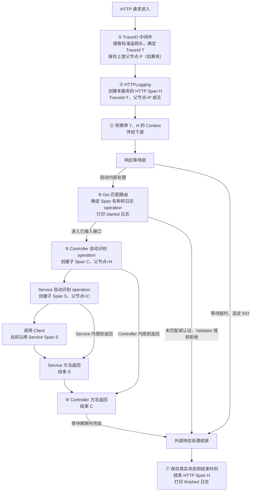
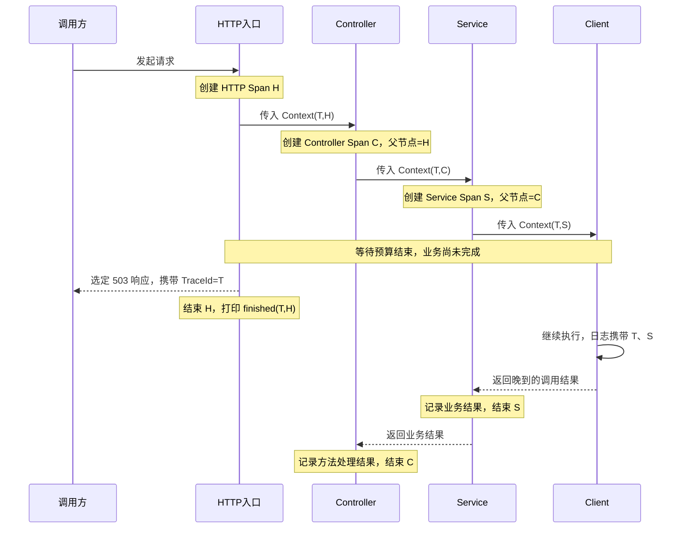

| 字段 | 含义 | 定义方 | 示例 |
| --- | --- | --- | --- |
| `timestamp` | 本条日志发生的时间，使用 UTC，保留高精度时间信息 | 公共 Logger 在写日志时自动生成 | `2026-11-09T06:05:06.123Z` |
| `level` | 日志级别，取值为 `DEBUG`、`INFO`、`WARN`、`ERROR` | 调用方选择对应级别的日志方法，公共 Logger 写入 | `INFO` |
| `message` | 本条日志的英文说明，便于阅读具体发生了什么 | 写日志的组件或业务代码指定 | `Avatar prompt optimized` |
| `component` | 日志来源的代码职责类别，统一取值为 `http_entry`、`controller`、`service`、`client`、`repository`；外部依赖调用组件统一归为 `client`；不适用或无法识别时省略 | 公共日志规范统一约定分类，框架在操作入口识别并写入派生 Context，Logger 自动读取 | `client` |
| `event` | 操作的生命周期节点，首期统一为 `started`、`finished`；`finished` 只表示操作结束，结果通过 `error`、`status_code` 等字段表达；普通说明性日志可省略 | 公共日志规范统一定义，各组件和业务代码复用相同取值 | `finished` |
| `trace_id` | 当前请求所属链路的标识，使用 32 个小写十六进制字符且不能全零；没有请求上下文的进程日志省略 | `tracing.TraceID(ctx)` 统一读取，优先标准 SpanContext，缺失时读取入口生成或校验后保存的值；公共 Logger 自动填充 | `4bf92f3577b34da6a3ce929d0e0e4736` |
| `span_id` | 产生日志时当前执行节点的标识，使用 16 个小写十六进制字符且不能全零；没有有效标准 SpanContext 时省略，未采样节点仍保留 | 公共 Logger 调用 `tracing.SpanID(ctx)` 自动读取；调用方不手填，不从兼容 TraceId 推导 | `00f067aa0ba902b7` |
| `service_name` | 产生日志的服务名称 | 应用配置显式提供，初始化 Logger 时统一注入 | `go-service-template` |
| `environment` | 当前进程所在的部署环境 | 复用已有 `env.Config.Environment`，由装配方传入 Logger；日志 Config 不单独声明 | `dev` |
| `instance_id` | 当前服务进程的标识，用于区分副本和重启；同一进程内保持一致 | 启动流程生成一次随机标识，初始化 Logger 时统一注入 | `2f7b6d598dbd4d61a4d4ab8652e22d74` |
| `caller` | 实际调用日志方法的代码位置；无法取得时省略 | 公共 Logger 自动提取，并处理日志封装带来的调用层级 | `service/user_profile_service.go:324` |
| `operation` | 本条日志对应的稳定操作标识，格式按下表随 `component` 确定；同一操作的 `started`、`finished` 及正常、错误路径使用相同值；不含实参、资源 ID、结果或生命周期后缀，不适用或无法识别时省略 | 框架在操作入口根据路由或方法信息生成并写入派生 Context，Logger 自动读取；命名空间沿用项目声明的领域或目录名称，层级统一以 `.` 分隔 | `example.ResourceService.QueryResource` |
| `duration_ms` | 本条事件对应操作的实际耗时，单位为毫秒；不适用时省略 | 负责执行该操作的组件记录开始和结束时间，计算后传给 Logger | `123.45` |
| `status_code` | 本次 HTTP 交互实际取得的状态码；没有 HTTP 状态时省略 | 入站请求由 HTTP 响应层记录；出站调用从远端响应读取；SDK 仅在确实提供状态码时记录 | `200` |
| `error` | 经过受控处理的失败信息；成功时省略，不记录密钥、完整供应商响应或敏感实参 | 故障发生层提供可记录的错误信息，交给公共 Logger 输出 | `Qwen text generation request failed` |

| component | operation 格式 | 取值规则 | 示例 |
| --- | --- | --- | --- |
| `http_entry` | `{HTTP 方法} {注册路由模板}` | 方法取请求值，中间一个空格；使用注册的完整路由模板，保留路径参数占位符，不包含 Query 或实际资源 ID。真正未匹配的请求使用 `{HTTP 方法} <unmatched>`；响应结束前仍未取得模板时使用 `{HTTP 方法} <unresolved>`。同一请求的开始、结束记录复用已确定的标识 | `GET /api/v1/example/resources/:resource_id` |
| `controller` | `{领域名}.{Controller 类型名}.{方法名}` | 领域名取所属领域目录名，类型名和方法名取项目实际声明的名称；不包含接收者指针符号或调用实参 | `example.ResourceController.QueryResource` |
| `service` | `{领域名}.{Service 类型名}.{方法名}` | 领域名取所属领域目录名，类型名和方法名取本项目业务 Service 的实际声明名称 | `example.ResourceService.QueryResource` |
| `client` | `{集成命名空间}.{Client 类型名}.{方法名}` | 集成命名空间取 `app/integrations/` 下 Client 所在的相对目录路径，将目录分隔符替换为 `.`；保留目录名原有拼写；类型和方法取本项目封装的 Client 声明 | `company.example-service.resource.ResourceClient.QueryResource`、`thirdparty.ai.llm.ProviderClient.GenerateText` |
| `repository` | `{领域名}.{Repository 类型名}.{方法名}` | 领域名取所属领域目录名，类型名和方法名取本项目 Repository 的实际声明名称；不使用 SQL 正文或查询条件作为操作标识 | `example.ResourceRepository.GetByID` |

## TraceId 格式与入站处理

TraceId 统一采用 W3C Trace Context 的标识格式：128 位，即 16 字节；文本形式严格为 32 个小写十六进制字符，只允许 `0-9`、`a-f`，不能全部为 `0`。不带连字符、前缀或空白。`tracing.IsValidTraceID(id)` 提供公共校验，`tracing.NewTraceID()` 使用密码学随机源生成符合规则的标识，出现全零时重新生成。[W3C TraceId 格式](https://www.w3.org/TR/trace-context/#trace-id)

TraceId 的生成、校验、存储与标准 Span 追踪统一位于 [internal/tracing](../../internal/tracing/)。所有读取使用 `tracing.TraceID(ctx)`：有效标准 SpanContext 优先，即使未采样也读取其 TraceId；没有有效标准节点时读取 `tracing.WithTraceID(ctx, id)` 保存的值；两者都没有或 Context 为 nil 时返回空字符串。读取不生成标识、不创建 Span，也不修改父 Context。

入站中间件先通过 `tracing.Extract` 提取合法 `traceparent`、`tracestate`，再通过统一入口读取标识；合法标准上下文优先于旧 `TraceId` 请求头，没有合法标准头时保留原 Context。若 Context 仍无标识，才按照下表处理自定义请求头。响应头、Logger 及公司 HTTP Client 使用同一读取入口，避免出现两个链路标识。

| 入站 `TraceId` 请求头 | 当前处理规则 |
| --- | --- |
| 符合上述格式 | 原样沿用 |
| 不存在或为空 | 生成新的合法标识 |
| 长度错误、大写字符、其他非法字符或全零 | 生成新的合法标识，不因格式非法拒绝业务请求，也不修剪、转换或回显原值 |

生成失败继续返回统一 HTTP 500，不进入业务处理。成功确定标识后，响应头 `TraceId`、Request Context、日志 `trace_id` 及公司 HTTP 请求头使用同一个值。`tracing.WithTraceID` 只负责保存标准上下文缺失时的兼容值，调用方必须通过 `NewTraceID` 取得标识，或先用 `IsValidTraceID` 校验外来值；已有标准 SpanContext 不会被该存储方法覆盖，也不会伪造 SpanId。后台任务同样遵守这个约定，自定义 HTTP 头名统一由 `tracing.TraceIDHeaderName` 声明。

生产 HTTP 入口已接入标准上下文提取和 HTTP Span 创建，同名 `TraceId` 响应头继续兼容既有调用方。有效上游标准上下文建立真正的远端父子关系；只有合法旧 TraceId 时，本地创建同一 TraceId 的根 Span，不伪造上游父 Span。用户资料六个 Controller 接口方法及对应六个 Service 业务方法已接入独立子 Span；其他 Controller、Service，以及公司出站标准头注入和 Client Span 仍待后续接入。

## operation 自动识别与 Context 作用域

每个操作入口接入一次公共封装，日志调用点只传 Context、消息和额外字段，不手动填写 `component`、`operation`，也不手写操作名称字符串。

| component | 自动识别方式 | 接入位置 |
| --- | --- | --- |
| `http_entry` | HTTP 外层与 Gin 模板绑定中间件协作，根据请求方法和匹配后的 `Gin.FullPath()` 生成，使用 `WithHTTPOperation` 建立作用域 | 生产 `NewHTTPHandler` 已接入；无法取得模板时按下文保留明确的占位标识 |
| `controller`、`service`、`repository` | `WithCurrentOperation` 通过 `runtime.CallersFrames` 取得直接调用入口的函数符号，解析包路径、接收者类型和方法名，按目录及类型后缀生成 | 对应组件的普通导出方法入口 |
| `client` | 按具体 Client 公开方法的包路径、接收者类型和方法名生成 | 具体 Client 的公开方法入口；共享底座的排除范围见下文 |

入口用法为 `ctx = logger.WithCurrentOperation(ctx)`。例如，在 `app/domains/example/service` 中的具名方法入口建立操作作用域：

```go
func (s *ResourceService) QueryResource(ctx context.Context) {
    // 1. 调用入口负责提供非 nil Context；公共封装不用于补造业务执行上下文。
    if ctx != nil {
        // 1.1. 建立当前 Service 方法作用域，后续日志及下游调用沿用派生 Context。
        ctx = logger.WithCurrentOperation(ctx)
    }
}
```

此入口生成 `component=service`、`operation=example.ResourceService.QueryResource`，四级日志方法自动从 Context 读取。`caller` 仍表示实际打印日志的代码位置，不用于每条日志重新推断操作。当前路由绑定的是 Validator，HTTP Handler 名称不能直接视为 Controller 名称；Controller 从自己的操作入口识别。

识别范围限于本模块约定目录下的普通导出具名方法，支持指针和值接收者。领域组件按 `app/domains/{领域名}/controller`、`service`、`repository` 的目录及对应类型后缀识别，Controller 版本子目录不进入操作标识；Client 按 `app/integrations/` 下的目录生成命名空间。普通函数、闭包、方法值包装、泛型符号和未知目录不作为操作入口识别，也不向上搜索其他调用帧来猜测名称。

现有 HTTP 公共底座 `company.base.Client` 已显式排除，SDK 公共底座因类型未导出而不符合入口识别条件。新增共享底座时须同步维护识别规则，不能仅凭目录或类型后缀保证自动区分所有底座与具体 Client。

入口识别结果按函数符号缓存，缓存仅保存组件和操作标识，不保存 Context、实参或请求数据。识别失败时建立空操作作用域，遮蔽父 Context 中的操作身份，避免把上层操作误认为新操作；日志省略 `component`、`operation`，原有 TraceId 继续保留。

### Context 的派生与传递

`logger.WithCurrentOperation(ctx)` 通过 `context.WithValue` 创建子 Context，将当前方法的 `component`、`operation` 写入新节点。父 Context 中的操作信息保持原值；各层将自己持有的 Context 显式传给下层，并在当前层打印日志时使用它。

1. **同一次请求沿用同一个 TraceId。** HTTP 入口确定 TraceId 后，后续操作派生沿用已有 Context。TraceId 与操作信息使用不同的 key，子 Context 可以沿父链读取原有 TraceId，覆盖当前操作身份不会改写链路标识。方法入口不重新生成 TraceId；原 Context 没有标识时，操作派生也不会补造。
2. **每个操作拥有自己的作用域。** Controller 将自己的 Context 传给 Service，Service 在入口派生自己的 Context，再传给 Client。Client 建立自己的作用域后，其日志使用 Client 的 operation；同一层内部的普通辅助函数沿用当前 Context，不重新识别辅助函数名称。
3. **局部赋值不会改变上层 Context。** 方法参数 `ctx` 是当前方法的局部变量，执行 `ctx = logger.WithCurrentOperation(ctx)` 只让这个变量指向新节点。调用方仍持有原来的 Context，原来的 operation 从未被下层改写。
4. **下层返回后，上层继续使用自己的 operation。** 无论下层成功还是返回错误，上层后续日志都从自己持有的 Context 读取操作身份，无须手动恢复。之后调用另一个 Client 时，再由那个 Client 基于传入的 Context 建立自己的作用域；各下层作用域不会互相覆盖。

以下示例中的 `T` 表示同一次请求已有的 TraceId；各方法均已接入操作入口识别：

| 执行位置 | 日志使用的 Context | trace_id | operation |
| --- | --- | --- | --- |
| Controller 调用 Service 前 | Controller 派生 Context | `T` | `example.ResourceController.QueryResource` |
| 进入 Service | Service 派生 Context | `T` | `example.ResourceService.QueryResource` |
| 进入 Client | Client 派生 Context | `T` | `company.example-service.resource.ResourceClient.QueryResource` |
| Client 返回，Service 继续打印日志 | 原 Service Context | `T` | `example.ResourceService.QueryResource` |
| Service 返回，Controller 继续打印日志 | 原 Controller Context | `T` | `example.ResourceController.QueryResource` |

操作作用域派生保留父 Context 的取消信号和截止时间。执行控制仍由相应边界决定：SDK 的 `context.WithTimeout` 可增加更早的截止时间；HTTP 响应等待层的 `context.WithoutCancel` 隔离取消及截止时间，同时保留 TraceId 和其他值。这些执行控制不会将子操作身份回写到父 Context。

`WithCurrentOperation` 本身对 nil 使用 `context.Background()` 的兼容处理不代表业务方法可以补造执行上下文；Service 调用入口负责提供非 nil Context，当前 Service 方法仅对非 nil 参数建立作用域。请求级 Context 不存入共享实例字段。

方法入口封装只识别并携带操作信息，不自动记录 `started`、`finished` 或计算耗时；需要生命周期日志时由操作边界调用日志方法。HTTP 的请求与响应边界由下文的中间件统一记录。

如需连入口封装调用也自动生成，后续须通过调用代理或生成包装代码，并将实际调用接入包装；只生成元数据不会拦截现有的直接方法调用。本阶段先采用入口公共封装的预期。

## Span 与调用链规范

本节约定链路追踪的固定边界。生产 HTTP 公共入口创建 SERVER Span，用户资料六个 Controller 接口方法及对应六个 Service 业务方法已创建各自的 INTERNAL 子 Span，形成 HTTP → Controller → Service 的父子关系；其他尚未接入的 Controller、Service 及所有 Client 仍沿用传入 Context 中的当前 Span，同时保留各层 operation。`logger.WithCurrentOperation` 继续只管理操作身份，`logger.Operation(ctx)` 只读已有识别结果。当前未配置导出器，仍不能通过集中查询系统展示调用树。

日志时间线按时间展示发生了什么，调用树通过 Span 的父子关系展示谁调用了谁，耗时瀑布图结合 Span 的开始、结束时间展示串行、并行及等待过程。Span 表示一次具体操作的执行区间，可以关联多条日志；`started`、`finished` 日志本身不是 Span，也不通过配对日志来推导 Span。

### 允许创建 Span 的五类边界

**当前阶段仅允许 HTTP 入口、Controller 公开接口处理方法、Service 公开业务方法、公司 HTTP Client 调用、第三方 SDK Client 调用五类边界创建 Span。创建、结束、结果记录和上下文传递由公共基础设施统一管理，业务代码不得自行创建其他 Span。**

| 边界 | 创建时机与覆盖范围 | Span kind | 统一接入责任 |
| --- | --- | --- | --- |
| HTTP 入口 | 每次收到 HTTP 请求时创建，覆盖接收请求至对外响应处理结束 | `SERVER` | HTTP 外层中间件创建和结束，路由匹配后补充注册模板 |
| Controller 公开接口处理方法 | 每次进入处理接口请求的 Controller 方法时创建，覆盖方法进入至返回或异常退出 | `INTERNAL` | Controller 统一入口与退出封装管理，名称沿用该接口处理方法的 operation |
| 公司 HTTP Client 调用 | 每次调用具体 Client 业务接口时创建，覆盖公共请求流程中的校验、编码、发送、读取、解码及资源清理 | `CLIENT` | 公司 HTTP 公共请求层管理，操作名称沿用具体 Client 的 operation |
| 第三方 SDK Client 调用 | 每次调用项目封装的具体 Client 业务方法时创建，覆盖参数校验、SDK 执行及结果处理 | `CLIENT` | 对应功能的公共 SDK 适配层管理，操作名称沿用具体 Client 的 operation |
| Service 公开业务方法 | 每次进入对外提供的 Service 业务方法时创建，覆盖方法进入至返回或异常退出 | `INTERNAL` | Service 统一入口与退出封装管理，名称沿用该业务方法的 operation |

Service 范围限于公开业务方法，不包含构造方法、配置加载、关闭资源等生命周期方法，也不包含私有辅助方法、校验和数据转换。Service 调用另一个 Service 的公开业务方法时，被调用方法建立子 Span；同一个方法调用多次时，每次执行分别创建 Span。

Controller 的接口处理方法创建 HTTP 入口 Span 的子 Span，调用 Service 时将自己的派生 Context 传给 Service；Service 再创建 Controller Span 的子 Span。Controller 的构造、私有辅助方法及非接口处理方法不创建独立 Span。Repository、Validator、普通函数及辅助方法也不创建独立 Span，需要记录过程时沿用传入 Context 中的当前 Span。operation 仍描述日志所属操作，不要求与 Span 一一对应。

一次具体 Client 调用只创建一个本项目的 Client Span。具体 Client 与公共底座不能重复创建；SDK 内部方法、底层 HTTP Transport 及内部重试也不额外创建 Span。接入自动采集组件时必须遵守这一边界，不能额外产生未约定的 Span。调用第三方只能观测本项目的调用边界，不能据此展示供应商内部的调用过程。

### Span 标识、名称与日志关联

| Span 数据 | 含义 | 定义方 | 示例 |
| --- | --- | --- | --- |
| `trace_id` | 整条请求链路的标识；同一链路中的 Span 和日志保持一致 | 公共追踪层从上游提取，无上游时在允许的入口创建 | `4bf92f3577b34da6a3ce929d0e0e4736` |
| `span_id` | 本次具体执行的标识；不同执行使用不同值，即使 operation 相同 | 公共追踪层在创建 Span 时生成 | `00f067aa0ba902b7` |
| 父 Span 标识 | 直接发起本次执行的上层 Span；没有上游 Span 时为空 | 公共追踪层根据传入的本地或远端上下文建立 | `b7ad6b7169203331` |
| 名称 | 稳定的操作标识，不包含参数、资源 ID 或执行结果 | HTTP 使用方法及注册路由模板；Controller、Service、Client 复用已有 operation 命名规则 | `example.ResourceService.QueryResource` |
| kind | 本次执行所属的服务端入口、出站调用或进程内业务类型 | 五类边界按上表固定映射，不由日志调用点填写 | `INTERNAL` |
| 开始时间 | 本次执行进入边界的时刻 | 公共追踪层在创建 Span 时记录 | `2026-11-09T06:05:06.000Z` |
| 结束时间 | 本次执行退出边界的时刻 | 公共追踪层在结束 Span 时记录 | `2026-11-09T06:05:06.123Z` |
| 耗时 | 从开始到结束的持续时间，不能直接作为 CPU 工作时间 | 公共追踪层根据执行区间取得 | `123ms` |
| 结果状态 | 本次执行的结果，不由某条日志的级别直接推断 | 执行边界提供已确认的结果，公共追踪层写入 | 调用失败时标记错误状态 |
| 受控错误信息 | 失败的固定阶段说明；遵守既有日志的敏感信息限制，不直接保存原始异常或远端正文 | 执行边界提供可记录的失败说明 | `Company HTTP request failed` |

Span 与 SpanContext 复用 OpenTelemetry 标准 API，不在业务层另造数据模型、随机标识或父子关系；实际采集及导出方式由后续 Provider 和导出器配置确定。名称、上下文传递和 Span 生命周期参考 [OpenTelemetry Go 接入文档](https://opentelemetry.io/docs/languages/go/instrumentation/)。

单行 JSON 日志已包含自动字段 `span_id`，与首表中的其他字段共同组成 `Record` 的 15 个字段。共享 Logger 和独立构造的 Logger 使用相同写入流程，四级打印方法均自动读取 Context，调用方不修改现有日志调用方式。

| Context 中的追踪信息 | 日志 `trace_id` | 日志 `span_id` |
| --- | --- | --- |
| 有有效标准 SpanContext，包括未采样节点 | 标准上下文中的 TraceId | 同一个标准上下文中的 SpanId |
| 仅有 `WithTraceID` 保存的兼容值 | 已保存的 TraceId | 省略 |
| 没有追踪信息或 Context 为 nil | 省略 | 省略 |

自动读取不创建或结束 Span，不生成标识，不改变原 Context；Span 是否采样不决定日志是否输出，日志仍按现有最低级别过滤。`Fields` 不增加 TraceId 或 SpanId，因此业务代码不能覆盖这些自动字段。

日志中的 `trace_id` 与当前 Span 的 TraceId 使用同一来源，不能形成两套不同的链路标识。父子关系保存在 Span 数据中，普通日志不重复增加 `parent_span_id`。查询整个 Trace 时展示整条链路的日志；查询其中一个 Span 时，通过 `trace_id`、`span_id` 定位这一次执行的日志。[OpenTelemetry 日志数据模型](https://opentelemetry.io/docs/specs/otel/logs/data-model/)

业务继续在需要的位置使用 `lg.Info`、`lg.Warn`、`lg.Error`、`lg.Debug`，不手填 TraceId 或 SpanId，不为每条日志创建 Span，也不为日志增加配对状态或 defer。Span 的结束不依赖是否打印成功日志，日志级别过滤及输出失败不能阻止 Span 正常结束。

### Context 传递、跨服务关系与生命周期

1. **上下层沿用 TraceId，分别持有自己的当前 Span。** 进入允许的边界时，公共封装基于传入 Context 创建子 Span，并返回派生 Context。向下调用时传入该 Context；辅助方法直接沿用，不创建新 Span。根 Span 只在没有上游 Span 时产生，HTTP 入口已有远端父 Span 时继续上游链路。
2. **下层返回不改变上层身份。** 子 Context 不修改父 Context；下层结束自己的 Span 后，上层继续使用原有 Context 中的 Span 和 operation，无须恢复。同一 Context 传给并发子调用时，各子调用分别创建自己的 Span，不共享可变的请求状态。
3. **跨服务传递标准追踪上下文。** 公司 HTTP Client 在发送前注入 W3C `traceparent` 等标准追踪头，被调用服务提取后创建自己的服务端 Span。调用方 Client Span 与被调用方 Server Span 是两个不同的执行节点，通过父子关系连接；仅透传相同的自定义 `TraceId` 不能还原调用树。[W3C Trace Context](https://www.w3.org/TR/trace-context/)
4. **标准上下文与旧头使用同一个链路标识。** 入站已调用标准提取方法，合法 `traceparent` 优先；与旧头冲突时，以其中的 TraceId 统一响应头、日志、Span 及公司 HTTP 的既有 TraceId 透传。没有合法标准上下文时，使用 Context 已有标识或校验旧头，缺失、非法时生成；共享 SDK 的私有 IDGenerator 在创建根 Span 时沿用该合法值，并独立生成 SpanId，不伪造远端父节点。仅凭旧头仍无法恢复上游父子关系。出站 `traceparent` 注入尚未接入，这些优先级属于项目兼容约定。
5. **第三方默认只做本地关联。** SDK Client Span 与本次请求使用相同 TraceId；不因为接入 Span 就默认向第三方供应商发送内部追踪头，对方内部节点也不在当前可观测范围内。
6. **所有退出路径可靠结束，保持业务语义。** 正常返回、提前失败及 panic 退出均须由边界封装结束本次 Span；不吞掉 panic、不改变错误链、超时、重试或响应行为。`WithCurrentOperation` 继续只管理操作身份，不能单靠现有的入口调用自动取得方法退出时机。
7. **各 Span 按自己的实际执行区间结束。** 当前 HTTP 等待层可能先返回 503，内部业务仍继续执行。HTTP Span 在实际响应处理结束时结束，Controller、Service 和 Client Span 在各自执行结束时结束，允许子 Span 晚于父 Span 结束；不能为了使图形嵌套而提前结束业务 Span，也不能用后续业务结果改写已结束的 HTTP 结果。
8. **父子耗时不能直接相加。** 父 Span 包含对子调用的等待，客户端与服务端 Span 也可能覆盖同一次交互。耗时表示经过的时间，不等于 CPU 时间；结束一个 Span 也不表示整条 Trace 已全部完成。

例如，一次业务先调用第三方 SDK，再调用公司 HTTP 服务，预期调用关系如下；各节点代表一次具体执行，对方的 HTTP 节点要求对方也接入标准追踪：

```text
HTTP 入口 Span
└── Controller 公开接口处理方法 Span
    └── Service 公开业务方法 Span
        ├── 第三方 SDK Client Span
        └── 公司 HTTP Client Span
            └── 被调用服务的 HTTP 入口 Span
```

Span 的采集和导出与现有 stdout JSON 日志是两条关联的数据通道。只增加日志字段不会自动获得调用树；后续仍需由追踪基础设施导出 Span，并由集中查询系统保存和展示。本节先固定采集边界，不代表已经选定或部署收集服务、存储及前端。

### 公共 tracing 包（已初始化，HTTP 与用户资料方法已接入）

公共封装位于 [internal/tracing](../../internal/tracing/)，使用 OpenTelemetry v1.47.0。独立构造方法 `New(provider trace.TracerProvider)` 接收外部 Provider，其关闭责任仍属于调用方。进程启动通过 `Init(serviceName, instanceID, deployment)` 在包内创建真实 SDK Provider，并通过 `tracing.Current()` 获取共享 Tracer，包级 `Shutdown(ctx)` 管理该 Provider。两种方式均不设置 OpenTelemetry 全局 Provider 或传播器，也不启动导出器；具体启动和退出约定见[tracing 初始化与共享实例](#tracing-初始化与共享实例)。

| 创建入口 | 名称来源 | 固定 kind |
| --- | --- | --- |
| `StartHTTP(ctx, method, routeTemplate)` | HTTP 方法及注册模板；暂未取得模板时使用 `<unresolved>` | `SERVER` |
| `StartController(ctx, operation)` | 统一入口已解析的 Controller operation | `INTERNAL` |
| `StartService(ctx, operation)` | 统一入口已解析的 Service operation | `INTERNAL` |
| `StartCompanyClient(ctx, operation)` | 公共请求层取得的具体公司 Client operation | `CLIENT` |
| `StartSDKClient(ctx, operation)` | 公共 SDK 适配层取得的具体第三方 Client operation | `CLIENT` |

五个入口均返回派生 Context 和 `*tracing.Span`，不修改调用方持有的父 Context。没有有效上游 Span 时由 Provider 决定根节点的标识；本包不伪造远端父节点。调用方必须提供非 nil Context；未构造的 Tracer 或缺失 HTTP 方法属于接入错误，不通过补造 Background 隐藏。非 HTTP 入口缺少 operation 时使用本边界的固定 `<unresolved>` 占位名，不借用父操作身份。

operation 参数由入口和公共调用层传递自动识别结果，业务不手写名称。Logger 的操作解析保留原位置，新增只读 `logger.Operation(ctx)` 供追踪边界复用，不重新解析调用栈、不创建作用域或 Span，nil 或识别失败时返回空字符串。tracing 不依赖 Logger，避免重复解析或循环依赖。`StartHTTP` 创建的句柄支持 `SetHTTPRoute` 更新同一 Span 的名称，HTTP 路由层负责沿用已有模板冻结规则；该方法对其他边界不生效。

创建后由边界直接使用 `defer span.End()` 收尾。`span.Fail(description)` 仅设置错误状态和受控说明，不产生新日志、不记录原始 Go error，也不提前结束；日志仍由发生位置的 `lg` 调用输出。正常结束不强制写入 OK，保留已经标记的失败。`End` 的重复调用遵循 SDK 幂等约定；直接作为 defer 执行时，panic 只写入固定的异常退出说明，结束后重新抛出同一值，不记录原始 panic 内容。HTTP 外层使用受限的 `EndHTTP(statusCode, failureDescription, finishedAt)` 保存真实结果及结束时间，再写结束日志；直接 defer 的 `End` 继续保障意外退出。其他通过额外闭包间接调用 `End` 的边界仍须自行标记异常，本包不根据业务返回值自动推断错误。

`Extract(ctx, carrier)`、`Inject(ctx, carrier)` 使用标准 `propagation.TraceContext` 处理 W3C `traceparent`、`tracestate`，不默认传播 Baggage。入站 `TraceID` 中间件已调用提取方法，合法远端上下文只派生 Context、不创建 Span；无合法头时沿用传入 Context。出站注入仍须后续在公司 HTTP 公共请求层接入，载体须可写且没有其他请求遗留的追踪头，不自动作用于第三方 SDK。

`tracing.TraceID(ctx)` 统一读取标准上下文或 `WithTraceID` 保存的兼容值，HTTP 响应头、Logger 正常输出与故障兜底、公司 Client 透传均使用该入口；`tracing.SpanID(ctx)` 只读取有效标准 SpanContext，无标准节点时返回空字符串，不为兼容值补造 SpanId。Logger 的 JSON 写入已自动读取 `span_id`，独立 stderr 故障兜底继续使用原有 TraceId 文本格式。共享 `Init` 已配置根标识兼容桥，独立 `New(provider)` 仍由调用方负责 Provider 策略；用户资料 Controller 及对应 Service 已接入独立 Span，其他 Controller、Service 及 Client 的独立 Span 仍待后续接入。

### 用户资料 Controller Span 接入（已实现）

[user_profile_controller.go](../../app/domains/user/controller/v1/user_profile_controller.go) 的六个接口方法按路由声明顺序接入，Span kind 固定为 `INTERNAL`，名称由具名方法自动识别：

| 方法 | 自动生成的 Span 名称 |
| --- | --- |
| `QueryUserProfileByUserID` | `user.UserProfileController.QueryUserProfileByUserID` |
| `QueryUserProfilePage` | `user.UserProfileController.QueryUserProfilePage` |
| `CreateUser` | `user.UserProfileController.CreateUser` |
| `GenerateUserAvatar` | `user.UserProfileController.GenerateUserAvatar` |
| `UpdateUserProfile` | `user.UserProfileController.UpdateUserProfile` |
| `BatchQueryUserProfiles` | `user.UserProfileController.BatchQueryUserProfiles` |

各方法在入口直接调用以下公共方法，不手写操作名称，也不从 Validator 或私有响应辅助函数猜测 Controller 身份：

```go
// 1. 在当前具名 Controller 方法内识别操作，保持已有调用帧及 Context 派生规则。
requestCtx := logger.WithCurrentOperation(ctx.Request.Context())
// 2. 读取已有识别结果，创建 HTTP Span 的子节点，并在本方法直接登记生命周期收尾。
requestCtx, span := tracing.Current().StartController(requestCtx, logger.Operation(requestCtx))
defer span.End()
// 3. 将携带新 Span 的 Context 保存回 Request，授权、Service、签发及响应处理沿用同一节点。
ctx.Request = ctx.Request.WithContext(requestCtx)
```

`defer span.End()` 只管理追踪生命周期，不集中输出业务日志，不维护业务日志结束状态。正常返回、提前失败和 panic 均结束本次 Controller Span；panic 继续按原值传播。已知的十四个失败分支在发生位置调用 `span.Fail`，覆盖身份或业务权限拒绝、Service 返回错误以及凭证签发失败，仅记录固定阶段说明，不传原始 error 或敏感参数，不增加重复日志。Controller Span 的 Error 表示本次方法未成功完成目标，包含已知业务拒绝；原有 WARN/ERROR 日志级别、业务错误分类及 HTTP 响应保持不变，HTTP 父 Span 仍按自己的边界判断结果。

只有实际进入 Controller 方法才创建该子 Span，认证或 Validator 提前拒绝、未匹配路由等路径仍只有 HTTP Span。纯 DTO 映射、批量列表循环及私有响应辅助函数不创建节点。进入已接入的 Service 业务方法时再创建子 Span，Client 当前沿用 Service 节点；Service 返回后 Controller 继续使用自己的 Context，外层 HTTP 日志也独立保存自己的 Context，因此各层后续日志仍属于各自的 Span。

### 用户资料 Service Span 接入（已实现）

[user_profile_service.go](../../app/domains/user/service/user_profile_service.go) 的六个公开业务方法按现有业务顺序接入，Span kind 固定为 `INTERNAL`，名称复用入口自动识别的 operation：

| 方法 | 自动生成的 Span 名称 |
| --- | --- |
| `QueryUserProfileByUserID` | `user.UserProfileService.QueryUserProfileByUserID` |
| `QueryUserProfilePage` | `user.UserProfileService.QueryUserProfilePage` |
| `CreateUser` | `user.UserProfileService.CreateUser` |
| `GenerateUserAvatar` | `user.UserProfileService.GenerateUserAvatar` |
| `UpdateUserProfile` | `user.UserProfileService.UpdateUserProfile` |
| `BatchQueryUserProfiles` | `user.UserProfileService.BatchQueryUserProfiles` |

各方法在输入校验之前直接接入公共入口，非 HTTP 调用也遵循相同边界：

```go
// 1. 调用入口提供非 nil Context，在当前具名业务方法内自动识别 operation。
if ctx != nil {
    ctx = logger.WithCurrentOperation(ctx)
}
// 2. 基于当前父节点创建 Service Span，直接登记所有退出路径的追踪收尾。
ctx, span := tracing.Current().StartService(ctx, logger.Operation(ctx))
defer span.End()
// 3. 后续流程日志、私有辅助函数及下游调用使用此派生 Context。
```

来自 Controller 的调用形成 `H → C → S`，其中 `S` 是本次 Service 执行新生成的 SpanId，TraceId 始终沿用 `T`。其他入口已有当前 Span 时成为其子节点，没有父节点时按共享 Provider 规则创建根节点；入口必须提供非 nil Context，传 nil 属于接入错误，不在 Service 中补造 Background。方法返回后 Controller 仍持有 `(T,C)`，不会被 Service 的 operation 或 `S` 覆盖。

十九个明确的错误返回分支在发生位置调用 `span.Fail`，覆盖参数错误、权限拒绝、查询未命中、账户冲突、状态或版本冲突、数据库执行故障及头像生成各阶段失败。说明复用该分支已有日志的固定 `Error` 文本，不记录原始错误或用户数据，不改变日志级别、错误返回及响应分类；正常返回和 panic 由直接登记的 `End` 收尾。`Fail` 只更新 Span 状态，不额外输出日志，业务日志仍直接写在原有发生位置，不新增方法级 started/finished、计时变量或日志完成状态。

构造方法、`validate...`、模型转换及私有 `createUser`、分页、批量查询和事务辅助函数不创建 Span；需要日志的辅助函数沿用本次 Service Context，其他辅助函数保持现有签名。私有流程返回的错误由公开业务方法标记 Service 失败。Qwen、MiniMax 及公司 HTTP Client 目前尚未接入独立 Span，接收 `(T,S)` 时继续使用 `S`，只切换自己的 operation。数据库会话、事务、取消和重试行为保持原有约定。

## Service 上下文与业务流程日志

所有 Service 公开业务方法统一使用 `ctx context.Context` 首参，业务输入通过显式 Params 传入。Context 不决定能否打印日志：没有请求上下文仍可记录进程日志，但无法自动携带本次请求的 TraceId；请求相关的业务流程日志必须使用从调用入口传下来的 Context。

HTTP Controller 将响应等待层隔离取消后的 `ctx.Request.Context()` 传给 Service；后台任务或其他入口提供本次执行的非 nil 生命周期 Context，独立执行的根 Context 由入口创建。Service 不用 `context.Background()` 替换已有上下文、不自行生成 TraceId，也不将 DTO、Params 或请求 Context 放进共享实例字段。

Service 入口通过 `logger.WithCurrentOperation` 建立自己的派生作用域，后续共享 Logger 从中自动取得 `component=service` 和 `{领域名}.{Service 类型名}.{方法名}`；已接入追踪的业务方法随后通过 `StartService` 创建自己的 Span。同一方法内部的流程日志保持同一 operation，使用 message 说明具体步骤，普通步骤省略 event。需要记录步骤或失败时，在对应业务位置直接调用日志方法；不要求为业务日志维护状态、增加计时或 defer，也不要求配齐 started、finished。直接 `defer span.End()` 只负责追踪生命周期。HTTP 和 Client 等公共边界仍可统一记录生命周期及耗时。调用其他 Service 或 Client 时继续传入当前 Context，由新入口建立自己的作用域，上层 Context 不变。需要流程日志的私有辅助函数显式接收并沿用该 Context，纯校验、转换和构造函数无需机械添加参数。

同一代码块中直接相邻、使用相同 Context 和 operation、等级相同且中间没有业务操作的普通说明日志，内容相关时应合并，在一条 message 中表达相关阶段。例如，提示词优化完成后立即准备生成图片，可以记录 `Avatar prompt optimized; requesting image generation`。两条日志之间执行了调用、查询或状态变更时，各自表达独立的执行位置；不同 TraceId、operation 或生命周期事件的日志也分别保留。同等级本身不作为合并条件，Logger 不按输出顺序自动合并或丢弃日志。

当前用户资料的六个 Controller 方法在入口自动识别 operation 并创建 Controller 子 Span，将派生 Context 保存回 `ctx.Request`，供 Service、凭证签发和响应处理沿用。对应六个 Service 方法接收 Context 首参，识别自己的 operation 后创建 Service 子 Span，再将派生 Context 传给需要上下文的辅助流程及 Client。两文件的日志均使用共享 Logger，局部变量统一为 `lg`，在业务发生位置直接打印。完整调用约定见[Service Context 约定](api-service-validator.md#service-context-约定)。

Controller 接收请求、处理完成及 Service 正常结果使用 `INFO`；授权拒绝、输入不符合约束和已知业务结果使用 `WARN`；未知执行故障使用 `ERROR`。查询未命中、重复账户、用户停用及版本冲突仍按原有业务错误返回，不因为增加日志改变响应分类。六个用例的 Service 失败日志均由 Service 负责，Controller 继续完成错误映射和响应，不重复输出同一 Service 故障摘要；Controller 自身的授权拒绝和凭证签发故障在当前 Controller 记录，不输出凭证、用户字段或原始错误文本。

需要打印流程日志的私有辅助函数显式接收所属 Service 的 Context。例如创建用户时，私有 `createUser` 在重复账户复查失败的位置记录阶段故障，沿用 `CreateUser` 的 operation 和 Service Span，不将辅助函数名识别为新操作，也不创建额外节点。纯校验、数据映射和其他无需日志上下文的辅助函数保持原有参数。Repository 签名、SQL 取消及事务行为保持不变；其他 Validator 的日志与 Repository 日志不在这两个文件的接入范围内。

### GenerateUserAvatar 接入示例

Controller 入口自动识别 operation 后创建 HTTP Span 的子节点 `C`，将新 Context 保存回 `ctx.Request`；Service 基于该 Context 识别自己的 operation 并创建子节点 `S`。两层日志的 TraceId 保持一致，SpanId 分别为 `C` 和 `S`，操作身份分别为 `user.UserProfileController.GenerateUserAvatar` 和 `user.UserProfileService.GenerateUserAvatar`。当前 Qwen 与公司图片 Client 的日志沿用 `S`，HTTP 开始与结束日志仍使用 HTTP 节点 `H` 的 SpanId。Service 返回后，Controller 后续日志继续使用 `C`。

| 日志边界 | component | level、event | 记录内容 |
| --- | --- | --- | --- |
| Controller 接收请求、处理完成 | `controller` | `INFO`，省略 event | 在实际处理位置记录普通说明，不推断客户端是否已收到响应 |
| 输入或授权拒绝 | 对应的 `service`、`controller` | `WARN`，省略 event | 在失败分支直接记录固定说明，随后沿用原有错误返回或响应 |
| Service 或远端调用失败 | `service` | `ERROR`，省略 event | Service 在失败分支直接记录固定阶段说明，Controller 沿用错误响应，不重复输出故障摘要 |
| 提示词优化前后、图片生成前后 | `service` | `INFO`，省略 event | 通过英文 message 说明业务步骤，operation 始终属于同一 Service 方法 |
| Validator 遇到未知校验故障 | 沿用入站的 `http_entry` 作用域 | `ERROR`，省略 event | 固定的校验失败说明；Validator 不建立新的职责类别或操作身份 |

Controller 和 Service 不为这些业务日志增加计时或结束状态，不输出方法级的成对生命周期日志。两层各自直接登记的 `defer span.End()` 仅负责本层 Span 收尾；业务日志仍在发生位置直接打印。HTTP 状态和对外耗时由外层入口记录，Client 的调用日志继续由公共层记录。等待超时先返回 503 时，Controller 和 Service Span 可以继续执行并晚于 HTTP Span 结束，晚到结果不会改写外层响应日志。

提示词、优化后的文本、图片地址、凭证、原始错误文本及远端正文不进入上述业务日志；业务错误仍原样返回，成功仍只返回头像地址，不更新用户资料。公司图片 Client 原有的调用日志继续保留。文本优化步骤由 Service 描述，Qwen 的文本调用另由 `llm` 公共层记录 Client 生命周期；两者沿用同一 TraceId，分别使用 Service 和具体 Client 的操作身份。

## 当前数据结构与基础写入范围

日志数据结构统一放在 `internal/logger/types.go`：`Level` 声明四种日志级别，`Component` 声明五种职责类别，`Event` 声明 `started`、`finished`，`Record` 对应字段表中的 15 个字段及 JSON 名称，包含 `TraceID`、`SpanID`。`Fields` 只包含调用方可按需补充的 `Event`、`DurationMS`、`StatusCode`、`Error`，自动字段由 Logger 维护。

`Timestamp` 使用 `time.Time`。`DurationMS` 使用 `*float64`，`StatusCode` 使用 `*int`：`nil` 表示未记录，非 nil 的零值仍保留，避免将零耗时与未采集混淆。`Error` 保存已处理的错误文本，不直接序列化 Go `error` 对象。`Component`、`Event`、`TraceID`、`SpanID`、`Caller`、`Operation`、`Error` 无值时省略；服务名称、部署环境、进程标识作为公共元信息保留。

基础 Logger 通过 `New(config Config, deployment env.Config, output io.Writer)` 构造。日志专属 `Config` 仅声明 `ServiceName`、`InstanceID` 和 `MinLevel`；部署环境复用现有 `env.Config`，装配方可在 `env.Init()` 成功后传入 `env.Current()`。Logger 按值保存部署配置，不重复读取环境变量或依赖全局初始化调用。服务名称、实例标识及传入的环境名称必须非空白，最低级别必须使用已声明的合法值；部署环境的允许值仍由 `env` 包管理。构造过程不读取配置文件、不推断服务名称，也不生成实例标识。

**应用 Logger 的局部变量统一命名为 `lg`。** 通过 `logger.Current()` 获取共享实例或通过 `logger.New(...)` 创建独立实例时均使用该名称。项目日志包沿用 `logger`，标准库日志包沿用 `log`；应用日志调用 `lg.Info`、`lg.Warn`、`lg.Error`、`lg.Debug`，标准库日志调用 `log.Printf` 等方法。

```go
// 1. 取得已初始化的共享 Logger，局部实例统一使用 lg 命名。
lg := logger.Current()
// 2. 在业务发生位置直接打印日志，沿用当前 Context 的 TraceId 和操作作用域。
lg.Info(ctx, "Avatar prompt optimized")
```

`Debug`、`Info`、`Warn`、`Error` 接收标准 Context、消息及可选的一个 `Fields`，均无返回值；不需要额外字段时直接省略 `Fields`。业务代码通过 `logger.Current()` 取得共享实例，在需要的位置直接调用对应级别方法，无须在日志外层处理输出结果。每条日志自动补充 UTC 时间、对应级别、Context 中的 TraceId、SpanId、实际调用位置和三项公共元信息。TraceId 通过 `tracing.TraceID` 统一读取，SpanId 通过 `tracing.SpanID` 读取标准节点；没有对应标识时分别省略，Logger 不补生成标识或创建 Span。

最低级别以下的日志被过滤，不触发故障输出；其余日志同步输出为单行 JSON，不抽样、不建立异步队列。参数校验、JSON 编码、写入及短写故障由 Logger 内部统一处理，向独立 stderr 输出故障说明，TraceId 使用引用格式转义；不递归调用 Logger、不重试业务调用，也不替换业务返回或 HTTP 响应。stderr 自身写入失败时不继续报告。`Fields` 不接受原始 Go `error` 或 SDK 对象，错误文本须由调用方先做受控处理；耗时必须为有限的非负数，HTTP 状态码来自实际交互。

业务调用的日志级别表达业务事件的重要程度，Logger 内部的输出故障处理负责日志基础设施本身的错误，两者分别处理。`New`、`Init`、实例及包级 `Sync` 继续返回 `error`，由初始化和退出流程检查；四级打印方法不承担这些生命周期控制职责。

输出 Writer 由调用方提供并管理。`Sync()` 在输出器支持 `Sync() error` 时转交同步，不关闭 Writer；普通 `io.Writer` 的文件、连接或额外缓冲生命周期仍由调用方管理。

以下为基础用法，示例中的公共信息由应用装配方提供：

```go
// 1. 通过显式配置创建日志器，部署环境已由应用初始化。
lg, err := logger.New(logger.Config{
    ServiceName: "example-service",
    InstanceID:  "example-instance",
    MinLevel:    logger.LevelInfo,
}, env.Current(), os.Stdout) // 调用方已完成 env.Init()。
if err != nil {
    // 1.1. 构造失败时尚无可用日志器，由装配调用方处理该错误。
    return err
}
// 2. 在业务位置直接打印日志，日志器内部处理输出故障，业务流程沿用原有结果。
lg.Info(ctx, "Operation completed")
```

需要补充事件、耗时或状态时，传入一份 `Fields`；以下数值用于说明字段形式，实际调用应使用采集结果：

```go
// 1. 采用本次操作实际采集到的耗时和 HTTP 状态，示例数值仅展示字段形式。
durationMS := 123.45
statusCode := 200
// 2. 直接记录操作结束，日志输出故障由日志器内部处理，不替换业务结果。
lg.Info(ctx, "HTTP call completed", logger.Fields{
    Event:      logger.EventFinished,
    DurationMS: &durationMS,
    StatusCode: &statusCode,
})
```

当前已实现 Logger 基础写入、操作识别、只读 `Operation(ctx)` 及追踪字段自动填充。HTTP 入口和用户资料六个 Controller、六个 Service 方法已创建独立 Span，Client 暂沿用传入 Context 中的当前节点，在头像用例中为 Service Span。公司 HTTP、Qwen、MiniMax、用户资料六个用例及头像 Validator 的未知校验故障日志已统一使用共享 Logger；其他日志尚未全部迁移，本次未新增测试用例或发起实际调用。

## HTTP 请求与响应日志

生产入口按 `TraceID → HTTPLogging → 响应等待包装器 → Gin` 装配。`TraceID` 先提取标准父上下文并确定兼容标识；`HTTPLogging` 使用共享 Logger 与 Tracer，在进入等待层前创建唯一的 HTTP SERVER Span，并将派生 Context 同时用于本次日志状态和下游 Request。Gin 的 `HTTPRouteLogging` 在路由匹配后读取 `FullPath()`，向同一个请求状态提供注册模板，不再创建另一套 Span 或路由状态。

### 一次请求的完整流程（当前实现）

进程启动时创建可复用的 TracerProvider 和 Tracer；每次 HTTP 请求进入时创建独立的 HTTP Span。**当前用户资料六个接口实际进入 Controller 后创建 Controller 子 Span，进入对应 Service 业务方法后再创建 Service 子 Span，Client 暂时沿用该 Service Span。认证或 Validator 提前拒绝、未匹配等没有进入 Controller 的路径只有 HTTP Span；Controller 内拒绝且未调用 Service 时只有 HTTP 与 Controller 节点。** 下图以已接入的用户资料接口为例。

以下使用简写说明标识，真实 TraceId 为 32 个小写十六进制字符，SpanId 为 16 个；`T`、`P`、`H`、`C`、`S` 不能直接作为实际请求头值：

| 简写 | 含义 |
| --- | --- |
| `T` | 整条链路的 TraceId |
| `P` | 上游调用方的 SpanId，可能不存在 |
| `H` | 本服务为这次 HTTP 请求新创建的 SpanId |
| `C` | 用户资料 Controller 方法新创建的 SpanId，其父节点为 `H` |
| `S` | 用户资料 Service 业务方法新创建的 SpanId，由 Controller 调用时父节点为 `C` |



图中展示可以正常建立标识的请求；随机源故障导致 TraceId 生成失败时，仍按既有规则直接返回 500，不进入后续 Span 创建。路由未匹配或响应结束前尚未取得模板的名称与日志补写规则见下文。

**① 确定链路归属，尚未创建本地 HTTP Span。** [TraceID 中间件](../../app/http/middleware/trace_id.go) 先提取标准头，确定本次请求属于哪个 Trace；合法 `traceparent` 同时提供调用方 SpanId，旧 `TraceId` 头只有链路标识，无法提供远端父节点。普通外部请求主要有以下三种情况；Context 已有合法标识时按前文优先级沿用。

| 请求携带的信息 | 确定的 TraceId | 是否知道远端父节点 |
| --- | --- | --- |
| 合法 `traceparent`，包含 `T` 和 `P` | 沿用 `T` | 知道，是 `P` |
| 只有合法旧 `TraceId=T` | 沿用 `T` | 不知道 |
| 没有可用标识 | 生成新的 `T` | 没有 |

两个头冲突时，合法标准上下文优先。确定后保存到 Request Context，并设置响应头 `TraceId=T`。这里准备的是链路标识和父上下文，还没有创建本服务的 HTTP 执行节点。

**② 创建本服务的 HTTP Span。** [HTTPLogging](../../app/http/middleware/http_logging.go) 调用 `StartHTTP` 创建 `H`：有上游 `P` 时，`H` 是 `P` 的子节点；没有父节点时，`H` 是本地根节点。两种情况均使用已经确定的 `T`，本地 `H` 每次独立生成，不直接沿用上游的 SpanId。共享 Provider 的兼容桥保证合法旧 TraceId 不会在创建根 Span 时被替换成另一个值。

**③ 通过 Context 逐层传递。** HTTP 先将 `(T,H)` 传给等待层和 Gin；进入用户资料 Controller 后派生为 `(T,C)`，进入 Service 业务方法后再派生为 `(T,S)`，Client 当前沿用 `(T,S)`。派生不修改父 Context，Controller 仍持有 `(T,C)`，外层 HTTP 状态仍独立持有 `(T,H)`。Logger 按每条日志传入的 Context 读取标识，不在共享实例中保存当前请求身份。Context 在进程内传递，跨进程需编码到请求头。

**④ 路由匹配后确定名称。** HTTP Span 创建时通常还不知道注册模板，名称暂为 `POST <unresolved>`。Gin 匹配头像接口后，更新为 `POST /api/v1/user/userProfile/generateUserAvatar`，同步确定 HTTP 日志的 operation 并打印 `started`。因此 Span 早于开始日志启动，不能把 `started` 日志的打印时刻当成 Span 创建时刻。

**⑤ Controller 和 Service 分别创建子 Span，Client 当前只切换 operation。** 两层在各自方法入口通过 `WithCurrentOperation` 自动取得方法身份，再用只读 `logger.Operation(ctx)` 作为 Span 名称，无须填写字符串。以头像生成流程为例，下表 operation 为阅读简写：

| 写日志的位置 | trace_id | span_id | operation 简写 |
| --- | --- | --- | --- |
| HTTP 请求开始 | `T` | `H` | `POST .../generateUserAvatar` |
| Controller | `T` | `C` | `UserProfileController.GenerateUserAvatar` |
| Service | `T` | `S` | `UserProfileService.GenerateUserAvatar` |
| Qwen Client | `T` | `S` | `QwenClient.GenerateText` |
| 公司图片 Client | `T` | `S` | `ImageGenClient.GenerateImage` |
| Service 返回后，Controller 继续处理 | `T` | `C` | `UserProfileController.GenerateUserAvatar` |
| HTTP 响应结束 | `T` | `H` | `POST .../generateUserAvatar` |

operation 说明日志来自哪个操作，SpanId 说明关联哪一次执行。`WithCurrentOperation` 本身仍只更新身份，Controller 另由 `StartController` 创建 `C`，Service 由 `StartService` 创建 `S`；Client 没有创建新 Span，因此继续使用传入的 `S`。后续接入 Client 边界时才会分别建立自己的子节点。

**⑥⑦ 各边界分别结束。** Service 方法返回或异常退出时结束 `S`，Controller 方法退出时结束 `C`；正常路径随后由 HTTP 外层保存实际响应状态和结束时刻、结束 `H`，再打印 `finished`。超时路径可以先结束 `H`，内部稍后再分别结束 `S` 和 `C`。结束 Span 不删除 Context 标识；Service 返回后 Controller 仍使用 `(T,C)`，HTTP 结束日志始终使用自己的 `(T,H)`。HTTP 的 5xx、写入或异常故障按原规则判断，普通 4xx 不仅凭状态标记服务端故障。

### 等待超时后的 Span 与日志

HTTP Span 结束不表示内部业务已经结束。下面假设某个已接入 Controller 和 Service Span 的接口等待预算为 3 秒，并且已经进入 Service，仅用于解释时间顺序；实际预算按路由配置，头像接口不是本例中的 3 秒。



响应等待层隔离业务取消并保留 Context 值，超时不会自动取消内部工作。进入已接入的 Service 后，晚到业务及当前 Client 日志关联 `S`，Service 返回后的 Controller 日志仍关联 `C`；未进入 Service 的 Controller 日志使用 `C`，尚未接入 Controller 的路径继续沿用 `H`。超时后才进入 Controller 时也可基于保留的 `H` 创建子节点，随后进入 Service 再创建 `S`，父节点无需仍在执行。晚到处理不会重启或延长 `H`，也不会改写已选定的 503；响应写出不保证调用方已完整接收正文。

当前 stdout JSON 日志能够显示上述标识，但没有配置 SpanProcessor 或 Exporter；完整 Span 数据未被集中保存，前端调用树也尚未具备。创建 Span、关联日志、导出和查询是分别需要接入的能力。

### 生命周期日志与响应边界

| 日志边界 | event | operation 来源 | 结果字段 |
| --- | --- | --- | --- |
| 请求开始 | `started` | 模板首次可知时确定 `{HTTP 方法} {注册路由模板}`；在认证、Validator 和 Controller 执行前记录 | 不预填 HTTP 状态或最终耗时 |
| 对外响应结束 | `finished` | 复用本次请求已确定的 HTTP 操作标识 | 记录从 HTTP 外层接管请求起计算的 `duration_ms`、实际已选定的 `status_code`，以及可确认的写入、取消或异常终止信息 |

两条日志均使用 `component=http_entry`，自动携带同一 TraceId、HTTP SpanId 和进程公共信息。Span 在外层请求进入时开始；`started` 日志的写出时刻仍是模板首次可知时，日志计时起点继续由外层保存。HTTP 入口不默认记录原始 URL、Query、请求正文、响应正文或认证头。

真正执行 `NoRoute` 时使用 `<unmatched>`；外层先结束、停机拒绝或自动重定向尚未取得模板时使用 `<unresolved>`，并按顺序补出 `started`、`finished`。日志 operation 与 Span 名称在同一个状态锁下首次固定，晚到路由不能改写。Span 保存 `http.request.method`，仅实际匹配的注册模板写入 `http.route`；两种占位值只用于名称，不当作真实路由。

外层响应路径返回时立即保存结束时刻，按原有规则确定真实状态及受控故障，再通过 `EndHTTP` 记录 `http.response.status_code` 并结束 Span，最后写 `finished`。结束时间不包含等候路由元信息锁、补写开始日志或同步输出结束日志的时间。只收到实际状态时才写状态属性；5xx 标记 Error，单纯 4xx 保持 Unset，写入失败、Context 结束及异常终止使用固定说明标记 Error，不记录原始异常。正常成功不强制写 OK。规则参考 [OpenTelemetry HTTP Span 状态规范](https://opentelemetry.io/docs/specs/semconv/http/http-spans/#status)。

路由元数据只通过本次请求的受锁状态共享，跨 goroutine 不读取或保存 Gin Context。Gin 为下游建立 HTTP 操作作用域时，以其当前 `Request.Context()` 为基础，保留响应等待层已经应用的取消隔离、TraceId 和其他值；后续方法作用域可以在自己的派生 Context 中覆盖操作身份，外层响应日志仍使用自己的 HTTP 作用域。

`finished` 只表示外层响应处理结束。等待超时返回 503 后，内部业务可以继续执行，不能用晚到内部的 200 覆盖本次 HTTP 日志；503 也可能由业务或停机产生，不仅凭状态码判定为等待超时。正常处理未显式写状态时遵循 HTTP 的隐式 200；若请求已取消或处理异常终止且没有选定状态，则不伪造状态码。本地写入成功也不保证客户端已收到完整正文。

原有 `gin.Logger()` 和响应等待层的对外摘要、重复写入故障输出已移除，请求与响应由统一入口各记录一次。现有 Recovery、内部逃逸 panic 及其他业务日志继续按其原有边界处理，本阶段不宣称全部日志来源已经完成关联。HTTP 日志直接调用共享 Logger，输出故障由 Logger 内部统一使用 stderr 兜底，HTTP 层不重复报告，也不替换业务响应。

独立调用 `routers.New(authenticator)` 只会安装 Gin 的模板绑定中间件；没有外层 HTTP 日志状态时直接透传，不隐式取得共享 Logger 或 Tracer。生产 `NewHTTPHandler` 负责外层装配；独立使用完整入口时须先初始化 Logger 和 tracing，再按上述顺序包装。TraceId 生成失败的既有 500 路径在进入 HTTPLogging 前返回，无法创建 HTTP Span，仍保留原有失败语义。

## 公司 HTTP Client 调用日志

具体 Client 的公开业务方法在入口对非 nil Context 调用 `logger.WithCurrentOperation`，再将派生 Context 传给公共 `GetJSON` 或 `PostJSON`。公共请求层统一记录调用生命周期，不重复识别操作名，也不将公共方法名作为远端操作标识。当前两个 image Client 均已接入，例如图片生成使用 `component=client`、`operation=company.python-service-template.image.ImageGenClient.GenerateImage`；后续新增具体 Client 方法时沿用同一入口方式。

| 日志边界 | level | event | 结果字段 |
| --- | --- | --- | --- |
| 进入公共请求流程 | `INFO` | `started` | 沿用具体 Client 的操作作用域和 TraceId，不预填状态或最终耗时 |
| 公共请求流程成功返回 | `INFO` | `finished` | 记录 `duration_ms` 和实际收到的 `status_code`，省略 `error` |
| 公共请求流程失败或异常终止 | `ERROR` | `finished` | 记录 `duration_ms`、固定的失败阶段说明；已经取得 HTTP 响应时同时保留实际状态码 |

开始和结束由 `company/base` 的公共请求流程统一配对，包含请求前校验、预取消、JSON 编码、请求构造等提前失败路径。具体 Client 不重复输出这些生命周期日志，也不在共享实例字段中保存请求 Context。日志沿用传入 Context 的 TraceId；HTTP 请求头继续透传同一标识，无标识时不额外生成。nil Context 保留原有的参数错误语义，具体 Client 不通过入口封装将其改成可执行请求的 Background Context。

`duration_ms` 从进入公共请求边界开始计算，覆盖校验、编码、构造、发送、响应读取、解码及响应体关闭；开始日志为同步输出，其开销也可能计入耗时。结束时先截取耗时，再输出 `finished`，结束日志写入时间不计入该数值。它表示本地一次 Client 调用的耗时，不能直接视为远端服务内部的执行耗时。

状态码在取得 HTTP 响应时保存，不以最终是否解码成功决定是否保留。即使 HTTP 200 的正文读取失败、超过读取上限或无法解码，结束日志仍记录 `status_code=200`，同时通过 `ERROR` 和 `error` 表达本地调用失败；非 200 同样记录实际状态。未取得响应的校验、连接、取消等失败不伪造状态码。

失败信息使用固定的阶段说明，不将原始错误对象、URL、Query、请求或响应正文、认证头写入日志；底层错误仍按现有方式返回业务方并保留错误链。调用日志不改变仅接受 HTTP 200、响应读取上限为 16 MiB、不额外重试、原有响应体关闭及关闭错误忽略等调用约定。异常终止会记录失败的 `finished`，panic 继续沿原有路径传播，不在日志层吞掉。

公共请求层通过 `logger.Current()` 取得启动时发布的共享 Logger，输出仍为 stdout 单行 JSON，并遵循最低日志级别过滤。发起公司 HTTP 调用前必须完成 Logger 初始化；未初始化调用仍按共享实例契约 panic，不隐式创建日志器。公共层直接调用日志方法，日志编码或输出故障由 Logger 内部统一使用独立 stderr 兜底，TraceId 采用引用转义格式；Client 不重复报告或替换调用的业务结果。

操作作用域应由具体 Client 入口建立。直接调用公共 `base.Client` 不会自动推断具体业务方法或生成 Client 操作名；公共层只使用传入 Context 中已有的作用域。Client 层目前覆盖公司 HTTP Client 及下文的 Qwen、MiniMax 文本调用，其他第三方 SDK 按各自协议另行接入。

## LLM 文本调用日志

Qwen、MiniMax 的 `GenerateText` 在入口对非 nil Context 调用 `logger.WithCurrentOperation`，自动建立 `component=client` 和具体方法的操作身份，再将派生 Context 传给现有 `openai_compatible.go` 中的公共 `generateText` 方法。具体 Client 不手写操作名，也不重复维护日志计时或结束状态。

| Client | operation |
| --- | --- |
| Qwen | `thirdparty.ai.llm.QwenClient.GenerateText` |
| MiniMax | `thirdparty.ai.llm.MiniMaxClient.GenerateText` |

| 日志边界 | level | event | 结果字段 |
| --- | --- | --- | --- |
| 进入公共文本调用流程 | `INFO` | `started` | 沿用具体 Client 的操作作用域和 TraceId，不预填耗时或状态 |
| 文本调用全部处理成功 | `INFO` | `finished` | 记录 `duration_ms`，SDK 提供实际 HTTP 状态时记录 `status_code`，省略 `error` |
| 参数、执行或协议失败返回 | `ERROR` | `finished` | 记录 `duration_ms`、固定失败阶段说明；保留 SDK 已提供的实际 HTTP 状态 |

公共方法按顺序执行 Client 已初始化检查、供应商支持模型校验、Context 检查、SDK 调用、供应商特有响应校验及公共文本提取，并在成功或失败返回的位置直接打印日志。调用和日志集中在这一个方法中，不再拆分额外执行层或单独维护日志状态结构。提前失败也记录结束；MiniMax 的 `base_resp` 校验和无有效候选文本等协议错误属于本次调用失败，不能仅凭 SDK 返回 HTTP 200 就记录成功。原有参数错误、`ClientError`、错误链及 MiniMax `ProviderCode` 的返回语义保持一致，不补模型默认值、不额外重试，也不改变 Client 的超时控制。

`duration_ms` 从进入公共方法起计算，覆盖校验、SDK 执行、供应商响应检查和文本提取；开始日志同步输出的开销可能计入，结束日志自身的输出开销不计入。日志不使用 defer 收尾或完成标志：正常成功和已知错误返回各自在返回前记录 `finished`；panic 沿原有异常处理路径传播，不额外补写 LLM 结束日志。SDK 调用预算仍使用原有的 `defer cancel()` 清理计时资源。Controller、Service 的业务流程日志同样在发生位置直接打印。

公共 SDK 适配通过逐次调用的 `option.WithResponseInto` 读取实际响应状态，SDK 返回 HTTP 错误时也可使用 `openai.Error.StatusCode` 提供的状态。HTTP 200 后的 SDK 读取或解码失败、MiniMax 扩展状态失败、公共文本提取失败，结束日志仍保留已知的 HTTP 状态并记录失败。未取得状态或 SDK 因取消等原因未提供状态时省略 `status_code`，不推断为 200。MiniMax 的 `base_resp.status_code` 是供应商业务状态，不写入 HTTP `status_code`；供应商错误码继续保留在返回的错误对象中，不新增日志字段。

日志仅记录固定阶段说明，不输出提示词、生成文本、目标 URL、密钥、凭证、SDK 对象、远端正文或原始错误文本。具体方法及 SDK 派生 Context 保留同一个 TraceId，不在 Client 中生成标识，也不向第三方发送自定义 `TraceId` 请求头。请求 Context 与单次日志状态不保存在共享 Client 字段中。

公共日志使用启动时初始化的共享 Logger，局部变量统一命名为 `lg`，直接调用无返回值的四级打印方法；输出故障由 Logger 内部使用独立 stderr 兜底。发起文本调用前必须完成 Logger 初始化，未初始化时沿用 `logger.Current()` 的 panic 契约。本节只覆盖 Qwen、MiniMax 当前的单轮非流式文本调用，不代表其他 SDK 或其他调用方式已经接入。

## 启动初始化与共享实例

`bootstrap.Init` 在 `env.Init()` 成功后、其他应用依赖创建前调用 `logger.Init(configDir, deployment)`。这里的 `configDir` 为配置根目录下的 `logger` 叶子目录，`deployment` 直接使用已有 `env.Current()`。配置选择、读取、实例标识生成、Logger 构造及共享实例发布均由 `internal/logger` 完成，bootstrap 只负责调用和初始化顺序。

配置文件为 `config/logger/dev.yml`、`test.yml`、`prod.yml`，只声明以下两个字段，不重复保存部署环境或进程实例标识：

```yaml
service_name: go-service-template
min_level: INFO
```

开发环境的 `min_level` 为 `DEBUG`，测试和生产为 `INFO`。只读取所选环境的文件，缺失时不回退；加载仅接受一份 YAML 文档及已声明字段，不展开环境变量。非法配置阻止启动，不发布部分实例。

`Init` 为本次初始化生成 16 字节随机数并编码为 32 位十六进制 `instance_id`，与配置中的服务名称、最低级别及复用的部署环境一起注入 `New`。共享 Logger 固定向 stdout 同步写入单行 JSON，不创建本地文件，也不接管 stdout 的关闭责任。启动装配只向输出适配器暴露 `Write`，当前没有内部缓冲，因此共享实例同步时不对终端或管道执行文件系统同步；独立调用 `New` 时，调用方仍可注入自己的 Writer，并遵循其原有 `Sync()` 契约。

初始化全部成功后才一次性发布共享实例，后续通过 `logger.Current()` 获取。初始化前调用 `Current()` 会 panic，重复成功调用 `Init` 返回错误，运行中不重新加载配置或替换实例。包级 `logger.Sync()` 在尚未初始化时返回 nil；已初始化时先取得共享实例快照、释放共享锁，再执行实例同步。

### tracing 初始化与共享实例

Logger 发布成功后，`bootstrap.Init` 通过 `logger.Current().Config()` 取得配置值副本，将其中的服务名称、实例标识及已有部署配置传给 `tracing.Init(serviceName, instanceID, deployment)`。bootstrap 只负责调用顺序及传值，SDK Resource、Provider、采样策略和共享实例发布均在 [internal/tracing/runtime.go](../../internal/tracing/runtime.go) 内完成，不新增 tracing YAML，不重复读取环境变量，也不生成另一份实例标识。Logger 已依赖 tracing 的 Context 方法，因此 tracing 不反向依赖 Logger。

| 标准 Resource 属性 | 来源 | 与日志的对应关系 |
| --- | --- | --- |
| `service.name` | 已初始化 Logger 的 `Config().ServiceName` | 与日志 `service_name` 相同 |
| `service.instance.id` | 已初始化 Logger 的 `Config().InstanceID` | 与日志 `instance_id` 相同，同一进程保持一致 |
| `deployment.environment.name` | 已有 `env.Current().Environment` | 与日志 `environment` 相同，不另设环境配置 |

`Init` 校验这些显式元信息后创建不可变 Resource，再创建 SDK TracerProvider 并复用已有 `New(provider)` 完成封装。采样固定为 `ParentBased(AlwaysSample)`：根链路全量采样，子节点尊重父节点决定；不在本步增加采样配置。SDK 自动记录原始 panic 的行为关闭，沿用边界 `End` 的固定说明和原值传播。Provider 和 Resource 的标准行为参考 [OpenTelemetry SDK API](https://pkg.go.dev/go.opentelemetry.io/otel/sdk/trace)。

共享 Provider 通过私有 `contextIDGenerator` 兼容根 TraceId：只有缺少有效父节点时才读取已校验的兼容值，没有合法值则生成随机 TraceId；根与子 Span 的 SpanId 始终独立随机生成并排除全零。有效上游父链路由 SDK 原样继承，不伪造父 Span 或将外来 TraceId 声明为必然随机，独立 `New(provider)` 的策略不变。

当前没有注册 SpanProcessor 或 Exporter，不创建批处理协程，也不把 Span 数据输出到 stdout、文件或远端服务。HTTP 入口和用户资料六个 Controller、六个 Service 方法已创建 Span，JSON 日志可看到各自标识；初始化本身不创建 Span，Client 尚未建立独立节点，也不能据此查看集中调用树或认定数据已上报。

全部构造成功后，`Init` 在锁保护下一次性发布共享 Tracer 和本包拥有的 Provider；失败不发布部分实例。`tracing.Current()` 初始化前调用会 panic，重复成功初始化返回错误；关闭后不清空指针，也不支持运行中重建。包级 `tracing.Shutdown(ctx)` 未初始化时安全返回 nil，只关闭本包 `Init` 创建的 Provider，不接管独立 `New` 注入的外部 Provider。

### 追踪关闭与最终日志同步

进程入口 `run` 在 bootstrap 之前登记最终清理，覆盖初始化失败、主动取消及正常退出路径。成功启动后先停止 HTTP 并等待内部工作结束，再清理 Client 和数据库，随后调用 `tracing.Shutdown(ctx)`，最后执行 `logger.Sync()`。尚未开始处理请求的启动或监听失败同样可以安全关闭已创建的 Provider。

追踪关闭使用独立的非 nil Context，其超时时长复用 `-shutdown-timeout`，不使用已经取消的进程 Context 或已经释放的启动 Context。该预算在业务排空及共享资源清理后单独创建，与 HTTP 和内部处理共用的原排空预算分开。关闭错误并入原始退出错误，仍继续同步 Logger；当前未配置处理器或导出器，关闭不意味着已有数据被远端保存。

未完全排空时沿用异常退出流程，跳过共享资源清理、Provider 关闭及日志同步，避免后台工作仍在执行时提前终止追踪或等待日志写锁。最终故障报告继续使用现有标准库日志兜底；Logger 同步不关闭 stdout，也不代表采集平台已持久化数据。
