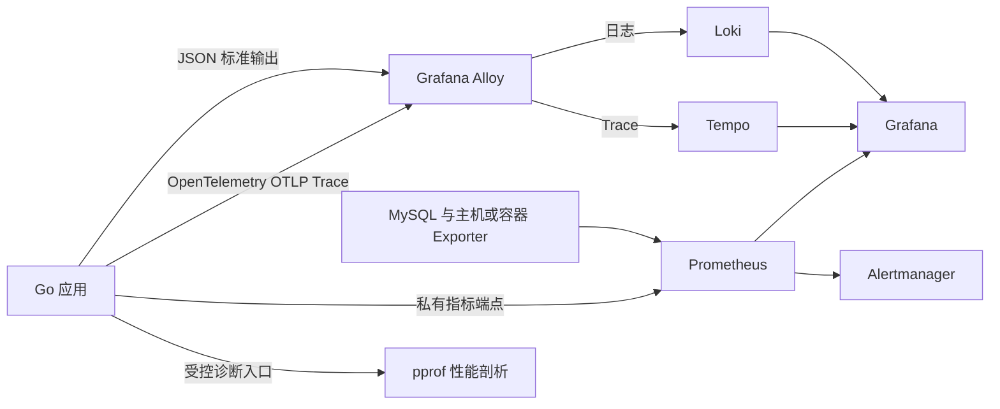

# 日志与可观测性体系设计

状态：设计方案，尚未实施。更新日期：2026 年 11 月 9 日。

本方案覆盖接口、数据库和服务性能三个维度，统一统计口径、日志字段、链路上下文、采集存储及排障方式。采用结构化日志、指标、分布式追踪和性能剖析共同支撑观测：指标回答发生了多少次、整体是否变慢，日志解释具体事件，Trace 展示一次调用的执行路径，Profile 定位 CPU、内存及阻塞热点。

项目现有的英文日志、错误原样传递、统一响应和响应等待超时约定继续作为设计边界。本文中的组件、配置、指标和方法签名属于后续实施目标；现有运行行为仍以代码及对应接口规范为准。

## 1 目标与主要决策

| 维度 | 统计信息 | 详细信息 |
| --- | --- | --- |
| 接口 | 调用次数、QPS、成功与失败次数、拒绝次数、异常分类、平均耗时、P50/P95/P99、耗时分布、并发量 | 一次请求的实际响应、内部执行结果、校验及认证失败、业务错误、下游调用、数据库操作和异常堆栈 |
| 数据库 | 应用数据库操作量、成功与未命中及错误次数、耗时与分布、慢操作、事务结果、连接池占用和等待；MySQL 实例资源与锁指标 | SQL 模板、操作名、命名连接、影响行数、事务过程、慢操作及驱动错误，并关联所属 Trace |
| 服务性能 | CPU、内存、GC、goroutine、实例存活、内部在途工作、Service 用例耗时及吞吐、资源饱和度 | Service 与依赖的耗时拆解、CPU/heap/goroutine/block/mutex Profile、运行时诊断及发布版本 |

主要决策如下。

1. **统计直接来自执行事件。** 使用 Counter、Gauge、Histogram，不通过扫描日志或抽样 Trace 计算正式接口统计。
2. **日志统一使用结构化 JSON。** 采用 Go 标准库 `log/slog`，由公共 Handler 注入上下文、执行脱敏和输出；不在各业务层创建独立 Logger。`go.mod` 已包含 zap，但当前主调用链使用 `log.Printf`，本方案不再增加第二套业务日志 API。
3. **链路统一使用 OpenTelemetry 和 W3C Trace Context。** 通过标准 `context.Context` 贯穿 HTTP、Service、Repository、事务和下游调用。
4. **首期保留全量关键记录及 Trace。** 先满足任意请求可查的需求，再依据实际数据量决定是否引入采样。采样后的详细链路覆盖范围必须明确。
5. **采集与业务解耦。** 应用向标准输出写日志，向采集器发送 OTLP Trace，并提供指标端点；集中存储不可用时，业务继续运行，观测数据可能丢失且必须可监测。
6. **单独定义响应与执行两个结果。** 当前等待超时会返回 503，但内部工作继续；两者分别计数、计时和记录，不用一次状态码推断业务是否提交。

## 2 当前项目的接入基础

| 现有位置 | 当前能力及缺口 | 后续接入方式 |
| --- | --- | --- |
| [启动入口](../../cmd/web/main.go)、[bootstrap](../../bootstrap/init.go) | 管理初始化、HTTP 监听、收尾和资源关闭；主要输出文本日志 | 初始化观测资源、记录生命周期事件，并纳入退出清理 |
| [Gin 路由](../../routers/web.go) | 使用 `gin.Logger`、`gin.CustomRecovery` | 替换为统一观测中间件和结构化 Recovery，避免并行输出两套访问日志 |
| [HTTP 装配](../../routers/http_handler.go)、[响应等待组件](../../app/http/middleware/response_timeout.go) | 默认等待 3 秒，分页 5 秒，创建用户 10 秒；超时后内部继续 | HTTP 外层观察真正选中的响应；内部独立观察工作结束 |
| [公共响应组件](../../internal/response/response.go) | 输出统一错误、记录编码和写出失败 | 在写出时登记结构化结果，日志使用同一请求上下文 |
| [Service](../../app/domains/user/service/user_profile_service.go)、[Repository](../../app/domains/user/repository/user_profile_repository.go) | 方法尚未接收标准 Context，部分 Service 记录技术故障 | 显式增加 Context，保持 Params、领域模型和错误语义 |
| [MySQL Manager](../../internal/database/mysql/client.go) | 管理 `user/post/order/transaction` 独立连接池，配置 GORM 参数化日志 | 安装统一 ORM 观测插件和日志适配器，提供只读池统计 |

目前尚无统一的 OpenTelemetry、Prometheus 指标端点、集中日志平台和性能诊断入口。实施 Context 改造时，须同步更新 README 及[接口处理流程](api-handle.md)、[Service 调用规范](api-service-validator.md)中有关签名和仓储不接收 Context 的描述。标准 Context 用于执行控制及观测，不引入 Gin、认证对象或 HTTP DTO 到 Service 和 Repository。

## 3 整体架构与组件分工



| 组件 | 职责与采用理由 |
| --- | --- |
| `log/slog` 与项目 Handler | 标准化 JSON、Context 字段、脱敏、队列和日志级别；Go 自带 API，业务调用保持简单 |
| OpenTelemetry Go SDK | 生成 Span、传递上下文、批量导出 Trace；不把业务绑定到单一存储平台 |
| `prometheus/client_golang` | 直接记录应用指标并导出 Go 和进程指标，适合当前单体服务及多副本部署 |
| Grafana Alloy | 收集运行环境中的标准输出日志，并接收 OTLP Trace；统一附加部署信息和转发 |
| Prometheus 与 Alertmanager | 保存时序指标、执行聚合和告警规则、管理通知路由 |
| Loki 与 Tempo | 分别保存日志与 Trace，通过统一标识关联 |
| Grafana | 接口、数据库、性能看板，日志搜索及 Trace 瀑布图，关联跳转 |
| pprof | 按需采集性能诊断文件；需要持续剖析时再引入 Pyroscope |

[Alloy 是 OpenTelemetry Collector 的发行版](https://grafana.com/docs/alloy/latest/introduction/)，本方案无需再并排部署另一套通用 Collector。首期指标由 Prometheus 直接抓取；如已有公司统一采集平台，可以替换存储与采集后端，应用的字段、指标口径及 OTLP 接口保持稳定。

开发环境可以先仅启用 JSON、本地指标和控制台 Trace 调试，联调时启动一套本地观测栈。生产环境由部署平台或进程管理器承接标准输出、轮转并供 Alloy 采集，应用不自行维护日志文件。MySQL 使用专用只读监控账号接入 exporter 或云监控，权限按需要授予。

## 4 统一标识与链路上下文

### 4.1 标识和资源属性

| 标识 | 规则 |
| --- | --- |
| `trace_id` | OpenTelemetry 生成的非零 128 位标识，以 32 位小写十六进制输出；全链路共用，不使用雪花业务 ID 替代 |
| `span_id` | 非零 64 位标识，以 16 位小写十六进制输出；每段操作独立，形成父子关系 |
| `request_id` | 本服务每次入站请求独立生成，用于区分一个 Trace 中多次进入同一接口的调用；不依赖上游提供的值 |
| `service_instance_id` | 每次进程启动分配，区分副本和重启；进入日志和 Trace，不作为业务指标维度 |
| `service_name/service_version/environment/region` | 跨信号一致；版本来自构建信息，环境和区域复用 `env.Current()` |

Trace 资源属性分别映射为 `service.name`、`service.version`、`service.instance.id`、`deployment.environment.name` 和自定义 `app.region`。项目的 `cn` 是应用区域，不冒充具体云厂商的地域编号。日志使用上述 snake_case 字段；Prometheus 抓取目标统一附加 `service_name/environment/region`，版本和进程标识通过独立 info 指标关联。

### 4.2 入站与出站规则

1. 在响应等待包装器之前提取 `traceparent` 和 `tracestate`，并创建 HTTP SERVER Span。没有有效上下文时创建新 Trace，无效头不导致业务请求失败。
2. 来自受信任网关和服务的有效上下文延续同一 Trace；公网边界由网关清理、校验并建立可信链路。服务直接暴露公网时，默认新建 Trace，合法外部上下文可作为 Span Link，不能仅凭自报头认定来源可信。
3. 响应头统一返回 `X-Trace-Id` 和 `X-Request-Id`，包括校验失败、认证失败、404、超时及停机拒绝；浏览器需要读取时配置 CORS 暴露头。保持现有 JSON 响应结构。
4. `X-Trace-Id` 仅供查询，不作为入站链路上下文来源。公司内出站 HTTP 使用带观测能力的 Transport，注入标准 `traceparent/tracestate` 并为可观测尝试创建 CLIENT Span；第三方调用默认仅保留本地 Span，对方明确支持且允许后才传播相关头。HTTP 与 SDK 的接入和观测边界见[外部接口调用规范](api-outbound.md#11-链路日志与统计)。
5. 后续接入 gRPC 时使用对应拦截器；消息发送与消费在消息属性中传递标准上下文，重试、扇出和延迟任务按实际因果关系使用子 Span 或 Span Link。
6. `baggage` 默认不透传；确需使用时仅接收白名单中的短小、非敏感字段。Trace 标识不承担认证或授权职责。

头格式与传播由标准实现处理，不手写 ID 解析及校验。协议依据见 [W3C Trace Context](https://www.w3.org/TR/trace-context/)和 [OpenTelemetry 上下文传播](https://opentelemetry.io/docs/concepts/context-propagation/)。

### 4.3 进程内传递和 Span 组织

目标调用方式如下，代码仅说明签名及传递关系。

```go
// Controller 取执行上下文，业务 Params 保持原有职责。
profile, err := composition.Current().UserProfile.QueryUserProfileByUserID(
    ctx.Request.Context(), params,
)

// Service 接收标准 Context，创建用例 Span 后继续向仓储传递。
func (s *UserProfileService) QueryUserProfileByUserID(
    ctx context.Context, params QueryUserProfileByUserIDParams,
) (*models.UserProfile, error)

// Repository 在每次操作建立当前会话，不修改共享根连接的 Context。
func (r *UserProfileRepository) GetProfileByID(
    ctx context.Context, id int64,
) (*tables.UserProfile, error)
// 方法内部使用 r.db.WithContext(ctx).Table(...).Where(...).Take(...)
```

推荐链路为 `HTTP SERVER → http.work → user.QueryUserProfileByUserID → DB operation`；有事务时在用例和 DB operation 之间增加事务 Span。不要为每个私有函数创建 Span，只有需要解释耗时、依赖或业务阶段的操作才增加层级。

Span 名称使用方法与路由模板、领域与用例等稳定名称，参数仅通过允许的安全属性表达。HTTP 属性采用 `http.request.method/http.route/http.response.status_code` 等标准语义；HTTP SERVER 的 4xx 默认保持状态 Unset，5xx 和未处理异常标记 Error，具体规则按锁定版本的[HTTP Span 语义约定](https://opentelemetry.io/docs/specs/semconv/http/http-spans/)实现。预期业务拒绝和数据库未命中不直接作为技术异常；实际技术错误同时登记异常事件与 Span 状态，不能假设 RecordError 会自动设置 Error 状态。

Context 不放入 DTO、Params、领域模型或长期存活的 Service/Repository 字段；不通过全局变量、goroutine ID 或字符串拼接恢复链路。并发任务显式传入标准 Context，不跨 goroutine 使用 Gin Context。真正独立的后台任务创建自己的根 Span，并保留触发请求的 Link。

### 4.4 响应等待超时后的链路

沿用当前 `context.WithoutCancel` 隔离客户端取消和响应等待截止时间的语义，同时保留 Trace、请求标识等 Context 值；不在传递 Context 的过程中意外恢复“超时即取消业务”。业务需要执行上限时另设明确的执行 Context，与响应等待时间分开配置。

HTTP SERVER Span 在外部响应处理结束时结束；`http.work` Span 在内部 Handler 真正退出时结束，允许子 Span 晚于父 Span 结束。晚到业务、事务和 SQL 继续使用相同 `trace_id`，日志关联当前工作 Span，不向已结束的 HTTP Span 补写事件。

例如创建请求 10 秒返回 503、12 秒业务完成：访问日志记录等待超时和 10 秒响应耗时，内部日志记录实际完成结果和 12 秒执行耗时；如果事务已成功提交，明确记录 `committed`。对外失败次数增加一次，内部成功次数也可增加一次，分别出现在对应看板中。

## 5 结构化日志规范

### 5.1 公共字段与级别

**所有项目固定日志消息、事件名和字段名使用英文。** 每条记录为一行完整 JSON，时间为 UTC RFC3339Nano；时长字段明确单位，日志使用 `duration_ms`，指标和 Trace 使用秒或 SDK 原生时间。公共 Handler 从传入 Context 中读取有效 Span，标准 `InfoContext/ErrorContext` 本身不会自动注入 Trace 字段，需要项目 Handler 完成。[slog 官方说明](https://pkg.go.dev/log/slog)

| 字段 | 内容 |
| --- | --- |
| `schema_version/timestamp/level/event/message` | 字段协议版本、时间、级别、稳定事件名和简短英文说明 |
| `service_name/service_version/service_instance_id/environment/region` | 服务及部署定位信息 |
| `trace_id/span_id/request_id` | 请求范围内必填；启动及独立周期任务无请求标识时省略，不伪造为同一个 Trace |
| `component/operation` | 例如 `http`、`user_profile_service`、`mysql` 及稳定操作名 |
| `error_kind/error_code/business_code/error_message` | 归类、接口通用码、可选业务码及脱敏后的原因；没有错误时按事件定义省略 |
| `stack` | 仅 panic、无法定位的非预期故障等诊断场景记录，使用 JSON 字符串编码 |

| 级别 | 适用场景 |
| --- | --- |
| DEBUG | 临时诊断、安全 SQL 模板等细节，生产默认关闭 |
| INFO | 请求及内部执行摘要、业务状态变化、启动和正常停机 |
| WARN | 慢操作、响应等待超时、资源接近饱和、可恢复的依赖问题；预期的参数或身份拒绝通常由 INFO 摘要表达 |
| ERROR | 数据库技术故障、未处理异常、编码或网络写出故障、初始化或收尾失败 |

### 5.2 事件与记录责任

| 事件 | 唯一记录方 | 主要附加信息 |
| --- | --- | --- |
| `http.request.completed` | 真实 HTTP Writer 外侧的观测层 | 方法、路由模板、实际尝试写出的状态、对外结果、响应来源、耗时、字节数和错误类别 |
| `http.work.completed` | 内部 Handler 工作包装器 | 内部结果、业务响应码、完整执行耗时、是否晚于响应结束 |
| `http.panic` | 覆盖当前 goroutine 的 Recovery | 脱敏 panic 内容、堆栈和当前阶段；只恢复本 goroutine |
| `http.response.encode_failed`、`http.response.write_failed`、`http.response.duplicate_write` | `internal/response` | 编码、缓冲写入或重复输出的阶段与原因，不打印 DTO 或正文 |
| `http.transport.write_failed` | 真实网络写出层 | 真实状态、实际与预期字节数，和内部缓冲写入失败区分 |
| `service.operation.failed` | Service 的故障出口 | 用例及必要的安全业务上下文，返回原错误 |
| `db.operation.slow`、`db.operation.failed` | GORM 日志适配器 | 命名连接、操作、SQL 模板标识、耗时、影响行数和有限错误分类 |
| `db.transaction.completed` | 统一事务观测入口 | 事务 Span、提交或回滚的确认结果、耗时及失败阶段 |
| `app.started`、`app.stopping`、`app.shutdown_incomplete` | 启动入口 | 版本、资源阶段、内部剩余工作及耗时 |

访问摘要不是异常堆栈日志。底层故障和 Service 业务上下文可以分别出现，但 Controller 不再复制同一个技术故障，堆栈只在负责故障的边界记录一次。接口异常次数依据每次请求最终归类统计，不能通过 ERROR 日志条数计算。

保留现有约定：响应组件负责输出阶段的日志，Controller 不为同一输出故障重复记录。详见[接口返回规范第 7 节](api-response.md#7-响应编码与写出失败)。使用新的 Recovery 后关闭 Gin 默认文本 Recovery 输出，尤其避免默认请求转储泄露请求头。

### 5.3 示例

```json
{"schema_version":1,"timestamp":"2026-11-09T02:00:00Z","level":"INFO","event":"http.request.completed","message":"HTTP request completed","service_name":"go-service-template","service_version":"example-build","service_instance_id":"example-instance","environment":"prod","region":"cn","component":"http","trace_id":"4bf92f3577b34da6a3ce929d0e0e4736","span_id":"00f067aa0ba902b7","request_id":"01ee29a4b8c14a88a9d9cfeecfd4426d","method":"GET","route":"/api/v1/user/userProfile/queryUserProfileByUserId","status_code":200,"result":"success","response_source":"handler","duration_ms":18.4,"response_bytes":156}
{"schema_version":1,"timestamp":"2026-11-09T01:59:59.996Z","level":"WARN","event":"db.operation.slow","message":"Database operation exceeded slow threshold","service_name":"go-service-template","service_version":"example-build","service_instance_id":"example-instance","environment":"prod","region":"cn","component":"mysql","trace_id":"4bf92f3577b34da6a3ce929d0e0e4736","span_id":"2e7b29c1a2a62eb6","request_id":"01ee29a4b8c14a88a9d9cfeecfd4426d","connection":"user","operation":"select","statement_id":"user_profile.get_by_id","statement_template":"SELECT * FROM user_service.user_profile WHERE id = ? LIMIT ?","duration_ms":12.1,"slow_threshold_ms":10,"rows_affected":1}
```

示例慢阈值 10ms 仅用于展示字段，不是生产推荐值。正式阈值统一来自命名连接的既有 `SlowThreshold` 配置，避免出现两套不同判定。

### 5.4 脱敏与体积控制

默认不记录请求和响应 Body、完整 Query、Authorization、Cookie、JWT、密码、密钥、DSN、数据库参数及整份配置。路径使用路由模板；IP、外部账户、昵称、头像 URL、用户 ID 等信息仅在确有排障需要且经过字段白名单、脱敏或受控标识化处理后进入日志。

SQL 原始错误可能包含冲突值，panic 也可能带入敏感对象，因此“记录 err”不等于直接序列化任意 `err.Error()`。观测层只生成脱敏展示值和有限错误分类，不修改原 error、错误链或现有 HTTP 错误输出契约。原始故障在受控诊断中按需查看。

同样的字段白名单和脱敏规则适用于 Span 属性、异常事件及采集器调试输出；安装自动追踪插件时显式检查其 URL、请求头、SQL 和错误信息采集行为，不能只保护 JSON 日志。

单条记录初始上限 16KiB；超长字段在序列化前截断，增加 `truncated=true` 和原长度信息，保持 JSON 合法。异步入队前完成脱敏和必要的数据复制，避免引用随后变化的 DTO、map 或 Context 容器。多行堆栈编码在同一 JSON 记录中，不使用终端颜色。

## 6 接口统计与结果口径

### 6.1 对外请求与内部执行分别统计

“接口调用次数”默认指进入应用 HTTP Handler 并完成外层处理的次数，重复请求和客户端重试分别计数。TLS/连接建立失败、请求头解析失败等尚未进入 Handler 的流量由网关和 `http.Server` 层观察；不混入应用接口次数。

| 对外 `result` | 口径 |
| --- | --- |
| `success` | 获选响应为 2xx，且本地网络写出未发现故障；不代表客户端一定收到或业务没有后续步骤 |
| `rejected` | 获选响应为 4xx，属于校验、身份、权限、未找到或业务条件拒绝 |
| `failed` | 获选响应为 5xx，或发生明确的编码、写出等技术故障；响应等待超时属于此类 |
| `unknown` | 无法确认本次对外结果，例如响应前客户端断开；当前接口不使用的其他状态也先归入此类 |

优先登记明确的传输故障和外层决策，再归类 HTTP 状态。**调用总数等于成功、拒绝、失败、未知四类之和。** 看板分别展示服务技术失败率和所有未成功请求占比，不能把全部 4xx 都算为服务故障。客户端取消是否影响可用性 SLO，按网关口径单独约定，不用一个虚构 499 冒充实际响应码。

内部工作独立使用 `success/rejected/failed/unknown`：按工作真正结束时的用例及准备响应结果归类。工作 panic 或编码失败为 `failed`；只调用 `response.Success` 不足以证明事务提交或真实响应发送成功。停机时未确认工作结束的记录为 `unknown`，不得补造成功或回滚结果。

### 6.2 指标定义

以下指标统一由应用进程累计，采集端附加 `service_name/environment/region/instance`。`route` 必须是注册模板，未知路由使用 `__unmatched__`；工作尚未进入路由而外层已结束时使用 `__unresolved__`，不把原始路径作为标签。

| 指标 | 类型 | 附加标签 | 定义 |
| --- | --- | --- | --- |
| `app_http_requests_started_total` | Counter | `method` | 进入外层 Handler 的次数，便于与在途量核对 |
| `app_http_requests_total` | Counter | `method,route,status_code,result` | 每个外层请求结束时增加一次；未实际写出状态时 `status_code=none` |
| `app_http_failures_total` | Counter | `method,route,error_kind,error_code` | 每个非 success 请求的主要失败或拒绝类别，仅增加一次 |
| `app_http_request_duration_seconds` | Histogram | `method,route` | 入站至外部响应处理结束，包含排队、绑定、依赖和响应写出 |
| `app_http_requests_in_flight` | Gauge | 无 | 外层仍在处理的请求数 |
| `app_http_work_completed_total` | Counter | `method,route,result` | 每个被接纳的内部 Handler 真正退出时增加一次 |
| `app_http_work_duration_seconds` | Histogram | `method,route` | 内部工作开始至退出的时间，覆盖超时后的继续执行 |
| `app_http_work_active` | Gauge | 无 | 所有仍在运行的内部工作数 |
| `app_http_late_work_active` | Gauge | 无 | 外层已结束、内部仍未退出的工作数，是 active 的子集 |
| `app_fault_events_total` | Counter | `component,error_kind` | 独立技术故障事件数，用于观察同一请求的多处故障，不能代替失败请求数 |

`error_code` 复用已有八个通用码，无法形成接口错误时为 `none`，非法或未登记值为 `other`。`business_code` 首期仅进日志和 Trace，不作为指标标签。

`error_kind` 使用公共有限枚举：`validation/authentication/authorization/rate_limited/not_found/business/response_wait_timeout/dependency_timeout/db_connection/db_deadlock/db_lock_timeout/db_constraint/response_encode/response_write/panic/shutdown_rejected/client_canceled/internal/unexpected`。下层保留精确事件，外层仅选择导致最终结果的主要原因；例如重试后成功的数据库错误不增加接口失败次数。错误分类依据已知错误类型、公共错误码和明确的执行阶段，禁止将原始错误文案作为类别。

Histogram 首期采用固定桶，便于跨副本聚合。HTTP 与内部工作桶为 `0.005, 0.01, 0.025, 0.05, 0.1, 0.25, 0.5, 1, 2.5, 3, 5, 10, 30, 60` 秒，另含自动生成的 `+Inf` 桶。3、5、10 秒覆盖当前等待上限。SLO 确定后将其准确边界纳入桶配置，并对所有副本保持一致。[Prometheus Histogram 聚合说明](https://prometheus.io/docs/practices/histograms/)

### 6.3 确保记录的是真正响应

外层观测必须包在响应等待组件之外；Gin 内部的 Writer 和状态可能只写入缓冲，不能作为最终 HTTP 统计来源。公共响应组件直接登记 `error_code/business_code` 等元数据，统计层不读取或重新解析 JSON Body。

超时和停机拒绝由外层登记自己的 `SERVICE_UNAVAILABLE` 及错误类别；内层准备的通用码与业务码保留在工作摘要中，不能冒充已经发送给客户端的结果。

新增请求级观测状态，使用互斥或原子状态保存路由、内部结果、外层响应来源、写出故障和结束状态。最终响应选择与 `response_source=handler/wait_timeout/shutdown` 的提交必须发生在同一决策点；仅看到 503、检查响应文案或启动第二个独立计时器均不足以准确判断等待超时。

当前 `http.TimeoutHandler` 不提供业务可用的明确超时回调。实施时需在等待适配层取得可靠的分支信号，必要时调整该适配层的响应决策实现，同时保留缓冲、晚到响应丢弃、取消隔离和收尾语义；不能只增加一段 Gin 中间件就宣称覆盖了超时结果。

每条路径使用一次性完成标记：正常、超时、panic、断连、停机拒绝、未匹配路由都各有一条访问摘要，晚到工作再各有一条工作摘要。路由和结果使用安全快照；外层不并发读取 Gin Context，晚到成功也不能覆盖已确定的对外 503。

### 6.4 查询示例

下列 PromQL 使用 Grafana 的单值变量 `$service`、`$environment`，时间范围由 `$__range` 指定；多区域场景增加 region 筛选。Counter 在进程重启时归零，使用 `rate/increase` 后再跨副本求和。

```promql
# 所选时间段各接口调用次数；成功次数增加 result="success" 筛选。
sum by (method, route) (
  increase(app_http_requests_total{service_name="$service",environment="$environment"}[$__range])
)

# 各接口 QPS。
sum by (method, route) (
  rate(app_http_requests_total{service_name="$service",environment="$environment"}[5m])
)

# 平均响应耗时，毫秒。
1000 * sum by (method, route) (
  rate(app_http_request_duration_seconds_sum{service_name="$service",environment="$environment"}[5m])
) / sum by (method, route) (
  rate(app_http_request_duration_seconds_count{service_name="$service",environment="$environment"}[5m])
)

# P99 响应耗时，毫秒；更换 0.99 可查询 P50/P95。
1000 * histogram_quantile(0.99,
  sum by (le, method, route) (
    rate(app_http_request_duration_seconds_bucket{service_name="$service",environment="$environment"}[5m])
  )
)

# 各类失败或拒绝次数。
sum by (route, error_kind) (
  increase(app_http_failures_total{service_name="$service",environment="$environment"}[$__range])
)
```

平均值按总耗时除以总次数计算，分位数按聚合后的桶计算，不能平均各实例的 P99。无样本时显示无数据，不显示 0ms。耗时热力图按选定接口聚合 `_bucket`，使用 Grafana Histogram/Heatmap 对累计桶进行正确转换，展示随时间变化的分布。

这些次数用于运维分析；`increase` 含抓取间隔外推，进程异常退出前未被抓取的增量也可能丢失，不能替代财务或业务审计账本。

## 7 数据库统计与详细观测

### 7.1 三层数据各自负责什么

| 层次 | 观测来源 | 能回答的问题 |
| --- | --- | --- |
| 应用数据库操作 | GORM 公共观测插件 | 哪个用例、命名连接及操作慢或失败，某次请求执行了哪些操作 |
| 客户端连接池 | 每个命名池的 `sql.DB.Stats()` | 池是否耗尽、连接是否排队、连接生命周期是否频繁结束 |
| MySQL 实例 | exporter、云监控、Performance Schema 和受控慢查询日志 | 服务端连接、锁等待、死锁、缓冲命中、磁盘及实例 CPU 是否异常 |

首期应用统计单位明确为**一次 GORM 操作**，包含对应客户端等待、驱动调用和 ORM 处理，不宣称等于服务端精确执行的 SQL 条数或纯 SQL 时间。分页的 Count 和 Find 是两次操作；预加载等嵌套调用分别记录，父子耗时可能重叠，不能将其简单相加得到数据库占用时间。事务 Begin/Commit/Rollback 另行观察；Row/Rows 返回游标后的消费和关闭时间需要单独记录，不能当作已被获取游标的耗时覆盖。

### 7.2 操作指标与错误分类

| 指标 | 类型 | 附加标签 |
| --- | --- | --- |
| `app_db_operations_total` | Counter | `connection,operation,result` |
| `app_db_operation_duration_seconds` | Histogram | `connection,operation` |
| `app_db_operation_errors_total` | Counter | `connection,operation,error_kind` |
| `app_db_slow_operations_total` | Counter | `connection,operation` |
| `app_db_transactions_total` | Counter | `connection,result` |
| `app_db_transaction_duration_seconds` | Histogram | `connection` |

`connection` 只取配置注册的命名连接；`operation` 限于 `select/insert/update/delete/raw/other`；操作 `result` 为 `success/not_found/error`。`gorm.ErrRecordNotFound` 计入未命中，不视为数据库基础设施故障，也不修改原错误。影响 0 行、唯一键冲突是否构成业务失败，继续由 Service 根据业务判断。

数据库 `error_kind` 限于 `connection/timeout/canceled/deadlock/lock_timeout/constraint/transaction/other`。重复键等约束问题单独展示，不和断连等基础设施问题混算。分类集中在公共数据库包，复用现有 `IsDuplicateKey`，通过 `errors.Is/As` 等机制识别，不要求 Service 包装或替换错误。

数据库 Histogram 桶初值为 `0.001, 0.005, 0.01, 0.025, 0.05, 0.1, 0.2, 0.5, 1, 2, 5, 10` 秒及 `+Inf`。慢判定复用每个连接的 `SlowThreshold`；该配置当前以秒表示，如后续需要毫秒级阈值，应统一升级其类型及配置规范，不另设相互矛盾的观测阈值。

### 7.3 统一接入与 SQL 详情

在创建每个命名 GORM 入口时安装同一套插件，为 Query/Create/Update/Delete/Row/Raw 等操作生成 Span 和指标，并取得当前 `Statement.Context`；日志适配器仅负责格式化事件。明确每类操作的唯一完成钩子，不能在 GORM Logger、callback 和驱动插件中重复增加同一指标或生成同一层 Span。

SQL 详情包含 `connection/db_namespace/operation/statement_id/statement_template/duration_ms/rows_affected`，同时带上请求和 Span 标识。`statement_id` 优先采用仓储中声明的稳定名称，例如 `user_profile.get_by_id`，用于慢操作排行；只能自动推导时，在日志与 Trace 中保存经规范化模板生成的指纹。首期不把任意模板、指纹或动态表名加入指标标签。

保留已有参数化原则：从仍含占位符的语句模板获取信息，不调用用于展开参数的 `Dialector.Explain` 等插值函数，不记录 `Statement.Vars`。自定义适配器需自行保证这一点，不能假设原默认 Logger 的 `ParameterizedQueries=true` 自动保护所有插件。Raw SQL 中已经内嵌的字面量同样要清理；无法可靠清理时只保留稳定操作名、模板标识和结构性信息。

正常操作以 Span 表达细节，避免每次成功 SQL 再产生一条 INFO 日志；慢操作记 WARN，技术故障记 ERROR，明确未命中不默认记 ERROR。SQL 模板 DEBUG 诊断按连接短期开启，关闭后指标与 Span 继续采集。行数未知时保持未知，例如 GORM 返回 -1；读取行数也不代表 MySQL 扫描行数。[GORM Context](https://gorm.io/docs/context.html)和 [Logger 接口](https://gorm.io/docs/logger.html)提供对应接入点。

如将来需要精确的驱动调用、重试次数或连接获取耗时，另增驱动层观测并使用独立名称及 Span 层级，不能无声改变现有 ORM 指标口径。MySQL 原生慢日志通常没有应用 `trace_id`，不承诺天然逐条关联；首期通过应用 Trace、SQL 模板、实例和时间窗口联合定位，避免默认向 SQL 注入高基数 Trace 注释。

### 7.4 事务观测

事务 Span 包含其内部所有数据库操作，必须使用 `db.WithContext(txCtx).Transaction(...)` 或具有等价语义的统一事务入口，仓储继续接收该事务连接，并按调用 Context 派生会话，不切回全局普通连接。

事务结果为 `committed/rolled_back/begin_failed/unknown`。只有 Commit 明确成功才记 committed，只有 Rollback 明确成功才记 rolled_back；提交时断连、回滚失败或进程退出等不能确认结果时记 unknown，并记录 `failure_phase`。业务回调返回错误不自动证明回滚已经成功。

当前 Service 直接调用 GORM Transaction，返回值无法提供所有回滚与提交阶段的独立确认。实施事务结果统计时，需增加公共事务观测适配入口，覆盖 Begin、Commit、Rollback 的实际返回；不能仅对 `Transaction()` 的 nil/非 nil 返回做二分计数。技术错误仍按现有错误规范传递。

### 7.5 连接池指标

Manager 为 `user/post/order/transaction` 分别导出只读 Stats 快照，不向业务暴露关闭或修改底层池的能力。相同地址的独立命名池分别统计，不能合并后掩盖单池耗尽。

| 指标 | 类型 | Stats 来源 |
| --- | --- | --- |
| `app_db_pool_open_connections` | Gauge | OpenConnections |
| `app_db_pool_in_use_connections` | Gauge | InUse |
| `app_db_pool_idle_connections` | Gauge | Idle |
| `app_db_pool_max_open_connections` | Gauge | MaxOpenConnections |
| `app_db_pool_wait_total` | Counter | WaitCount |
| `app_db_pool_wait_duration_seconds_total` | Counter | WaitDuration 换算为秒 |
| `app_db_pool_connections_closed_total` | Counter | MaxIdleClosed/MaxIdleTimeClosed/MaxLifetimeClosed，增加固定 `reason` 标签 |

所有池指标含 `connection`。自定义 Collector 在抓取时读取累计快照，不能每次把累计值再次 Add 到 Counter。等待平均时间使用等待总时长的 rate 除以等待次数的 rate，无等待时显示无数据；Stats 不提供每次等待样本，不能据此构造等待 P99。[database/sql DBStats](https://pkg.go.dev/database/sql#DBStats)

### 7.6 MySQL 实例观测

数据库看板另展示实例可用性、当前连接与上限、Threads_running、查询量、慢查询、InnoDB 锁等待及死锁、Buffer Pool、磁盘容量和 I/O。实例指标由独立 exporter 或云监控提供，不让应用每个请求额外查询系统表。

Performance Schema 和原生慢日志按需接入，限制访问范围和保留期；受控提取 SQL digest、锁等待、执行计划及扫描行数。[EXPLAIN ANALYZE 会执行语句](https://dev.mysql.com/doc/refman/8.4/en/explain.html)，不能在生产业务请求中自动触发。应用命名连接与数据库实例通过部署清单或 info 指标建立映射，支持从池问题跳转到对应实例。

## 8 服务性能统计与诊断

### 8.1 应用与运行环境指标

注册 Prometheus Go Collector 和 Process Collector，基础项包括 `go_goroutines`、`go_memstats_heap_alloc_bytes`、GC 时间、`process_cpu_seconds_total`、`process_resident_memory_bytes` 和进程启动时间。CPU 使用率基于 CPU 时间的 rate，容器利用率还须结合分配核数及限额。主机和容器层补充 CPU throttling、内存限额、OOM、重启、文件句柄及磁盘 I/O。[Go 应用指标接入](https://prometheus.io/docs/guides/go-application/)

用例层增加 Counter `app_service_calls_total{domain,use_case,result}` 和 Histogram `app_service_duration_seconds{domain,use_case}`，在公共用例观测入口记录，固定用例名而不使用参数值。`result` 复用内部工作的四类结果，耗时桶沿用内部工作桶。它们统计真正执行的 Service 调用，和包含校验、认证及响应写出的 HTTP 耗时分开。批量用例的一次调用记一次，元素数量作为日志或独立大小 Histogram，不展开成任意标签。

未来出现重试、工作队列、缓存或外部服务时，各自增加有限维度的尝试次数、排队、命中率和耗时；一次接口请求可能有多次依赖尝试，这些次数不混入 HTTP 调用数。当前优先关注内部 work 与 late work、连接池等待、goroutine 和内存是否持续增长。

### 8.2 详细性能诊断

| 现象 | 首先查看 | 详细诊断 |
| --- | --- | --- |
| 接口 P99 升高 | Trace 中用例、DB、依赖耗时，池等待及 CPU | CPU Profile、阻塞 Profile；区分计算、锁与依赖等待 |
| 内存持续增长 | Heap、RSS、GC、在途工作及 goroutine 趋势 | heap alloc/inuse Profile，比较不同时间样本 |
| goroutine 持续增长 | late work、池等待、下游超时和任务并发 | goroutine 堆栈及 block Profile，找出阻塞位置 |
| 锁竞争或吞吐下降 | CPU、用例耗时及并发量 | 临时开启 mutex/block 采样并比较热点 |

在独立管理监听器上显式注册 `/debug/pprof/*`，默认关闭 Profile 接口，不通过业务 Gin 路由或默认全局 ServeMux 隐式暴露。需要时在受控网络中限时启用；CPU 采集建议短时运行，block/mutex 按需设置采样率并在诊断后恢复，避免持续额外开销。[Go pprof](https://pkg.go.dev/net/http/pprof)

Profile 使用服务、版本、实例及采集时间关联；按需使用低基数 pprof label 标记用例，不把每个 trace_id 放入持续 Profile 标签。单次 Profile 是一段时间内的采样，不保证精确归属于一个请求。持续火焰图及 Trace 到 Profile 的关联作为后续 Pyroscope 接入目标。

## 9 看板与跨信号排障

### 9.1 默认看板

| 看板 | 核心展示 | 下钻入口 |
| --- | --- | --- |
| 接口总览 | 按服务、环境、区域、方法和接口筛选；调用量、成功率、拒绝率、技术失败率、异常分类、平均耗时、P50/P95/P99、热力图、在途和 late work | 异常类别对应的日志；Histogram exemplar 对应的 Trace |
| 数据库 | 命名连接的操作与错误趋势、P95/P99、慢操作、事务结果、池利用率和等待，关联实例锁及资源指标 | 慢事件、稳定 SQL 模板排行、对应 Trace 和 MySQL 实例 |
| 服务性能 | CPU、RSS、Heap、GC、goroutine、重启、资源限额、内部工作与用例耗时 | 时间段内的慢 Trace、Profile 和发布版本 |
| 观测管道 | 抓取存活、日志及 Span 丢弃、导出错误、采集延迟、队列、后端容量 | 应用与 Alloy 的受控诊断日志 |

### 9.2 一次请求的查询路径

用户提供响应中的 `X-Trace-Id` 后，可在 Grafana 直接查询 Tempo，并通过 Trace 关联日志；只拿到 request_id 时先在 Loki 查询访问摘要取得 trace_id。跨服务查询同一个 Trace 时放宽 service_name 筛选，并按时间与实例定位。

Loki 示例：

```logql
{service_name="go-service-template",environment="prod"}
  | json
  | trace_id = "4bf92f3577b34da6a3ce929d0e0e4736"
```

Tempo 展示 SERVER、工作、Service、事务和数据库 Span 的瀑布图；日志定位到同一个 Span 和业务阶段。从指标下钻时，应用通过 OpenMetrics exemplar 记录对应 Trace 标识；仅在相关客户端、Prometheus 存储及 Grafana 均配置完成后启用。Exemplar 不创建新的时序标签。

在 Grafana 配置 Loki derived field 到 Tempo、Tempo trace-to-logs 以及数据库和服务的关联查询。晚到工作可能长于服务器 Span，日志查询窗口应覆盖完整 Trace 的最后一个工作 Span，再加时钟容差，不能只用 HTTP 响应时段。[Grafana Tempo 数据源关联配置](https://grafana.com/docs/grafana/latest/datasources/tempo/configure-tempo-data-source/)

## 10 采集成本与数据可靠性

### 10.1 基数约束

Prometheus 标签只接收有限的路由、HTTP 方法、状态、用例、连接和错误枚举。未知方法归为 `other`，不把用户 ID、订单 ID、request_id、trace_id、原始 URL、错误文案、SQL 原文或无界指纹放入标签。版本和实例元数据集中在 info 指标，避免将所有业务指标都乘以更多维度。[Prometheus 标签命名建议](https://prometheus.io/docs/practices/naming/)

Loki 首期索引标签仅为 `service_name/environment/region/level` 等少量固定字段；trace_id、span_id、request_id、业务标识及高变化实例字段保留为 JSON 字段或 structured metadata，不建立独立日志流索引。[Loki 基数说明](https://grafana.com/docs/loki/latest/get-started/labels/cardinality/)

每次增加经典 Histogram 或标签前估算活跃时序数：活跃副本数 × 标签组合数 ×（有限桶数 + 1 个 +Inf 桶 + sum/count 两个序列）。接口 Histogram 不额外叠加全部错误类别，数据库 Histogram 不额外叠加每条 SQL，防止指标数量失控。

### 10.2 全量与采样

首期配置为全量访问摘要、全量工作摘要、全量故障与慢操作事件，以及受控服务内全量 Trace 和 DB Span；正常 SQL 的详情在 Trace 中查询。受控链路统一使用 AlwaysOn 采集策略。对于尚未接入或采用其他策略的上下游，只能查看实际传来及采集到的部分，不能据此补造外部 Span。

“任意请求完整可查”的范围是：已接入、处于保留期内且观测管道没有丢失数据的受控链路。全量设置不等于在进程崩溃或采集器故障时具有审计级无损保证。

数据量增长后优先缩减冗余日志、优化字段与保留期，再考虑 Trace 尾采样：保留错误、慢调用和指定诊断流量，普通成功 Trace 按比例保留。应用仍须将待判定的 Span 发送至采样器，并按 trace_id 将同一链路路由到同一决策节点；不能先在应用丢弃大部分 Trace，再承诺错误全保留。[OpenTelemetry 采样说明](https://opentelemetry.io/docs/concepts/sampling/)

当前内部工作没有由响应等待时间提供的执行上界，尾采样窗口不能仅按 3、5、10 秒设置。只有明确了执行上界和晚到 Span 处理策略，验证窗口、缓存及容量后再启用尾采样；启用后，未保留的成功请求只能查摘要和关键事件，不能承诺完整瀑布图。无论是否采样，指标始终全量更新。

### 10.3 初始容量与保留期

以下是部署起始值，需用实际 QPS、平均事件大小及 Span 数量校准。

| 数据 | 初始保留期 | 容量与失效策略 |
| --- | --- | --- |
| 应用指标 | 30 天 | 按活跃时序和抓取频率规划；需要长期趋势时再接入兼容的远程存储 |
| 日志 | 14 天 | 访问与故障日志统一保留，按环境隔离；磁盘轮转、采集延迟及丢弃须监测 |
| Trace | 14 天 | 和日志对齐，按实际全量 Span 数量规划 |
| Profile | 7 天 | 按需采集，限制访问，排障结束后按策略清理 |

例如假设 100 QPS、每请求 2 条 1KB 摘要、5 个 0.5KB Span，则每天约 1728 万条摘要、4320 万个 Span，未压缩载荷约 17.28GB 和 21.6GB；尚未计入额外事件、索引、副本及存储开销。这个例子只说明全量链路的成本量级，不代表项目当前流量。

### 10.4 队列与降级

应用日志和 Trace 使用有界队列，禁止每条日志创建 goroutine、无界缓存或同步等待远端存储。日志初始容量 8192 条，其中为 ERROR 保留 1024 条；高峰或故障时日志仍可能丢弃，不能为了写日志无限阻塞请求。Trace 队列初始容量 8192 个 Span，批次上限 512，导出间隔 1 秒、超时 3 秒；具体值在压测后调整。

记录 `app_observability_dropped_total{signal,reason}`、`app_observability_export_errors_total{signal}` 等有限维度指标，并监测 Alloy 的重试、发送失败、队列和存储空间。无法上报时使用不经过原日志队列的限频应急输出，避免故障递归。采集器可持久化的队列按选定组件配置；应用内存队列不承诺进程退出后保留。

日志输出失败或 Trace 导出超时不改变业务响应、数据库提交或回滚结果。应用仍更新本地指标；Prometheus 抓取失败依靠 `up` 及外部探测发现，不把无数据解释为零错误。

## 11 配置与资源生命周期

### 11.1 配置组织

新增 `config/observability/{dev,test,prod}.yml`，遵守项目按环境选择、字段严格校验的习惯。复用启动参数 `-config-dir`，不额外维护一套环境判定。缺失必要配置、非法队列大小应在启动时报告；后端临时不可达只触发观测降级，不使健康业务反复重启。

配置形状示例，字段在实施阶段固化：

```yaml
service_name: go-service-template
logging:
  level: info
  format: json
  queue_capacity: 8192
  error_reserved_capacity: 1024
  max_record_bytes: 16384
tracing:
  enabled: true
  sampler: always_on
  otlp_endpoint: 127.0.0.1:4317
  transport: local_plaintext
  queue_capacity: 8192
  batch_size: 512
  batch_timeout: 1s
  export_timeout: 3s
metrics:
  enabled: true
  path: /metrics
admin:
  address: 127.0.0.1:9091
  pprof_enabled: false
```

示例表示同机采集器，跨主机改用验证服务端身份的 TLS，认证信息由部署配置安全注入且不打印。管理端口仅在回环或受控内网监听，Prometheus 和诊断客户端必须具备可达路径；容器部署不能照抄回环地址后期待跨容器抓取。管理请求不进入业务指标，端点使用独立的超时和访问控制。

GORM 既有 LogLevel 只决定 SQL 日志输出，不能关闭指标或 Trace。SQL 慢阈值仍在命名连接配置中；日志和 Trace 的保留期、采样器尾采样和后端磁盘配置由观测部署管理，不混入数据库连接参数。

### 11.2 初始化和停机

初始化顺序为：最小英文日志入口 → 加载部署及观测配置 → 发布 Logger、指标 Registry、Trace Provider 和 Propagator → 初始化 JWT、雪花、数据库等应用资源 → 安装数据库插件及池 Collector → 创建业务和管理 Handler → 监听并报告就绪。服务启动检查仍遵守原有依赖规则，观测后端不是业务就绪的硬依赖。

观测资源由启动入口持有清理句柄，不放入领域 Service，也不让现有 Runtime 承担所有基础设施职责。初始化中途失败时先记录失败和释放已创建业务资源，再尽力刷新观测输出。

停机继续使用当前共享收尾预算：停止接收业务请求 → 等待 HTTP 收尾 → 等待内部工作（含 late work）→ 全部确认结束才关闭数据库 → 结束池采集和管理端点 → 使用剩余预算 Flush/Shutdown Trace 和日志。刷新使用独立于已取消进程信号的 Context，但不得突破总收尾上限；部署平台的终止宽限须覆盖该预算。

如果预算耗尽，记录 `app.shutdown_incomplete` 和剩余工作数，在可用预算内尽力刷新，按现有规则以失败退出，不主动关闭仍在使用的共享池。强制退出、OOM 和 SIGKILL 可能留下无完成记录的请求，需结合平台重启事件判断，不能补记为已经回滚。

## 12 告警与运行方式

告警由 Prometheus 规则计算，经 Alertmanager 聚合、去重并发往部署方配置的渠道。每条告警附服务、环境、接口或连接、观察窗口、看板和排障入口；按服务及依赖关系抑制级联噪声。本次仅设计，不实际创建外部通知。

| 告警 | 起始条件 | 处理方向 |
| --- | --- | --- |
| 服务不可用或指标失联 | `up=0` 持续 1 分钟，结合外部可用性探测 | 判断实例故障、抓取路径或服务本身不可用 |
| 接口技术失败率 | 5 分钟 failed 占比超过 1%，且至少 100 次请求，持续 5 分钟 | 按 error_kind、接口和发布版本下钻；低流量另设连续失败规则 |
| 接口延迟异常 | 每接口配置延迟目标；以 P95/P99 或 SLO 桶超标持续 10 分钟判定 | 比较响应和 work 耗时，查看慢 Trace、池等待及 CPU |
| 数据库资源饱和 | 命名池占用超过 80% 且等待次数持续增长 | 排查长事务、慢操作、连接上限与实例容量 |
| 数据库严重故障 | 连接故障、死锁或锁超时持续发生，unknown 事务结果出现 | 关联 MySQL 实例与受影响用例，确认提交状态 |
| 内部工作堆积 | late work 持续增长或超过部署配置阈值 | 排查超时后未结束的依赖和事务 |
| 运行资源异常 | 内存逼近限额、CPU throttling、goroutine 持续增长或 OOM/重启 | 用性能看板定位后按需采集 Profile |
| 观测数据丢失 | dropped 增长、导出长期失败、采集延迟或容量超标 | 优先恢复观测管道，评估缺失时间段 |

百分比、持续时间和延迟目标都是起始建议，需在联调及试运行后按服务基线调整。稳定运行后以业务确定的成功口径和延迟目标建立 SLO，并使用错误预算消耗速率告警；明确参数拒绝、客户端取消及计划停机是否纳入分母，避免以通用阈值代替业务目标。

## 13 实施顺序与验收

### 13.1 分阶段落地

| 阶段 | 交付内容 | 完成标准 |
| --- | --- | --- |
| 第一阶段 统一日志和 Context | 新增观测公共包与配置；结构化 Handler；Service/Repository 显式 Context；统一请求标识及工作状态；替换 Gin 和分散日志 | 任意路径返回可查询标识，所有请求内事件含链路标识，原接口和超时语义保持一致 |
| 第二阶段 指标和 Trace | HTTP、工作、Service、GORM、事务、连接池和运行时埋点；管理端点；OTLP 导出 | 三个维度的计数与耗时口径正确，超时与晚到执行可分别查证 |
| 第三阶段 集中检索和告警 | 本地联调栈及生产部署模板；Grafana 数据源和三类看板；关联跳转、告警、保留期和管道自监测 | 指标异常可跳转至日志及 Trace，采集故障可发现并恢复 |
| 第四阶段 性能与成本优化 | 受控 pprof、容量压测、队列调整；有需要再接入持续 Profile 和尾采样 | 验证观测开销、丢弃策略及诊断覆盖，明确采样后查询边界 |

第二、三阶段全部完成后，才具备集中查询和看图的完整使用体验；仅增加日志文件或公共 Logger 不算完成本方案。

公共代码建议组织为 `internal/observability` 下的 `logging/tracing/metrics`，HTTP 适配放在 `app/http/middleware`，GORM 插件及池 Collector 放在数据库公共组件附近。公共包只依赖基础库和标准 Context，不反向依赖具体领域。

### 13.2 必须覆盖的验收场景

| 场景 | 预期结果 |
| --- | --- |
| 正常请求、合法上游上下文、无或非法上下文 | 按可信边界延续或生成 Trace；一次访问摘要及工作摘要；调用和耗时各统计一次 |
| 参数错误、无效凭证、权限拒绝、业务 404/409、未知路由 | 分别出现正确的通用码及有限错误分类；业务拒绝不计为数据库基础设施异常 |
| 下游 HTTP 及未来消息链路 | 同一 trace_id，正确父子或 Link 关系，跨服务查询及 Header 注入可验证 |
| 等待超时后成功、失败或 panic | 对外只计一次 503，内部继续并单独完成；相同 Trace 可查看晚到事务及 SQL；late work 最终归零 |
| Handler 自己返回 503、停机拒绝 | 分别标记 handler/shutdown 来源，不误记为等待超时 |
| 编码、缓冲写入、真实网络短写或断连 | 责任层各记录自己的故障，外层结果反映实际决策，不能仅凭准备的 200 计成功 |
| 事务提交成功、业务回滚、提交或回滚阶段断连 | 只有明确确认时才记 committed/rolled_back，不确定时记 unknown |
| 慢操作、未命中、重复键、死锁、连接池耗尽 | DB 操作、错误、慢指标口径不重复；可从请求定位到命名池和具体操作 |
| 并发请求、路由未知及响应和工作同时结束 | 运行竞争检测；无跨请求标识串用、重复计数或 Gauge 负值 |
| 敏感数据和超大输入 | JWT、密码、DSN、参数及字面量不泄露；日志合法、受体积上限约束；标签数不随随机输入增长 |
| 后端断开、队列满、正常及超时停机 | 业务不因导出阻塞；丢弃可观察；总退出时间受预算约束，不伪造业务结果 |
| 同等负载前后对比 | 对比吞吐、CPU、分配、内存、P99 和丢弃；初始争取吞吐下降与 P99 增幅均不超过 5%，最终阈值以实测确定 |

接口语义检查复用现有响应与路由测试；新增检查围绕结果状态机、并发、Context 传播和计数不变量。真实数据库锁、事务提交不确定性、跨服务链路及观测后端恢复还需专门联调，不能只用无网络测试证明完成。
