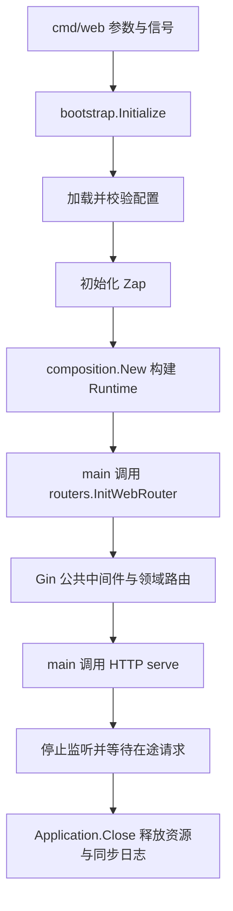

# Go 后端启动、路由与请求处理基线

本规范以 `moralspace-tennis-backend` 的现行启动和请求处理链路为依据，保留一个健康检查领域，作为 Go 后端框架的最小完整实现。核对日期：2026-11-02；参考项目 HEAD：`df4df9a`。

## 1. 实施范围与技术基线

采用参考项目的 Gin、Viper 和 Zap，以及按业务域组织的路由、Controller、请求 DTO、应用服务、响应 DTO 和统一响应工具。直接依赖版本对齐参考项目：Gin `1.10.1`、Viper `1.20.1`、Zap `1.27.0`；本项目 Go 版本仍以 `go.mod` 为准。

健康检查走完整的公共请求链路。数据库、缓存、支付、AI、后台任务、历史接口迁移和管理后台按实际业务需要接入，不为健康接口初始化这些外部系统。数据库接入继续遵守 [MySQL 基线](../databases/mysql/baseline.md)及 [库表设计规范](../databases/mysql/schema-design.md)。

[应用层结构与开发规范](structure-and-conventions.md)提供参考项目的完整背景；当前项目的实际职责与调用顺序以本文及代码为准。

## 2. 目录与唯一职责

```text
cmd/web/
  main.go                     # 参数、信号、启动顺序、错误与退出码
  server.go                   # 监听、HTTP 运行、停机等待和超时关闭
bootstrap/init.go             # 加载配置、初始化日志、取得业务运行图、资源清理
config/
  config.go                   # 独立 Viper 配置实例、默认值、类型转换和校验
  app.yml                     # 当前环境的应用与 HTTP 配置
routers/web.go                # Gin、中间件、公共前缀、版本组和领域挂载清单
app/
  composition/runtime.go      # Runtime 及业务依赖装配，不执行 I/O
  infrastructure/logging/     # Zap 创建；同步清理由 bootstrap 负责
  shared/
    contracts/                # VersionedRouter 注册契约
    requestmeta/              # 不依赖 Gin 的追踪元信息
  http/
    middleware/               # 请求上下文及 TraceId 响应头、访问日志、异常恢复
    requests/                 # 通用请求绑定与取值
  utils/response/             # 统一 JSON、HTTP 状态与业务错误码
  domains/health/
    routers/                  # 健康端点声明和请求绑定
    controllers/v1/           # 获取请求、转换调用参数、调用用例、交给响应适配
    requests/v1/              # HTTP 请求协议
    services/                 # UseCases、Call、Result 与业务实现
    transport/                # Gin 上下文转换为业务调用信息
    responses/v1/             # 业务结果投影为对外 DTO
```

这些包承担的是不同职责。新增业务归入 `app/domains/<domain>`，需要持久化时再补该域的 `models`、`ports`、`infrastructure/persistence`；无实际用途的仓储、模型和外部客户端不创建。

| 位置 | 负责 | 边界 |
| --- | --- | --- |
| `cmd/web/main.go` | 先解析参数，建立信号上下文，依次调用初始化、路由构建、HTTP 运行和资源清理 | 不声明业务端点，不实现业务流程；仅此入口决定进程退出码 |
| `bootstrap` | 加载并校验配置、创建日志、调用 `composition.New`，返回 Application | 不导入路由包，不创建 Controller/Router，不监听端口；失败向入口返回错误 |
| `composition` | 创建共享的业务 Service，形成 Runtime | 构造过程不读配置、不取连接、不查询数据库、不启动任务；没有 HTTP 适配对象 |
| 主路由 `routers` | 创建 Gin，安装公共中间件，建立前缀与版本组，维护领域 Router 清单 | 使用已有 Runtime；不重新创建业务 Service 或初始化资源 |
| 领域 Router | 创建注入 Service 的 Controller，绑定请求 DTO，声明本域 URL 和 HTTP 方法 | 不通过默认全局对象取服务，不执行用例，不写响应 |
| Controller | 读取已绑定请求，调用 transport 与 UseCases，把结果交给响应层 | 不直接查询数据库，不承担业务权限和状态迁移，不直接序列化 JSON |
| Service | 检查业务规则、组织用例、返回业务结果 | 不导入 Gin 或 HTTP DTO，不带 HTTP 绑定/JSON 标签 |
| Responses | 明确对外字段与错误语义，调用公共响应工具 | 不直接输出完整内部模型，不执行用例 |
| `cmd/web/server.go` | 打开监听、运行 HTTP、等待已接受请求、按超时关闭 | 不初始化资源、不注册路由、不处理具体业务 |

## 3. 启动、依赖与关闭顺序



`bootstrap.Application` 持有配置、Logger 和 Runtime，交由入口显式传递。`Runtime` 只持有业务服务；Controller 使用构造器注入 `UseCases`，多个路由入口复用同一实例。这个注入方式对应 tennis 的 `WithService` 构造路径，避免复制其全局 `Install/Default` 访问方式。

依赖方向为：`main → bootstrap / routers`；`bootstrap → config / logging / composition`；`routers → composition / 领域 routers / 公共 HTTP 设施`；`领域 routers → controllers → services`，Controller 同时依赖 requests、transport 和 responses。业务服务和 DTO 不反向依赖启动或装配包。

运行配置通过 `-config` 显式选择，默认 `config/app.yml`；`-addr` 可以覆盖监听地址，覆盖后仍须校验。配置按进程固定，更换环境通过指定配置文件并重新启动。读取配置使用独立 Viper 实例，避免参考项目旧缓存及全局配置监听带来的实例间影响。

命令行参数在初始化前解析，因此帮助命令不加载应用资源。配置、日志或路由构建失败时向入口返回错误；初始化模块不能调用 `log.Fatal` 或 `os.Exit` 跳过清理。

收到 SIGINT/SIGTERM 时，先关闭 HTTP 入口并等待已接受请求，在独立的超时上下文中执行 Shutdown。超时后强制关闭连接并返回错误；HTTP 收尾完成后再释放应用资源，日志最后同步。初始化后监听失败也经过相同资源清理。未来接入 Worker 或数据库时，把停止接收、任务排空、连接释放明确插入这个顺序，不能仅登记无序清理回调。

## 4. 路由与请求闭环

主路由采用 `gin.New()`，按顺序安装访问日志、异常恢复、请求上下文。日志在后续处理返回后记录最终状态，恢复器覆盖上下文校验和业务调用；追踪信息在参数绑定之前建立。这样，追踪头校验失败也能进入访问日志，成功、参数失败、404、405 和恢复后的 500 都能关联请求。

主路由维护 `[]contracts.VersionedRouter` 并统一调用 `RegisterV1Routes(*gin.RouterGroup)`。领域只声明组内端点，公共业务前缀来自配置，版本组由主路由确定。健康的公共地址和 V1 地址使用同一控制器与用例。

```text
HTTP 请求
  → 访问日志 / 异常恢复包围后续处理
  → 请求上下文（读取或生成 TraceId）
  → 领域 Router 绑定并校验请求 DTO
  → Controller 取得请求并调用 transport.Call
  → Service.UseCases 返回 Result
  → 领域 responses 映射对外 DTO
  → utils/response 返回 JSON（TraceId 响应头已由请求上下文中间件设置）
```

追踪元信息放在 `shared/requestmeta`，不依赖 Gin。实际的 `context.Context` 另行从请求传给用例，用于取消和超时；TraceId 不具备取消能力。请求体、令牌和查询字符串不写入公共访问日志。

请求 DTO 与业务 Input 分开。健康接口无业务参数，使用空请求协议说明这一点；其他用例按字段契约绑定和校验。绑定失败必须终止后续调用，不能继续执行业务。

异常恢复记录服务端诊断信息，对外返回固定错误消息。已经开始写出的响应不能再追加另一份 JSON。代理信任范围通过配置显式设置；未配置代理时不信任客户端自报的代理头。

### 健康接口契约

默认前缀为空，提供 `GET /health` 和 `GET /v1/health`，均返回 HTTP 200：

```json
{"code":200,"msg":"Success","data":{"status":"ok"}}
```

成功及错误响应均携带 `TraceId` 响应头。合法的调用方 TraceId 被保留，缺失时生成；非法追踪标识按参数错误拒绝并生成可用追踪标识。健康检查只表示进程能响应请求，不验证数据库或外部系统就绪。

HEAD 显式注册，返回相同状态和响应头、无响应体。启用 Gin 的方法检查，错误方法返回 405 和由实际路由生成的 Allow，未注册路径返回 404；二者使用统一 JSON 错误封装。

| 情况 | HTTP 状态 | 业务 code | data |
| --- | --- | --- | --- |
| 成功 | 200 | 200 | 明确的响应 DTO |
| 参数校验失败 | 200 | -400300 | null |
| 内部错误或未处理 panic | 500 | -500100 | null |
| 未注册路径 | 404 | 404 | null |
| 方法不支持 | 405 | 405 | null |

成功、参数和内部错误编码沿用 tennis；404、405 明确作为框架错误。HTTP 状态与业务 code 各有语义，调用方不能只凭 HTTP 200 判断业务成功。

## 5. 扩展与验证

| 变化 | 应修改的位置 |
| --- | --- |
| 已有领域新增接口 | 该域 requests、services、controller、responses 及领域 Router；需要外部能力时扩展依赖注入 |
| 新增业务域 | 新领域包、Runtime 服务字段及构造、主路由的领域挂载清单；无需改进程监听和清理实现 |
| 新增基础资源 | 在 infrastructure 实现，在 bootstrap 初始化并处理失败清理，通过 composition 注入服务 |
| 新增公共 HTTP 能力 | 在公共 middleware 实现，由主路由统一安装 |

新增领域的两个入口是业务服务装配 `composition.New` 和 HTTP 挂载 `routers`。`bootstrap` 不维护路由清单，路由层不初始化数据库或业务 Service。

验证覆盖完整路由与响应、TraceId、参数失败短路、错误恢复与日志、业务上下文传递、配置失败、监听失败、在途请求收尾和停机超时。使用真实 HTTP 客户端验证 HEAD 无响应体；离线替代服务验证异常分支。数据库和远程系统尚未接入，不把这些验证当作它们的就绪证明。

## 6. 与参考项目的对应关系

| tennis 依据 | 当前实现 |
| --- | --- |
| `cmd/web/main.go` 的显式启动与 serve | `cmd/web/main.go`、`server.go`；保留顺序，增加有界停机 |
| `bootstrap/init.go`、Viper 配置与 Zap 工厂 | `bootstrap`、`config`、`infrastructure/logging`；只初始化实际使用资源 |
| `app/composition/runtime.go` | `composition.Runtime`；使用显式构造器注入服务 |
| `routers/web.go`、`shared/contracts` | 主路由、中间件、公共/版本组与领域注册契约 |
| `domains/news`、`domains/agent` 的 HTTP 适配和用例 | health 的 requests、controllers、transport、services、responses |
| `request_context`、日志、`utils/response` | 追踪、访问日志、统一响应；恢复器也使用统一错误响应 |

参考项目的 Legacy 入口、全局可变注册、敏感请求日志、业务资源及调度器不属于健康接口的依赖。当前实现保留其职责和运行机制，同时明确修正帮助命令触发初始化、初始化直接退出、无限等待以及恢复器响应不统一等历史问题。
