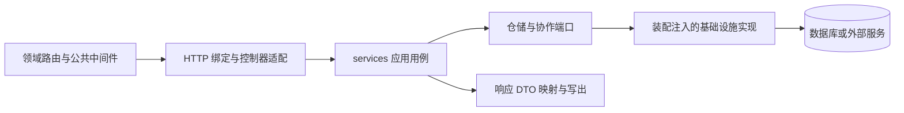

# 应用层结构与开发规范

本文参考 `GolandProjects/moralspace-tennis-backend` 的现行代码、编码约定和架构边界测试，提炼 Go 后端应用代码的组织方式与开发规范，作为新项目建设和代码评审的参考。

核对日期：2026-11-02。参考项目 HEAD：`df4df9a`；内容以核对时的本地代码为准。本文只总结结构与通用约定，不要求复制参考项目的具体业务、历史接口或全部目录。

## 1. 应用层定位与组织原则

本文的“应用层”泛指 `app/` 下的业务模块、HTTP 适配、依赖装配及配套基础设施；其中，狭义的应用用例主要由 `app/domains/<domain>/services` 承担。

参考项目采用按业务域组织的模块化单体，例如 `user`、`order`、`community`、`notification`、`mall`。一个业务域是代码模块，不自动等于独立部署的服务，也不自动对应一个业务库。服务与数据库的关系按 [MySQL 库表设计规范](../databases/mysql/schema-design.md)确定，不能直接从领域目录推导。

基本原则如下：

- **先按业务归属组织，再在域内分层。** 新业务进入所属 `domains/<domain>`，避免把所有控制器、服务和模型分别堆在全局目录中。
- **HTTP 与业务用例分离。** HTTP 入口处理协议，用例处理权限、状态、幂等和业务协作。
- **数据、接口与实现分离。** `models` 保存数据和本地规则，`ports` 声明能力，基础设施实现数据库及外部协议访问。
- **依赖显式装配。** 仓储、客户端、时钟及任务执行能力通过构造器、接口或函数注入，方便替换和验证。
- **按实际需要增加结构。** 不预建空目录、空 Service、无人调用的接口或装配字段；小模块可以少量文件起步。

参考项目仍保留跨域数据类型、部分默认依赖和兼容门面，不应将其描述为已经实现严格的 DDD 或完全隔离的微服务架构。

## 2. 总体目录

以下为参考项目的主要组织方式，省略具体业务和部署文件：

```text
.
├── cmd/                         # Web、Worker、批处理等进程入口
├── bootstrap/                   # 显式初始化配置、连接、客户端和应用依赖
├── routers/                     # 全局中间件、公共前缀及领域路由挂载
├── app/
│   ├── domains/<domain>/        # 按业务域组织的完整模块
│   ├── composition/             # 应用依赖图、共享服务实例和任务注册
│   ├── http/middleware/         # 公共鉴权、追踪、跨域等 HTTP 设施
│   ├── infrastructure/          # 数据库管理、存储、媒体等共享适配器
│   ├── providers/               # 已有第三方服务适配，如 tennis_ai
│   ├── shared/                  # 共享数据、端口辅助、事务及请求元信息
│   ├── core/                    # 容器、事件管理、退出清理等通用机制
│   ├── global/                  # 已有常量、错误、配置及日志等全局对象
│   └── utils/                   # 日志、响应、ID、配置等通用工具
├── database/                    # 按业务归属管理的 SQL 迁移
└── internal/
    ├── architecture/            # 导入、分层和装配边界测试
    ├── legacycontract/          # 历史接口契约保护
    └── testsupport/             # 公共测试支持
```

领域专属的支付、通知或业务客户端优先放入对应领域；多个领域实际复用的外部能力再进入共享基础设施。参考项目同时存在 `providers` 和 `infrastructure`，新增适配器应沿用相邻实现的归属，不为同一能力重复建立目录或客户端。

`shared`、`utils` 和 `global` 必须有清楚的共享理由。订单履约、用户权益、通知发送等业务逻辑仍归对应领域，不能因被多个调用方使用就移入通用工具包。

## 3. 单个业务域的结构与职责

```text
app/domains/<domain>/
├── routers/router.go                 # 领域 HTTP 路由与绑定入口
├── controllers/v1/*_controller.go     # 调用用例并衔接请求、响应适配
├── requests/v1/*_req.go               # HTTP 请求字段、格式及绑定规则
├── responses/v1/                     # 对外响应 DTO、结果映射和写出
├── transport/http.go                 # HTTP 身份、追踪及调用信息转换
├── services/
│   ├── service.go                    # Service、用例接口及构造器等
│   ├── inputs.go                     # 用例输入较多时单独定义
│   ├── *_use_cases.go                # 按发布、查询等业务拆分用例
│   ├── repository_dependencies.go    # 仓储接口或仓储工厂依赖
│   └── operation_dependencies.go     # 跨域及外部操作依赖，按需设置
├── ports/                            # 仓储和协作能力的接口
├── models/                           # 数据结构、映射及本地规则
├── enums/                            # 领域枚举，按需设置
├── infrastructure/
│   ├── persistence/                  # 仓储实现、SQL 及事务内数据操作
│   └── ...                           # 本域外部协议和跨域适配器
├── wiring/                           # 本域具体依赖装配，按需设置
└── application/                      # 已有查询组装及协作，按需保留
```

这是一组职责位置，不是必须全部创建的目录清单。`rules`、`services/entitlements` 等子目录可在业务规模需要时增加。

| 位置 | 负责什么 | 必须维护的边界 |
| --- | --- | --- |
| HTTP 适配：routers、controllers、requests、responses、transport | 路由、绑定、格式校验、身份转换、输入输出映射 | 不执行 SQL，不编排扣费、履约、AI 等业务流程 |
| services | 业务权限、幂等、状态转换、事务和协作顺序 | 不依赖 Gin 或 HTTP 请求响应 DTO，不直接执行数据库查询或更新 |
| models | 字段、JSON/GORM 映射、表名、纯转换和本地校验 | 不持有数据库连接，不执行 SQL、远程调用或服务编排 |
| ports | 声明用例所需的仓储和协作能力 | 不依赖具体基础设施或 HTTP 实现，不暴露任意查询的通用入口 |
| infrastructure/persistence | 实现仓储、绑定模型或表、执行查询与写入 | 接收显式连接，遵守调用方的事务及错误契约 |
| application | 复用已有查询展开、权益计算、履约等协作 | 依赖数据和端口，不反向依赖基础设施或 HTTP |
| wiring、composition | 把具体实现注入服务，管理实例 | 不承载业务判断，不在构造依赖图时执行 I/O |

**`services` 与 `application` 的区别：** 参考项目的 `services` 已经是主要应用用例层。`application` 保存从模型移出的查询展开、余额计算、购买履约等已有协作，不是每个用例都必须再经过的一层。新增代码默认沿用 `services`，不要建立两套职责重叠的业务层。

## 4. 请求链路与输入输出规范

### 4.1 典型调用链路



图中表示运行时调用关系。源码中是基础设施实现端口，再由装配层注入；不要求端口反向导入实现。CLI、Worker 和调度任务也应复用应用服务，而不是经由 HTTP 控制器调用业务。

### 4.2 请求、身份与用例输入

- Request DTO 定义 `json`、`form`、`binding` 等协议信息，负责必填、长度、格式和基础范围校验；服务 Input 与 HTTP DTO 分开，通过明确的字段映射转换。
- 操作者身份来自已经验证的登录上下文，不信任请求体中自报的用户或角色。目标用户、资源所有者等业务参数与操作者身份分别表达。
- `transport` 将 HTTP claims、追踪信息、客户端信息等转换为服务调用参数。登录校验不能替代资源归属、可见性、状态及业务权限检查。
- 参考项目部分鉴权中间件主要解析 Token，不自动拒绝所有匿名请求。每个用例必须明确公开策略和授权要求，不能把这一历史行为当作完整的访问控制。
- 新增 HTTP 入口优先集中绑定和响应写出。存量领域存在控制器直接绑定的回退方式；`agent`、`video_gen`、`mall` 已有更严格的边界测试，禁止控制器直接绑定或调用 `JSON`。

### 4.3 服务契约与响应

参考项目较多领域采用以下形式：

| 契约 | 含义 |
| --- | --- |
| `UseCases` | 控制器依赖的业务用例接口，便于替换测试实现 |
| `Actor` | 用户、账号、角色等调用身份 |
| `Call` | Actor、追踪和客户端信息等本次调用参数 |
| `<Action>Input` | 与 HTTP 字段标签分离的用例输入 |
| `Result` | 业务码、消息和业务数据，由响应层转换为对外协议 |

这些名称是常见模式，不是全领域统一签名。`video_gen` 等领域使用 `context.Context`、类型化结果和错误；新增或修改代码应沿用目标领域已有模式，避免为形式统一重写接口。

`shared/requestmeta.RequestContext` 是追踪、请求头和开始时间等元信息，不等于 Go 的 `context.Context`。需要取消、超时或停机传递时，应使用实际的 `context.Context`，不能假定追踪结构已经提供这些能力。

对外响应由 `responses` 映射，并复用 `{code, msg, data}` 等已有封装。HTTP 状态与业务码分别按契约处理，不能直接假设二者相等。ID 字符串、字段缺省、NULL、空数组、分页与时间格式都属于接口契约；新增详情显式选择允许展示的字段，不直接返回完整持久化对象、内部载荷或底层错误。

## 5. 依赖注入、装配与生命周期

### 5.1 仓储和外部能力

- 仓储实现接收显式连接，例如 `NewPostRepository(db)`；连接由启动和装配层选择，不由模型或仓储自行读取全局连接。
- 服务可接收仓储接口，也可通过 `RepositoryDependencies` 接收 `func() ports.XRepository` 工厂。工厂在业务真正需要时解析连接并构造仓储。
- 本域 `wiring` 负责组装具体仓储；`composition` 负责组合各域服务及共享能力。时钟、通知、AI、内容审核和异步执行等依赖，可按需要使用小接口或函数注入。
- 权限和参数校验应在必要的数据访问之前完成；无须访问数据库即可拒绝的请求，不提前调用仓储工厂。
- 参考项目部分服务默认依赖文件仍导入基础设施。这不表示业务方法可以绕过端口执行 SQL，也不应将“所有 services 一律禁止导入 infrastructure”写成其现有全局规则。新装配优先集中在 `wiring` 和 `composition`。

### 5.2 启动、共享实例和退出

参考项目通过进程入口显式调用 `bootstrap.Initialize()`：读取配置、初始化日志和数据库管理器、检查连接及外部依赖，再调用 `composition.New` 构建依赖图、`Install` 发布共享实例。

1. 构造 Service 或应用依赖图时，不取数据库连接、不执行 SQL、不调用远程服务、不启动 goroutine。
2. `composition.Default()` 读取已安装的应用图，不隐式初始化。控制器生产构造使用该图，测试通过 `WithService` 等构造器注入替代实现。
3. 具有会话、计时器或在途任务的服务按进程共享，不能每个请求重建。业务注册采用显式调用，不使用 `init()` 隐式安装运行时依赖。
4. `StartTasks()` 在参考项目中负责注册任务；是否启动调度器由进程入口决定，不能把注册和执行混为一谈。
5. 进程入口负责停止接收请求、等待应完成的工作，再释放连接和日志等资源。停机清理与依赖图构造分别管理。

## 6. 数据访问、跨域协作与事务

### 6.1 数据访问边界

数据库查询与更新放在 `infrastructure/persistence`。服务不能直接调用 `Where`、`Raw`、`Exec`、`Updates` 等操作；模型不嵌入带连接的 `BaseModel`，也不提供数据库访问方法。

仓储接口按业务对象和操作表达，例如 `PostRepository`、`FindById`、条件状态更新。不要向业务层提供可任意更新所有状态的通用 `Save` 或通用查询语法，以绕过用例检查。查询、计数和更新必须正确绑定目标模型或表，区分“记录不存在”和“执行失败”，向上传递错误时保留可诊断的底层原因。

GORM 标签用于映射，不能代替数据库设计和迁移。字段类型、主键、时间语义及索引按 [MySQL 基线](../databases/mysql/baseline.md)和 [库表设计规范](../databases/mysql/schema-design.md)执行；生产启动不自动执行建表或结构变更。

### 6.2 跨域协作

用户权益、订单履约、通知和资源查询等能力由所属领域维护。调用方通过明确的操作端口、应用接口或已注入的依赖复用，不复制规则，不通过其他领域的控制器协作。

已有 `application` 可以组合多个领域的数据和端口，例如组装动态作者、活动参与者，或在购买履约时更新用户权益。跨域数据类型引用并未被全面禁止；重点是明确数据归属和调用契约，避免隐藏的数据访问及循环依赖。需要改变联合查询或聚合边界时，单独评估语义和性能。

### 6.3 事务所有权

参考项目多数存量流程使用 `app/shared/transaction` 显式表达事务所有者：用例调用 `Begin`，通过 `Borrow()` 把同一个 `*gorm.DB` 交给仓储、权益或履约协作者，再由所有者提交或回滚。

- 借用方不得另取连接、隐式开启嵌套事务，或自行提交调用方的事务；事务内读写必须使用收到的同一个句柄。
- 开启、读写和提交分别检查错误。存量接口中的 `false, nil`、零 ID 等也可能代表失败，不能只检查 `err`。
- `Owned` 只标明所有权，不自动回滚、重试、建立保存点或执行提交后任务；所有退出分支都必须明确收尾。
- `mall` 已有基于 `ports.Store.Transaction` 回调的事务契约。因此不要求所有领域暴露 GORM 句柄，也不为统一外观重写现有事务。
- 跨库本地事务按数据库专题的受控入口、连接权限和同一事务要求执行。两个连接各自开启事务，或调用另一个服务的 HTTP 接口，不能形成同一个本地事务。

并发写入按业务使用唯一键、锁、条件更新和幂等结果。请求 ID 不能代替数据库唯一约束及余额、状态的并发保护；提交报错时还需考虑结果不确定，通过幂等核对或重试确认。

### 6.4 外部副作用和异步任务

支付、AI、上传和通知的副作用不能由数据库回滚撤销。新流程应避免在数据库事务中等待长耗时远程调用，并明确调用顺序、幂等、失败补偿和重试边界。

通知是在提交前、提交后还是响应后执行，必须由具体用例定义和测试保护，不能因目录调整而改变。异步任务应显式传入所需数据和依赖，在任务内取得所需仓储，不沿用已结束的请求事务或 Gin 上下文。

可靠性按业务需要设计：明确任务状态、重启恢复、重试和多副本协调。参考项目部分领域已有持久化任务，但不能据此认定全项目都有统一的 Outbox 或分布式事务机制，也不要求所有流程统一增加消息队列。

## 7. 命名、兼容与日常开发

- 文件名默认使用小写下划线，如 `post_publish_use_cases.go`、`repository_dependencies.go`；优先扩展对应职责的现有文件，再按业务规模拆分。
- `service.go` 保存服务及调用契约；输入多时拆为 `inputs.go`；仓储接口集合可用 `repositories.go`，单独仓储文件也可沿用 `article_repository.go` 等命名。
- 构造器采用 `NewXRepository`、`NewServiceWithRepositories` 等清楚表达依赖的名称。字段、方法和导入别名沿用目标模块约定，不在无关改动中批量统一 `Id/ID` 等历史差异。
- Go 文件使用 `gofmt`。注释优先解释业务原因、权限边界和特殊语义，不逐行翻译实现。
- 新旧 HTTP 入口复用业务服务，各自维护请求、响应与校验。URL 由路由显式声明，不因目录名或 `v1` 目录而自行改动地址或版本。
- `app/model`、`app/service`、`app/sal` 及旧 HTTP 目录主要保留兼容适配，新业务不回流这些旧实现；`app/service/scheduler` 是仍承担通用调度职责的明确例外。
- 兼容门面只做必要转换和转发，不复制业务判断。旧 DTO 不能随意别名到持续变化的新模型；退出兼容入口前先确认调用方迁移及契约回归。

## 8. 开发与验证流程

新增或修改业务时，先明确所属领域、接口契约、权限、状态和一致性要求，再补充 Input、用例、端口与实现，最后接入装配和 HTTP 或任务入口。跨域、事务和异步顺序应在实现前明确，不靠目录拆分自动获得一致性。

| 变更类型 | 应完成的验证 |
| --- | --- |
| 仅文档或文件改名 | 内容、引用、格式和差异检查，无须新增业务测试 |
| 模型、仓储、用例 | 受影响包回归；按需覆盖权限、状态、失败路径、映射和序列化 |
| 分层或依赖装配 | 架构边界、无需数据库构建依赖图、实例隔离与共享行为 |
| HTTP 与兼容接口 | 路由、鉴权、状态码、ID 类型、NULL/空数组及新旧协议对照 |
| 事务与并发 | 同一事务传递、失败回滚、重复请求及并发状态竞争；必要时在隔离 MySQL 验证 |
| 异步与外部协作 | 通知时序、失败重试、恢复和停机行为；普通测试使用可替换依赖 |

参考项目用同目录 `*_test.go` 测试具体行为，用 `internal/architecture` 防止边界回退，用 `internal/legacycontract` 和 `routers` 测试保护历史 HTTP 契约。新项目按实际功能建立对应检查，不照搬无关业务夹具。

接口变更同步更新对应说明、Swagger 注释及生成产物，并核对生成范围确实覆盖目标控制器。数据库变更采用受版本管理的独立增量脚本；离线测试通过不等于真实 MySQL 的锁、迁移或外部平台联调已经通过。

## 9. 参考依据

以下路径均相对于 `moralspace-tennis-backend` 根目录，便于后续核对。架构说明含历史阶段，具体实现优先结合现行代码和边界测试判断，不沿用过时的目录数量、启动顺序或测试统计。

| 资料或实现 | 主要参考内容 |
| --- | --- |
| `docs/project_coding_style.md` | 文件职责、模型边界、装配、事务、HTTP 和验证约定 |
| `docs/current_architecture.md` | 模块化单体、按域组织及兼容迁移背景 |
| `docs/data_access_and_domain_boundaries.md` | 模型与连接解耦、仓储端口、application 协作 |
| `docs/service_consolidation_and_composition.md` | 服务归属、显式初始化、共享实例及事务所有权 |
| `app/domains/community/{services,wiring,application}` | UseCases、独立 Input、仓储工厂及查询组装 |
| `app/domains/agent/{controllers,requests,responses,transport}` | 集中请求响应适配与较薄控制器 |
| `app/domains/video_gen/services/service.go`、`app/domains/mall/services/service.go` | context、类型化结果及不同事务契约的实例 |
| `app/composition/runtime.go`、`bootstrap/init.go` | 当前依赖图、安装、初始化和任务注册 |
| `app/shared/transaction/transaction.go`、`app/shared/requestmeta/context.go` | 事务所有权与请求元信息的真实能力范围 |
| `internal/architecture/{data,service,agent}_boundaries_test.go` | 数据、用例、兼容及部分领域的更严格边界 |
| `internal/legacycontract/`、`routers/` 中的测试 | 历史协议和路由兼容保护 |
