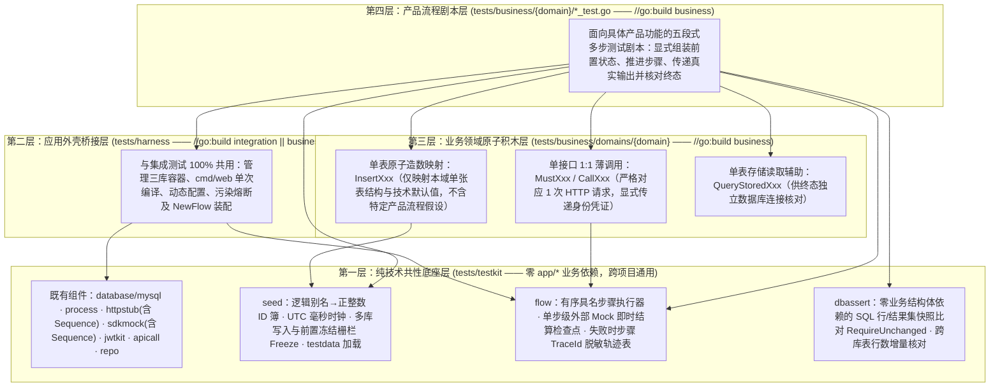

# 业务测试规范与方案

本文统一规定本仓库**业务测试的目标定位、共性与业务代码的分层解耦边界、目录组织映射、跨领域前置数据构造准则、单接口动作封装红线、五段式流程剧本规范及运行维护要求**，作为测试基础设施演进与各产品流程业务测试编写的唯一准则。

---

## 1. 目的、定位与三类测试分工

**业务测试验证多个接口组合起来能否完成一个产品层面的用例或功能。** 用例从产品前置条件出发，经真实 HTTP 接口推进状态，验证各步骤之间的数据衔接、权限隔离、外部交互与最终跨库持久化结果。

本项目统一采用以下三级测试体系：

| 类型 | 验证对象 | 构建标签 | 规范文档 |
| --- | --- | --- | --- |
| **单元测试** | 无外部依赖的纯函数、领域规则、值转换与小型内存组件 | 无（默认 `go test ./...`） | [单元测试规范](unit-test.md) |
| **集成测试** | **单个 HTTP 接口**在不同入参、身份、存储状态与下游响应下的完整执行分支矩阵 | `//go:build integration` | [集成测试规范与方案](integration-test.md) |
| **业务测试** | **多个 HTTP 接口**协同完成的产品功能流程、跨步骤真实输出传递与跨领域数据一致性 | `//go:build business` | 本文 |

**核心边界判定准则**：
1. **不按请求次数机械划分**：同一接口的重复提交、单接口连续分页或并发竞争，仍属于单接口行为，归入[集成测试](integration-test.md)；当它们作为多接口产品旅程中的一环出现时，可作为业务测试的步骤。
2. **互补而非替代**：业务测试聚焦产品主流程与产生**不同产品结果**的关键业务分支，不重复穷举单个接口的参数校验边界。多个接口各自通过集成测试，不能证明接口间状态衔接无误；业务测试通过，也不能替代单接口的边界覆盖。

---

## 2. 架构分层：共性能力与具体业务的严格解耦

为确保工程模板具备跨项目可移植性，同时防止测试辅助代码退化为耦合特定产品诉求的“上帝构建器（God Builder）”，业务测试按**是否依赖具体业务概念**自下而上划分为四层：



### 2.1 分层职责红线表

检验代码放对层级的唯一标准：**若删除 `app/domains/*` 与 `database/*` 中的所有示例业务域并替换为全新业务项目，`tests/testkit` 与 `tests/harness` 必须无需改动业务逻辑即可通过编译并正常工作。**

| 层级 | 目录路径 | 业务耦合度 | 允许包含的内容 | 严禁出现的内容 |
| --- | --- | --- | --- | --- |
| **第一层：共性底座** | `tests/testkit/` | **0% 业务相关** | 容器管理、进程托管、HTTP/SDK 协议模拟及顺序响应队列、JWT 签发、脱敏断言、命名 ID 分配簿、测试时钟、写库冻结栅栏、步骤执行与轨迹引擎、通用 SQL 快照与行数对比 | 禁止 `import` 任何 `app/*`、`bootstrap`、`routers`、`cmd/*`；禁止出现任何领域名、表名、业务路由或供应商名 |
| **第二层：外壳桥接** | `tests/harness/` | **仅绑定启动外壳** | 复用单进程启动参数、动态生成 `test.yml`、`Suite`（`Shared` 共享 / `Isolated` 独占）、JWT Claims 封装、`NewFlow` 桥接 | 禁止感知具体有哪些业务域、数据库表结构或 HTTP 业务接口 |
| **第三层：领域积木** | `tests/business/domains/<domain>/` | **绑定所属业务域单表与单接口** | 本域单张表的 `Insert<Table>` 插入映射、本域单个路由的 `Call<Endpoint>` / `Must<Endpoint>` 1:1 薄封装、本域表行直查函数 | 禁止封装跨多接口的黑盒流程函数（如 `RegisterAndUpdate`）；禁止堆砌耦合特定测试剧情的复合大对象（如 `InsertUserWithTwoOrdersAndThreePosts`） |
| **第四层：产品剧本** | `tests/business/<domain>/` | **100% 产品流程相关** | 面向产品用例的多步骤流程测试文件与本域静态 `testdata/*.json` 数据模板 | 禁止绕过 HTTP 接口直接调用业务 `Service` 或在步骤中途直接写库伪造流程中间态 |

### 2.2 外部依赖与运行边界（与集成测试完全一致）

1. **真实 HTTP 协议入口**：所有业务步骤均通过宿主机回环网络向真实 `cmd/web` 子进程发起 HTTP 请求，完整经过路由、中间件、认证、Validator、Controller、Service、Repository、事务与真实 MySQL 8.4 容器。
2. **双轨外部依赖模拟**：
   - **公司内部 HTTP 服务**：保留真实 Company Client（含超时、连接池、`TraceId`/`traceparent` 传播与结构化日志），通过配置指向 `httpstub.Server`；
   - **第三方供应商 SDK**：在 `//go:build integration_app` 启动装配边界将底层网络往返委托给 `sdkmock.Controller`，保留客户端入参校验、Tracing Span 与日志生命周期；
   - **默认拒绝未声明调用**：任何步骤触发未显式声明的内部服务路由或第三方 SDK 方法，立即判定该步骤失败。
3. **边界声明**：模拟服务与 SDK Mock 用于验证本服务在多步骤业务流转中对外部依赖参数拼装与结果处理的正确性，不能替代真实跨服务联调与第三方供应商线上兼容性验收。

---

## 3. 目录结构与文件命名规范

```text
tests/
├── testkit/                                      # 共性基础设施（与集成测试共享）
│   ├── seed/                                     #   前置数据会话（命名 ID、UTC 毫秒时钟、Freeze 栅栏、JSON 加载）
│   ├── flow/                                     #   多步流程执行器、单步 Mock 结算与步骤轨迹表
│   ├── dbassert/                                 #   通用 SQL 行快照零变更比对与多库表行数增量断言
│   └── (apicall, database/mysql, httpstub, jwtkit, process, repo, sdkmock)
├── harness/                                      # 应用外壳桥接（//go:build integration || business）
└── business/                                     # 业务测试根目录（全部标记 //go:build business）
    ├── domains/                                  # 各业务域可复用的单表/单接口原子积木
    │   ├── userdom/                              #   user 域单表插入、8 个接口 1:1 薄调用及单表直查
    │   ├── orderdom/                             #   order 域单表插入及直查
    │   └── postdom/                              #   post 域单表插入及直查
    └── user/                                     # 按发起流程的主业务域分包
        ├── main_test.go                          #   包级 Suite 生命周期入口（固定约 15 行）
        ├── testdata/                             #   本域大型静态前置数据或协议响应模板
        ├── register_and_set_generated_avatar_test.go
        └── inspect_cross_domain_membership_lifecycle_test.go
```

1. **独立构建标签**：业务测试源码统一使用 `//go:build business`，绝不同时声明 `integration`，确保单元测试、集成测试、业务测试三类命令严格独立筛选。
2. **主域归属原则**：跨多个业务域协作的产品流程，放入**发起该产品动作的主业务域目录**（如用户个人中心发起的资料与权益流程归入 `tests/business/user/`；由会员下单与支付回调驱动的跨库履约流程归入 `tests/business/order/`）。
3. **命名表达产品行为**：测试文件采用 `<product_use_case>_test.go`（`snake_case`），顶层测试函数命名为 `Test<ProductUseCase>`（如 `TestRegisterAndSetGeneratedAvatar`）；同一产品流程下的主路径与关键业务分支使用带两位序号的 `t.Run("01_<variant>", ...)` 组织，每条子用例均能独立运行。

---

## 4. 业务测试五大编写规范

### 4.1 规范一：跨领域前置数据（Fixture）构造规范

1. **只造存量起点，硬性封存禁造中间态**：
   - 所有前置存量数据通过 `sd := seed.New(t, env.DB)` 会话调用各领域单表 `InsertXxx` 写入真实数据库；
   - 在发起第 1 个业务 HTTP 请求前**必须调用 `sd.Freeze()`**（`flow.Runner` 绑定 `sd` 后亦会在首个 `Step` 启动前自动校验封存）。一旦封存，任何测试代码若试图在步骤中途通过 `sd.Exec` 直接篡改数据库伪造中间状态，立即 `Fatalf` 报错终止。
2. **告别裸魔法数字与精度漂移**：
   - 跨库跨表关联的主外键统一通过 `sd.ID("domain:alias")`（如 `sd.ID("user:alice")`、`sd.ID("order:first")`）分配确定性正整数标识，使跨表引用关系在代码字面上自解释；
   - 存量记录时间统一使用 `sd.Time(offset)` 生成，自动截断至 `UTC` 毫秒精度以严格对齐 MySQL `DATETIME(3)` 列定义。
3. **跨领域组合保持透明**：
   - 当用例需要复杂跨库前置状态（例如同时存在 `order_service.membership_order` 已履约订单、`user_service.membership_change_record` 变更流水与 `user_service.user_membership` 生效快照）时，在用例 `[1. 前置存量状态]` 段落用上述命名 ID 显式拼装各域单表 `InsertXxx`，让外键闭环与状态假设一目了然；
   - 超长文本、批量历史流水模板或大型外部报文放入 `testdata/*.json`，使用 `seed.LoadJSON[T]` 读取后再绑定动态分配的 ID 与时间戳落库。

### 4.2 规范二：领域单接口动作封装（Domain Action）红线规范

`tests/business/domains/<domain>/api.go` 旨在消除多步骤流程中重复手写 URL 路径与 JSON 样板的噪音，编写时必须严守**「三不红线」**：

1. **不串联多接口**：每个动作函数**严格只发送 1 次 HTTP 请求**，严禁在辅助函数内部组合调用两个及以上接口、严禁自动重试或替调用方隐式拉取前置版本号。
2. **不隐藏调用身份**：函数签名必须显式接收请求选项 `opts ...apicall.Option`（如 `apicall.WithBearerToken(issuedToken)`），使剧本正文清楚展示每一步是由匿名访客、新注册成员还是内部管理服务发起。
3. **不吞没错误分支能力**：按用途成对提供：
   - `Must<Action>(s *flow.Step, req ...) RespData`：断言 HTTP `200` 且业务信封成功，直接返回强类型 `data`，用于正常推进步骤；
   - `Call<Action>(s *flow.Step, req ...) *apicall.Response`：原样返回响应快照，供异常分支配合 `apicall.RequireError` 断言 `4xx`/`5xx` 状态码与 `business_code`。

### 4.3 规范三：跨步骤真实输出交接规范

后续步骤必须严格消费前序步骤的**真实接口输出**，并在交接前先断言前序输出符合契约：

| 交接要素 | 强制要求 |
| --- | --- |
| **业务实体 ID** | 使用创建或查询接口实际返回的雪花 ID（如 `created.UserProfile.ID`），严禁猜测发号序列 |
| **认证凭证** | 流程包含注册或登录签发时，后续步骤必须使用响应实际返回的 `access_token`；仅存量前置角色才由 `env.Auth` 签发初始凭证 |
| **乐观锁版本与游标** | 更新资料使用前序创建/查询返回的真实 `version`；连续翻页使用上一页响应返回的真实不透明 `next_page_token`，绝不手工伪造编码 |
| **下游生成产物** | 如将 `generateUserAvatar` 实际返回的 `avatar_url` 原样传入后续 `updateUserProfile` |
| **关键前置熔断** | 前序步骤一旦失败（断言未过或非预期错误），`flow.Runner` 立即中止当前流程，不拿零值变量继续执行后续步骤制造连锁噪音 |

### 4.4 规范四：单条流程剧本「五段式结构」与单步 Mock 结算规范

每个业务测试文件及子用例统一遵循以下**五段式视觉结构**：

1. **文件头产品说明书**：声明主业务域、涉及数据库表、按执行顺序列出参与的 HTTP 路由清单、以及主流程与分支变体的对照总览表。
2. **`[1. 前置存量状态（Given State）]`**：通过 `seed.Session` 装载流程开始前已存在的跨领域记录并执行 `sd.Freeze()`；对需要证明“全程未被波及”的背景记录或表行数，使用 `dbassert.CaptureSingleRow` / `dbassert.CaptureCounts` 拍下初始基线。
3. **`[2. 跨步骤流转变量（Flow Handoff State）]`**：用一组 `var (...)` 集中声明跨步骤传递的真实业务输出变量，直观呈现整条链路的数据依赖图。
4. **`[3. 有序产品步骤推进（Ordered Steps）]`**：
   - 使用 `fl.Step("01_<action_and_intent>", func(s *flow.Step) { ... })` 顺序组织；
   - **单步级外部依赖结算（Step Checkpoint）**：仅在确实需要访问外部依赖的步骤内调用 `s.ExpectSDK(...)` 或 `s.ExpectHTTP(...)`（若单步内对同一依赖按序调用多次且返回不同结果，使用 `sdkmock.Sequence` 或 `httpstub.Sequence`）。**每个 `Step` 闭包结束瞬间，`flow.Runner` 自动校验本步声明的所有规则均已被实际调用，并校验无任何未声明调用，随后立即清空规则**——从而保证外部预期绝不跨步骤串扰，任何步骤的意外出站调用都会在发生的当步精准报错。
5. **`[4. 最终产品可见态与跨库持久化核对（End-State Audit）]`**：
   - **外部接口视角**：从用户本人查询接口和（如适用）后台服务查询接口确认最终产品可见状态；
   - **底层存储视角**：通过独立数据库连接核对目标库表持久化列值、跨表外键关联闭环，以及禁止副作用（如生成预览步骤未改库、对照用户快照零变化、只读流程表行数增量为 `0`）。

**故障诊断输出约定**：当任一步骤失败时，`flow.Runner` 自动输出**脱敏步骤执行轨迹表**（包含从第 1 步至失败步的步骤名、耗时、每次 HTTP 请求的 `Method Path -> StatusCode` 及服务端 `TraceId`，严禁在日志中打印响应 `data` 中的 `access_token` 或密钥）。

### 4.5 规范五：非原子提交边界与超时污染隔离规范

1. **按真实提交边界断言失败终态**：跨多个 HTTP 请求的业务流程不属于同一个数据库事务（甚至单次请求内部也可能存在“先提交用户记录、再签发凭证”的阶段边界）。当流程在第 $K$ 步因下游错误、权限拦截或版本冲突中断时，必须同时核对：
   - 第 $1 \dots K-1$ 步已成功提交的状态仍然真实保留并可查询；
   - 第 $K$ 步及未执行的后续步骤没有写入半成品数据或触发多余的下游调用。
2. **慢请求与超时场景强制独占隔离**：当用例使用 `httpstub.DelayedResponse` 或 `sdkmock.WithDelay` 故意制造请求超时（如触发 `503` 或客户端超时）且服务端内部协程可能尚未完全排空时，**严禁使用 `suite.Shared(t)`**，必须改用 `suite.Isolated(t, ...)` 独占进程环境；断言完成后由框架按「优雅停机排空 `cmd/web` → 关闭模拟桩 → 销毁数据库容器」逆序彻底回收，防止污染后续业务流程。

---

## 5. 标准代码范式示例

以下节选展示共性原语（`seed`、`flow`、`dbassert`）与领域原子积木（`userdom`）如何组装成清晰可审阅的业务流程测试：

```go
func TestRegisterAndSetGeneratedAvatar(t *testing.T) {
	t.Run("01_register_generate_and_apply_avatar", func(t *testing.T) {
		// [产品目标] 新用户注册后持真实签发凭证完成初始查询、AI 头像生成与资料更新，本人端、后台端与数据库三方终态一致。
		env := suite.Shared(t)
		sd := seed.New(t, env.DB)
		fl := harness.NewFlow(t, env, flow.WithSeed(sd))

		// [1. 前置存量状态] 预置无关存量用户作为隔离对照，封存前置写库入口
		userdom.InsertProfile(sd, userdom.ProfileSeed{
			ID:                sd.ID("user:bystander"),
			AccountSource:     "wechat",
			ExternalAccountID: "wx_existing_bystander",
			UserName:          "存量路人甲",
			IsEnabled:         true,
			CreatedAt:         sd.Time(-24 * time.Hour),
		})
		sd.Freeze()

		bystanderSnap := dbassert.CaptureSingleRow(t, env.DB(t, "user"),
			"SELECT user_name, avatar_url, version FROM user_profile WHERE id = ?", sd.ID("user:bystander"))

		// [2. 跨步骤流转变量]
		var (
			createdUserID  int64
			issuedToken    string
			initialVersion int64
			generatedURL   string
			updatedVersion int64
		)

		// [3. 有序产品步骤推进]
		fl.Step("01_register_new_user", func(s *flow.Step) {
			created := userdom.MustCreateUser(s, userdom.CreateUserRequest{
				AccountSource:     "wechat",
				ExternalAccountID: "wx_new_member_001",
				UserName:          "初来乍到的小明",
			})
			createdUserID = created.UserProfile.ID
			issuedToken = created.AccessToken
		})

		fl.Step("02_query_initial_profile_with_issued_token", func(s *flow.Step) {
			initial := userdom.MustQueryProfileByUserID(s, createdUserID, apicall.WithBearerToken(issuedToken))
			initialVersion = initial.Version
		})

		fl.Step("03_generate_avatar_without_mutating_profile", func(s *flow.Step) {
			selfBeforeGen := dbassert.CaptureSingleRow(s.T(), env.DB(s.T(), "user"),
				"SELECT user_name, avatar_url, version FROM user_profile WHERE id = ?", createdUserID)

			qwen := s.ExpectSDK("ai.llm.qwen", "GenerateText", sdkmock.RespondJSON(map[string]any{
				"content": "flat vector portrait of an astronaut shiba inu",
			}))
			imgRoute := s.ExpectHTTP("python-service-template",
				http.MethodPost, "/api/v1/image/imageGen/generateImage",
				httpstub.JSONResponse(http.StatusOK, map[string]any{
					"image_url": "https://cdn.example.com/avatars/shiba-astro.png",
				}),
			)

			gen := userdom.MustGenerateAvatar(s, "宇航员柴犬", apicall.WithBearerToken(issuedToken))
			generatedURL = gen.AvatarURL

			qwen.RequireCallCount(s.T(), 1)
			imgRoute.RequireCallCount(s.T(), 1)
			selfBeforeGen.RequireUnchanged(s.T())
		})

		fl.Step("04_update_own_profile_with_generated_avatar", func(s *flow.Step) {
			updated := userdom.MustUpdateProfile(s, userdom.UpdateProfileRequest{
				UserID:          createdUserID,
				ExpectedVersion: initialVersion,
				UserName:        "太空柴犬小明",
				AvatarURL:       &generatedURL,
			}, apicall.WithBearerToken(issuedToken))
			updatedVersion = updated.Version
		})

		// [4. 最终产品可见态与跨库持久化核对]
		fl.Step("05_verify_end_state_across_member_admin_and_storage", func(s *flow.Step) {
			selfView := userdom.MustQueryProfileByUserID(s, createdUserID, apicall.WithBearerToken(issuedToken))
			adminToken := env.Auth.IssueServiceAdminToken(s.T(), "ops-console")
			adminPage := userdom.MustQueryProfilePage(s, userdom.QueryProfilePageRequest{
				UserName: "太空柴犬小明", PageNumber: 1, PageSize: 10,
			}, apicall.WithBearerToken(adminToken))
			stored := userdom.QueryStoredProfile(s.T(), env, createdUserID)

			if selfView.Version != updatedVersion || adminPage.TotalCount != 1 || stored.Version != 1 {
				s.T().Fatalf("end-state mismatch across member/admin/storage views")
			}
			bystanderSnap.RequireUnchanged(s.T())
		})
	})
}
```

---

## 6. 已覆盖与待演进的产品流程清单

### 6.1 当前已实现流程（`tests/business/user/`）

1. **`TestRegisterAndSetGeneratedAvatar`**（[register_and_set_generated_avatar_test.go](../../tests/business/user/register_and_set_generated_avatar_test.go)）：
   - `01_register_generate_and_apply_avatar`：新用户注册、真实凭证传递、AI 头像生成（含 Qwen→图片服务链路参数衔接及中间态零写库验证）、乐观锁资料更新及本人/后台/DB 三方终态核验；
   - `02_preserve_registered_account_when_avatar_generation_fails`：生成阶段 Qwen 故障中断后，已注册账户保留初始状态且阻断下游图片调用；
   - `03_reject_stale_version_replay_and_keep_latest_profile`：更新成功后重放旧版本被 `409` 拦截，确认线上最新资料不被覆盖；
   - `04_forbid_applying_generated_avatar_to_other_user`：生成头像后试图越权修改存量他人资料被 `403` 拒绝，本人查询、后台批量查询与 DB 快照共同确认双方资料安全隔离；
   - `05_isolate_company_image_timeout_without_polluting_next_flow`：使用 `suite.Isolated` 独立环境验证内部图片服务超时中断后的账户状态与资源安全回收。
2. **`TestInspectCrossDomainMembershipLifecycle`**（[inspect_cross_domain_membership_lifecycle_test.go](../../tests/business/user/inspect_cross_domain_membership_lifecycle_test.go)）：
   - `01_active_member_inspects_profile_benefits_and_paginates_order_history`：结合 `seed.Session` 与 `testdata/` 模板构造横跨 `order_service`、`user_service`、`post_service` 三库 6 表的复杂存量生态（含已履约首购/续费订单、待支付未履约订单、同毫秒多条变更流水及社区发帖点赞），验证本人资料核查 → 生效会员窗口核查 → 持真实不透明 `next_page_token` 连续翻页追溯全部订单关联流水及全链路零写副作用；
   - `02_expired_member_retains_historical_ledger_and_admin_cross_check`：验证已过期会员快照保留、未支付订单不提前生效、历史变更记录完整可查及后台批量资料巡检一致性。

### 6.2 后续随接口上线扩展方向

- 当 `order` 域下单及支付回调履约 HTTP 接口实现后，在 `tests/business/order/` 增加从「创建订单 → 渠道支付回调 → 跨库验证订单状态、会员权益开通/续期与变更流水」的写链路闭环流程；
- 当 `post` 域发帖、点赞与关注 HTTP 接口实现后，在 `tests/business/post/` 增加多角色社交互动与软删除可见性闭环流程。

---

## 7. 运行入口与维护要求

| 运行目标 | 执行命令 |
| --- | --- |
| **运行全部业务测试** | `go test -v -tags=business -count=1 -p 2 -timeout=15m ./tests/business/...` |
| **运行指定产品流程** | `go test -v -tags=business -count=1 ./tests/business/user -run '^TestRegisterAndSetGeneratedAvatar$'` |
| **运行单个流程分支变体** | `go test -v -tags=business -count=1 ./tests/business/user -run '^TestRegisterAndSetGeneratedAvatar/03_reject_stale_version_replay_and_keep_latest_profile$'` |

**日常维护准则**：
1. 默认 `go test -count=1 ./...` 仅运行无外部依赖的单元测试；集成测试（`-tags=integration`）与业务测试（`-tags=business`）独立执行与报告。
2. 任何失败报告、步骤轨迹与进程日志摘要均严格对 `access_token`、数据库密码及 JWT 签名密钥脱敏。
3. 当产品流程或参与接口契约变更时，同步更新对应领域原子积木与业务流程剧本，严禁通过弱化终态断言或跳过步骤使测试假性通过。
