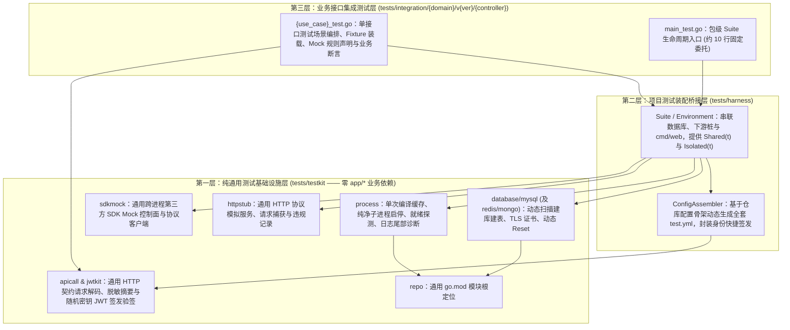
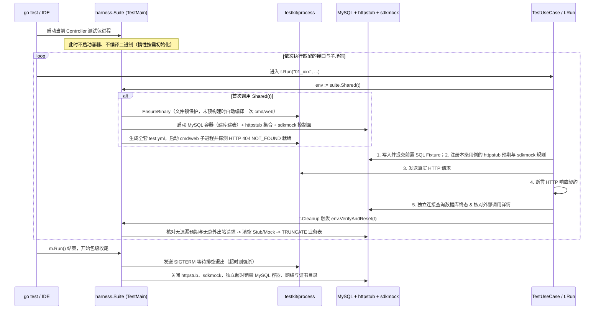

# 集成测试规范与方案

本文统一规定本仓库**集成测试的目标边界、三层代码架构、模块职责划分、执行生命周期、低开销复用策略、路由/Controller 目录映射规则以及单接口测试文件的标准结构**，作为测试基础设施实现与各业务领域接口集成测试编写的唯一准则。

---

## 1. 设计目标与四大核心原则

集成测试面向**单个 HTTP 接口在真实协议入口、真实认证/绑定中间件、真实数据库容器与正式 DDL、受控下游模拟环境下的完整执行链路**。整体设计围绕以下四项核心原则展开：

| 核心诉求 | 设计原则与落地机制 |
| --- | --- |
| **1. 辅助与功能代码同具体业务解耦** | 严格拆分纯通用测试底座 `tests/testkit` 与项目薄装配层 `tests/harness`。`testkit` 严禁依赖 `app/*`，不感知业务领域（`user`/`post`/`order`）、库表清单、内部服务名称或具体第三方供应商 SDK；`harness` 亦通过扫描目录和读取配置拓扑自动装配。 |
| **2. 单接口与多接口均可便捷、低开销运行** | 结合「按需单次自动编译二进制（文件锁缓存）」+「Controller 包级惰性共享环境 `Shared(t)`」+「毫秒级表与桩状态重置 `VerifyAndReset`」，使同组几十个测试场景仅启停 **1** 次容器与服务进程；同时保留 `Isolated(t)` 供超时未排空等破坏性场景安全隔离。 |
| **3. 单接口集成测试内部结构高度清晰** | 每个接口测试文件固定采用「头部场景总览表 + 协议解码契约 + 唯一 `Test<UseCase>` 入口 + 局部辅助函数」四段式布局；每个子场景强制显式呈现**业务解释、前置数据与身份、Company Client 与三方 SDK 模拟、协议输入、预期响应、存储与调用副作用核对**六大要素。 |
| **4. 测试目录与业务路由/Controller 严格同构** | 测试文件路径严格遵循 `tests/integration/<domain>/v<version>/<controller>/<use_case>_test.go`，与路由 `/api/v<version>/<domain>/<controller>/<useCase>`、Controller、Validator 和 DTO 实现确定性的双向直达定位。 |

---

## 2. 三层代码划分与模块职责

为避免把容器管理、子进程控制、YAML 拼接、JWT 签发和 HTTP 解码样板散落在业务测试文件中，同时防止测试基础设施反向耦合具体业务模型，测试代码按依赖方向自下而上划分为三层：



### 2.1 第一层：`tests/testkit/`（纯通用基础设施层，与业务完全解耦）

**约束边界**：`tests/testkit/` 下所有包**禁止导入 `app/...`、`bootstrap`、`routers`、`cmd/...`**，不出现任何当前项目的领域名、表名、内部服务名（如 `python-service-template`）或供应商名（如 `Qwen`、`MiniMax`），可直接复用于任意 Go 服务项目。

| 子包路径 | 核心职能 | 解耦与关键设计要点 |
| --- | --- | --- |
| `tests/testkit/repo` | 仓库与模块根目录发现 | 从工作目录向上查找 `go.mod`，消除对具体模块名（如 `module go-service-template`）的硬编码检查。 |
| `tests/testkit/database/mysql` | 隔离 MySQL 容器与结构生命周期 | 递归扫描指定根目录下 `database/<name>/mysql/create_database.sql`，自动识别实际建出的库名并生成连接配置与最小权限账号；`Reset` 查询 `information_schema.TABLES` 动态清空业务表。未来接入 `database/redis`、`database/mongo` 遵守同等动态发现与重置契约。 |
| `tests/testkit/process` | 宿主机服务二进制构建与子进程托管 | 纯通用宿主机子进程管理器：<br/>1. **按需单次编译**：未指定预编译路径时，用跨进程文件锁将指定 `main` 包与 `-tags` 编译至临时缓存，杜绝 IDE 直接运行报错与“改了代码却跑旧二进制”的陷阱；已指定环境变量时直接校验复用；<br/>2. **生命周期与诊断**：管理纯净 `Env`、动态端口发现、可插拔 `ReadinessProbe`、`SIGTERM` 优雅停机与超时强杀；启动或停机异常时自动截取进程日志尾部内容附入报错。 |
| `tests/testkit/httpstub` | 通用下游 HTTP 协议模拟服务 | 基于 `httptest.NewServer` 封装可跨用例复用的受控端点：<br/>1. 支持按 `Method + Path` 注册本轮预期处理器（返回固定状态码/JSON、自定义响应头或模拟网络延迟/断连）；<br/>2. **不直接持有单个用例的 `testing.T`**：收到未匹配的意外请求时，返回 `502` 并线程安全地记入内部违规列表，由当前用例结束时的 `VerifyAndReset()` 统一向当前活跃的 `testing.TB` 报告失败；<br/>3. 完整记录每次入站请求快照（Method、Path、Query、Header、Body 字节）供用例断言。 |
| `tests/testkit/sdkmock` | 通用跨进程第三方 SDK Mock 框架 | 解决子进程架构下父进程无法直接替换子进程内存对象的痛点，且不绑定任何具体 SDK：<br/>1. **父进程 `Controller`**：在 `127.0.0.1:0` 启动本地控制面，按通用二元组 `(provider, operation)`（例如 `("ai.llm.qwen", "GenerateText")`）管理预期匹配规则、模拟耗时、预设返回载荷或错误，并记录实际调用序列；未配置调用一律拒绝并记入违规列表；<br/>2. **子进程轻量 `Client`**：纯标准库实现，将子进程收到的调用入参序列化发往控制面，还原返回值或错误。未来项目新增 OSS、COS、视频生成等任何非 HTTP 协议 SDK，`sdkmock` 无需任何改动。 |
| `tests/testkit/jwtkit` | 测试 JWT 密钥与凭证工具 | 每轮生成密码学随机 32 字节 HS256 密钥，导出配置参数，并提供按任意 `(Kind, Namespace, SubjectID)` 签发合法 Token、已过期 Token、异构密钥无效 Token 以及解析验签的能力（不绑定本项目的具体角色常量）。 |
| `tests/testkit/apicall` | HTTP 契约调用与脱敏断言辅助 | 提供禁用重定向与跨用例连接复用的 `http.Client`，支持便捷发送 Query / 原始 JSON / 自定义 Header 请求；限制响应体读取上限，提供通用 `data/error` 信封解码，并在状态码不符预期时安全提取非敏感的 `error.code`、`error.business_code`、`error.message` 与追踪响应头输出诊断（绝不打印 `data` 中的敏感 Token）。 |

### 2.2 第二层：`tests/harness/`（项目装配桥接层，`//go:build integration || business`）

**约束边界**：作为 `tests/integration` 与 `tests/business` 共用的薄适配层，集中维护“如何把通用 `testkit` 组装成本项目 `cmd/web` 所需的运行环境”，使业务测试文件彻底告别环境胶水代码：

1. **配置拓扑自动装配（零硬编码下游服务）**：
   - 数据库配置直接采用 `mysqltest.Environment.ConfigDir()` 生成的 `database/mysql/test.yml`。
   - 补齐 `logger/test.yml`、`snowflake/test.yml` 及由 `jwtkit` 生成的 `authn/jwt/test.yml`（通过结构化序列化写出）。
   - **公司内部服务自动挂载**：直接读取仓库 `config/integrations/company/test.yml` 的拓扑骨架，遍历其中声明的每个顶层服务名，自动为其分配一个独立的 `httpstub.Server` 实例并替换 `base_url`、收敛测试超时。未来在 `config/integrations/company/` 新增内部服务或 Controller 时，`harness` 自动感知并为其建立默认拦截桩，旧用例无需改动一行代码。
2. **第三方 SDK 边界装配**：
   - 在 [app/integrations/thirdparty](../../app/integrations/thirdparty) 的装配边界（`//go:build integration_app`）为第三方 SDK Client 接入轻量委托，读取启动器注入的 `APP_INTEGRATION_SDK_MOCK_URL` 转发至 `sdkmock.Client`；保留模型校验、Tracing Span 与日志契约，上游 `Service`、`Controller` 业务代码保持零修改。
3. **双模式环境托管器（`Suite`）**：
   - `suite.Shared(t)`：懒初始化包级共享环境，自动注册用例级 `VerifyAndReset` 钩子。
   - `suite.Isolated(t, opts...)`：按自定义参数（如缩短的 `ShutdownTimeout`）启动当前用例专属环境，结束后独立排空销毁。
4. **项目级语义便捷方法**：
   - 基于 `jwtkit` 提供 `IssueMemberToken(t, userID)`、`IssueExpiredMemberToken(t, userID)`、`IssueServiceAdminToken(t, subject)`、`AuthenticateToken(t, token)` 等贴合本项目 [api-authentication.md](../application/api-authentication.md) 的辅助入口。

### 2.3 第三层：`tests/integration/`（接口集成测试层，`//go:build integration`）

只包含各业务接口的测试场景代码与可选静态样本 `testdata/`，职责纯粹收敛为：**声明业务意图 → 装载最小前置 SQL 数据 → 声明本条用例的下游行为 → 发送真实协议请求 → 断言响应、数据库终态与外部调用记录**。

---

## 3. 目录组织与业务路由/Controller 严格对应规则

### 3.1 完整目录结构全景

```text
tests/
├── testkit/                                         # 第一层：纯通用基础设施（无 build tag，自身单测可随 go test ./... 运行）
│   ├── repo/
│   ├── database/
│   │   ├── mysql/
│   │   ├── redis/
│   │   └── mongo/
│   ├── process/
│   ├── httpstub/
│   ├── sdkmock/
│   ├── jwtkit/
│   └── apicall/
│
├── harness/                                         # 第二层：项目级测试装配桥接层（//go:build integration || business）
│   ├── suite.go                                     # Suite 管理、Shared(t) / Isolated(t) 与 VerifyAndReset 编排
│   ├── environment.go                               # 组合 MySQL、httpstub、sdkmock 与 cmd/web 子进程
│   ├── config.go                                    # 自动扫描并写出全套 test.yml
│   └── auth.go                                      # 本项目身份凭证签发与验签辅助
│
├── integration/                                     # 第三层：单接口集成测试（//go:build integration）
│   ├── user/
│   │   └── v1/
│   │       ├── user_profile/                        # 严格对应 UserProfileController (/api/v1/user/userProfile/*)
│   │       │   ├── main_test.go                     # 包级 TestMain 入口
│   │       │   ├── helpers_test.go                  # 包内最小 SQL Fixture 与表查询辅助
│   │       │   ├── query_user_profile_by_user_id_test.go
│   │       │   ├── query_user_profile_page_test.go
│   │       │   ├── create_user_test.go
│   │       │   ├── generate_user_avatar_test.go
│   │       │   ├── update_user_profile_test.go
│   │       │   └── batch_query_user_profiles_test.go
│   │       └── user_membership/                     # 严格对应 UserMembershipController (/api/v1/user/userMembership/*)
│   │           ├── main_test.go
│   │           ├── helpers_test.go
│   │           ├── query_user_membership_by_user_id_test.go
│   │           └── query_membership_change_record_page_test.go
│   ├── post/
│   │   └── v1/...
│   └── order/
│       └── v1/...
│
└── business/                                        # 多接口产品流程业务测试（//go:build business，复用 harness 与 testkit）
    └── user/...
```

### 3.2 路由、Controller 与集成测试文件的双向确定性映射

参照 [接口路由与命名规范](../application/api-routing.md)，项目中任一 HTTP 接口与集成测试均遵循**零歧义的一一映射公式**：

```text
HTTP 路由        : /api/v<version>/<domain>/<controllerGroup>/<useCase>
业务 Router      : app/domains/<domain>/routers/router.go
业务 Validator   : app/domains/<domain>/validator/v<version>/<controller>/<use_case>_validator.go
业务 DTO         : app/domains/<domain>/dto/v<version>/<controller>/<use_case>.go
业务 Controller  : app/domains/<domain>/controller/v<version>/<controller>_controller.go -> (*<Controller>Controller).<GoUseCase>
对应集成测试文件 : tests/integration/<domain>/v<version>/<controller>/<use_case>_test.go
测试包名         : package <controller_compact>_test   (如 user_profile 对应 package userprofile_test，与 DTO/Validator 包名一致)
顶层测试入口函数 : func Test<GoUseCase>(t *testing.T)  (每个接口文件有且仅有一个顶层 Test 函数，名称严格等于 Test + Controller 方法名)
```

以现有 `user` 领域的全部 V1 接口为例，定位关系如下：

| HTTP 方法与完整路由 | Controller 方法（`app/domains/user/controller/v1/`） | 集成测试文件（`tests/integration/user/v1/`） | 顶层测试函数 |
| --- | --- | --- | --- |
| `GET /api/v1/user/userProfile/queryUserProfileByUserId` | `(*UserProfileController).QueryUserProfileByUserID` | `user_profile/query_user_profile_by_user_id_test.go` | `TestQueryUserProfileByUserID` |
| `GET /api/v1/user/userProfile/queryUserProfilePage` | `(*UserProfileController).QueryUserProfilePage` | `user_profile/query_user_profile_page_test.go` | `TestQueryUserProfilePage` |
| `POST /api/v1/user/userProfile/createUser` | `(*UserProfileController).CreateUser` | `user_profile/create_user_test.go` | `TestCreateUser` |
| `POST /api/v1/user/userProfile/generateUserAvatar` | `(*UserProfileController).GenerateUserAvatar` | `user_profile/generate_user_avatar_test.go` | `TestGenerateUserAvatar` |
| `POST /api/v1/user/userProfile/updateUserProfile` | `(*UserProfileController).UpdateUserProfile` | `user_profile/update_user_profile_test.go` | `TestUpdateUserProfile` |
| `POST /api/v1/user/userProfile/batchQueryUserProfiles` | `(*UserProfileController).BatchQueryUserProfiles` | `user_profile/batch_query_user_profiles_test.go` | `TestBatchQueryUserProfiles` |
| `GET /api/v1/user/userMembership/queryUserMembershipByUserId` | `(*UserMembershipController).QueryUserMembershipByUserID` | `user_membership/query_user_membership_by_user_id_test.go` | `TestQueryUserMembershipByUserID` |
| `GET /api/v1/user/userMembership/queryMembershipChangeRecordPage` | `(*UserMembershipController).QueryMembershipChangeRecordPage` | `user_membership/query_membership_change_record_page_test.go` | `TestQueryMembershipChangeRecordPage` |

> [!NOTE]
> **补充约定**：
> 1. 同一 `<controller>` 目录下若有接口测试专用的大型协议样本文件，统一放在 `tests/integration/<domain>/v<version>/<controller>/testdata/<use_case>/` 下。
> 2. 对于尚无 HTTP 路由暴露、但需在真实数据库中做补充集成验证的公开 `Service` 方法，统一放入 `tests/integration/<domain>/service/<service>_test.go`，不混入 `v<version>/<controller>/` 目录，保证 HTTP 接口目录的严格纯粹性。

---

## 4. 集成测试执行流程与低开销运行机制

### 4.1 全生命周期执行流程

每个 `<controller>` 测试包中仅需一份固定约 10 行的 `main_test.go`：

```go
//go:build integration

package userprofile_test

import (
	"testing"

	"go-service-template/tests/harness"
)

var suite harness.Suite

func TestMain(m *testing.M) {
	suite.Run(m)
}
```

一次测试执行的完整控制流如下：



### 4.2 共享模式与独占隔离模式的边界与防污染熔断

1. **常规场景使用 `suite.Shared(t)`（占比 >95%）**：
   - 同一个 `<controller>` 包内的所有接口（如 `UserProfileController` 的 6 个接口、数十个子场景）**全程只启动 1 个 MySQL 容器和 1 个 `cmd/web` 进程**。
   - 场景切换仅执行内存态 Stub/Mock 重置与数据库 `TRUNCATE`，单次切换耗时从 ~10 秒降至数十毫秒。
   - **环境污染熔断保护**：在 `VerifyAndReset` 中，如果发现 `cmd/web` 子进程已异常退出或 `Database.Reset` 返回错误，立即将该共享环境标记为 `poisoned` 并终止销毁，阻止后续子场景在半脏数据上产生误导性的连锁报错。
2. **破坏性或未排空场景使用 `suite.Isolated(t, opts...)`**：
   - 针对测试「外层 `ResponseTimeout` 超时返回 `503` 后内部事务仍在继续执行」、「模拟优雅停机拒绝新请求（`server is shutting down`）」或「自定义特殊应用配置（如极短 Token TTL 或极短请求等待预算）」的场景，调用 `suite.Isolated(t, opts...)`。
   - 依然直接复用已编译好的 `cmd/web` 二进制，但拉起独立容器与进程，用例结束时先停机排空确认后台任务彻底结束再回收，绝不干扰包内其他常规测试使用的 `Shared` 环境。
3. **关于 `t.Parallel()` 的使用约束**：
   - 共享同一套环境的不同测试函数或子场景之间**禁止调用 `t.Parallel()`**（因共用全表计数、分页及全局 Stub/Mock 规则）；单个子场景内部需要验证并发锁或唯一索引竞争时，在该子场景函数内部启动受控的并发 `goroutine` 组并等待全部返回后再进入 `Cleanup`。
   - 跨包并行直接交给 `go test -p <N>`，每个测试包进程各自拥有完全独立的容器、端口与模拟端点，天然无冲突。

### 4.3 五种运行粒度与推荐命令

无论是日常在 GoLand 点击单个函数旁边的运行图标，还是在终端/CI 批量回归，均无需手工前置编译：

| 运行粒度 | 执行命令 | 实际资源开销说明 |
| --- | --- | --- |
| **1. 跑单个具体子场景** | `go test -tags=integration -count=1 ./tests/integration/user/v1/user_profile -run '^TestCreateUser$/02_duplicate_external_account$'` | 自动编译 1 次二进制，启动 1 套环境，仅执行该子场景后立即清理。 |
| **2. 跑单个接口全部场景** | `go test -tags=integration -count=1 ./tests/integration/user/v1/user_profile -run '^TestCreateUser$'` | 启动 **1** 套环境，`createUser` 的全部正常、异常、并发场景通过毫秒级 `Reset` 共享复用。 |
| **3. 跑单个 Controller 全部接口** | `go test -tags=integration -count=1 ./tests/integration/user/v1/user_profile` | 同包下全部 6 个接口测试文件共享 **1** 套环境，零重复拉起容器。 |
| **4. 跑单个业务领域全部接口** | `go test -tags=integration -count=1 -p 2 ./tests/integration/user/...` | `user_profile` 与 `user_membership` 两个包按 `-p 2` 并行，各自内部复用 1 套环境。 |
| **5. 跑全仓库全部集成测试** | `go test -tags=integration -count=1 -p 2 -timeout=15m ./tests/integration/...` | 全仓库通过文件锁仅编译 **1** 次 `cmd/web`，同时最多运行 2 个 MySQL 容器（内存峰值可控在 4 GiB 以内），包内全量复用。 |

---

## 5. 单接口集成测试文件标准结构规范

为了保证任何开发者打开任意 `<use_case>_test.go` 都能迅速掌握该接口测试的全貌，单接口集成测试文件统一遵守**文件级四段式布局**与**场景级六要素规约**。

### 5.1 文件级四段式布局

每个 `<use_case>_test.go` 按以下固定顺序组织：

1. **第 1 段：文件头接口契约与测试场景总览表**
   - 写明被测 HTTP 方法与完整路由、对应的 Router / Validator / Controller / Service 源码位置。
   - **场景总览清单**：明确列出本接口共有多少个测试场景、各自的子测试编号名称、维度分类（`正常链路` / `参数与协议` / `认证与权限` / `业务状态冲突` / `外部依赖` / `并发与事务`）以及核心验证点。新增或删改场景时同步更新此表。
2. **第 2 段：线上协议解码结构与文件常量**
   - 定义仅用于本接口测试断言的轻量 JSON 解码结构体（例如用 `string` 接收 `json:",string"` 的 `user_id`、用 `json.RawMessage` 检验显式 `null`、用指针区分缺失与零值）。不直接用生产 Response DTO 反序列化自证，防止生产 DTO 标签误改时漏检线上协议破坏。
3. **第 3 段：唯一顶层测试函数 `func Test<GoUseCase>(t *testing.T)`**
   - 内部按场景总览表的完全相同顺序，用 `t.Run("<两位序号>_<英文场景名>", ...)` 组织每一个测试场景。
4. **第 4 段：文件局部辅助函数（按需置于文件末尾或包内 `helpers_test.go`）**
   - 仅提取重复的 SQL 预置或单行查询扫描动作（内部首行调用 `t.Helper()`）；**严禁将请求入参、Mock 返回值或核心业务预期值隐藏进辅助函数内部**。

### 5.2 单场景内部六要素规约

无论是独立展开的 `t.Run` 子测试，还是同构分支合并的表驱动条目，**每个场景都必须清晰展现以下六部分信息**：

| 序号 | 结构分块标识 | 必须交代清楚的内容 |
| --- | --- | --- |
| **说明** | **`[业务解释]`** | 解释为什么要测这个场景、背后的业务规则是什么、为什么选择这组输入与状态（不写重复代码字面意思的无意义注释）。 |
| **1** | **`[1. 前置数据与身份]`** | 数据库初始有哪些业务记录（表名、关键主键、状态、版本号），本次调用采用何种身份（匿名、本人 `user/member`、他人 `user/member`、`service/admin`、过期/伪造 Token）。 |
| **2** | **`[2. 外部依赖模拟]`** | 明确声明两类边界行为：<br/>• **Company HTTP Client（`httpstub`）**：哪个下游服务的哪个路径预期收到请求、返回什么状态码与响应体；哪些服务必须保持 **0 次调用**。<br/>• **第三方 SDK（`sdkmock`）**：哪个供应商的哪个方法预期被调用、返回什么结果或错误；哪些 SDK 必须保持 **0 次调用**。 |
| **3** | **`[3. 请求输入]`** | 显式写出 HTTP 方法、路径、Query 参数、必要请求头（如 `Authorization`、`TraceId`）以及原始 JSON 请求体。 |
| **4** | **`[4. 预期响应核对]`** | 核对 HTTP 状态码、关键响应头（如 `Content-Type`、`TraceId`、敏感接口的 `Cache-Control: no-store` 或 `401` 的 `WWW-Authenticate`）、顶层 `data`/`error` 互斥关系、`error.code`/`error.business_code`/`error.details` 或业务返回字段。 |
| **5** | **`[5. 存储终态与调用副作用核对]`** | • **持久化核对**：通过 `env.DB("<domain>")` 独立查询真实落库数据、受影响行数、乐观锁 `version` 变化，或失败场景下原记录**未被修改**。<br/>• **出站与禁止副作用核对**：检查 `httpstub` 收到的真实请求体/追踪头、检查 `sdkmock` 收到的实际参数与调用次数，确认前序失败时下游未被越级调用。 |

### 5.3 标准代码模板示例

#### 示例一：完整展开型子场景（适合涉及多依赖联动、状态变更或并发的核心场景）

以下以 `POST /api/v1/user/userProfile/generateUserAvatar`（`tests/integration/user/v1/user_profile/generate_user_avatar_test.go`）为例，展示全部要素的组织方式：

```go
//go:build integration

// 接口集成测试：POST /api/v1/user/userProfile/generateUserAvatar
// 对应路由    ：app/domains/user/routers/router.go
// 对应校验器  ：app/domains/user/validator/v1/user_profile/generate_user_avatar_validator.go
// 对应控制器  ：app/domains/user/controller/v1/user_profile_controller.go -> (*UserProfileController).GenerateUserAvatar
// 对应服务    ：app/domains/user/service/user_profile_service.go -> (*UserProfileService).GenerateUserAvatar
//
// 测试场景总览（共 6 个场景）：
//   01_member_generates_avatar_success      [正常链路]   已认证成员提交提示词，经 Qwen 优化后交由图片服务生成并返回 URL，不修改用户资料表
//   02_reject_blank_or_invalid_prompt       [参数与协议] 空白提示词或损坏 JSON 在 Validator 层返回 400 INVALID_ARGUMENT，不触发外部调用
//   03_reject_unauthenticated_and_service   [认证与权限] 匿名、无效凭证或 service/admin 身份调用被拒绝（401 / 403），不触发外部依赖
//   04_propagate_qwen_sdk_failure           [外部依赖]   Qwen SDK 返回调用故障时返回 500 INTERNAL_ERROR，且不继续调用图片服务
//   05_abort_when_qwen_returns_empty_text   [外部依赖]   Qwen SDK 返回空白优化文本时返回 500 INTERNAL_ERROR，阻断公司图片生成服务调用
//   06_propagate_company_image_gen_failure  [外部依赖]   Qwen 优化成功但公司图片服务返回非 200 时，接口返回 500 且不污染用户资料
package userprofile_test

import (
	"database/sql"
	"encoding/json"
	"net/http"
	"strings"
	"testing"

	"go-service-template/tests/harness"
	"go-service-template/tests/testkit/apicall"
	"go-service-template/tests/testkit/httpstub"
	"go-service-template/tests/testkit/sdkmock"
)

type generateUserAvatarData struct {
	AvatarURL string `json:"avatar_url"`
}

func TestGenerateUserAvatar(t *testing.T) {
	t.Run("01_member_generates_avatar_success", func(t *testing.T) {
		// [业务解释]
		// 生成头像接口仅供已登录的普通成员（user/member）预览新头像：
		// 服务端先用固定系统指令拼接用户原始描述调用 Qwen（qwen3.8-flash）生成优化提示词，
		// 再将优化后的文本传给公司内部 python-service-template 的图片生成接口获取 URL。
		// 该操作不绑定具体资料更新动作，因此数据库中该用户的 avatar_url 和 version 必须保持原样。
		env := suite.Shared(t)

		// [1. 前置数据与身份]
		const operatorID int64 = 10001
		seedUserProfile(t, env, userSeed{
			ID: operatorID, AccountSource: "wechat", ExternalAccountID: "wx_10001",
			UserName: "Alice", AvatarURL: sql.NullString{}, IsEnabled: true, Version: 0,
		})
		memberToken := env.Auth.IssueMemberToken(t, operatorID)

		// [2. 外部依赖模拟]
		// - 第三方 SDK：注册 Qwen.GenerateText 返回确定的优化文本；MiniMax 未注册（若误调用将自动判败）。
		const optimizedPrompt = "A warm flat-style portrait of a tabby cat wearing glasses, centered square avatar"
		qwenRule := env.SDKMock.Expect("ai.llm.qwen", "GenerateText", sdkmock.RespondJSON(map[string]any{
			"content": optimizedPrompt,
		}))
		// - 公司内部服务：注册 python-service-template 的生成图片路由返回头像地址；其余路由（如 imageEdit）未注册（误调用自动判败）。
		const expectedAvatarURL = "https://cdn.example.com/avatars/generated-cat.png"
		imageGenRoute := env.CompanyStub("python-service-template").Expect(
			http.MethodPost, "/api/v1/image/imageGen/generateImage",
			httpstub.JSONResponse(http.StatusOK, map[string]any{
				"image_url": expectedAvatarURL,
			}),
		)

		// [3. 请求输入]
		const rawPrompt = "一只戴眼镜的橘猫"
		resp := env.HTTP.PostJSON(t, "/api/v1/user/userProfile/generateUserAvatar",
			apicall.WithBearerToken(memberToken),
			apicall.WithRawJSON(`{"prompt":"一只戴眼镜的橘猫"}`),
		)

		// [4. 预期响应核对]
		data := apicall.RequireSuccess[generateUserAvatarData](t, resp)
		if data.AvatarURL != expectedAvatarURL {
			t.Fatalf("avatar_url = %q, want %q", data.AvatarURL, expectedAvatarURL)
		}
		if traceID := resp.Header.Get("TraceId"); len(traceID) != 32 {
			t.Fatalf("response TraceId header = %q, want 32-char hex trace ID", traceID)
		}

		// [5. 存储终态与调用副作用核对]
		// 5.1 核对 Qwen SDK 收到了一次调用，模型为 qwen3.8-flash 且 Prompt 包含用户原始描述。
		qwenCalls := qwenRule.RequireCallCount(t, 1)
		if !strings.Contains(string(qwenCalls[0].ParamsJSON), rawPrompt) {
			t.Errorf("Qwen prompt payload %s did not contain raw user prompt %q", qwenCalls[0].ParamsJSON, rawPrompt)
		}
		// 5.2 核对公司图片服务收到了 Qwen 优化后的提示词（而非原始提示词），且携带了同一 TraceId。
		imageReqs := imageGenRoute.RequireCallCount(t, 1)
		var outboundBody struct {
			Prompt string `json:"prompt"`
		}
		if err := json.Unmarshal(imageReqs[0].Body, &outboundBody); err != nil || outboundBody.Prompt != optimizedPrompt {
			t.Errorf("company imageGen request body = %s, want prompt %q", imageReqs[0].Body, optimizedPrompt)
		}
		if imageReqs[0].Header.Get("TraceId") != resp.Header.Get("TraceId") {
			t.Errorf("outbound TraceId = %q, want inbound %q", imageReqs[0].Header.Get("TraceId"), resp.Header.Get("TraceId"))
		}
		// 5.3 核对禁止副作用：数据库中的用户资料未被修改（avatar_url 仍为 NULL，version 仍为 0）。
		stored := queryStoredUserProfileByID(t, env, operatorID)
		if stored.AvatarURL.Valid || stored.Version != 0 {
			t.Errorf("stored profile after avatar generation = {avatar:%v version:%d}, want {avatar:NULL version:0}",
				stored.AvatarURL, stored.Version)
		}
	})
}
```

#### 示例二：表驱动子场景组（适合同一维度下的多组拒绝/状态矩阵）

当同一接口存在多条结构高度一致的异常或权限分支（例如 `03_reject_unauthenticated_and_service` 下细分无 Token、损坏 Token、`service/admin` 越权调用）时，可在对应子组中使用显式包含相同六要素字段的表驱动结构，避免机械复制过程代码，同时保持每条数据的业务意图一目了然：

```go
	t.Run("03_reject_unauthenticated_and_service", func(t *testing.T) {
		cases := []struct {
			name             string
			businessExplain  string
			authHeader       func(env *harness.Environment) string
			rawBody          string
			wantStatus       int
			wantCode         string
			wantBusinessCode string
		}{
			{
				name:            "anonymous_caller",
				businessExplain: "未携带 Authorization 头时按匿名请求进入 Controller，因接口要求 user/member 身份而返回 401 UNAUTHENTICATED 及 Bearer 挑战头",
				authHeader:      func(_ *harness.Environment) string { return "" },
				rawBody:         `{"prompt":"cyberpunk cat"}`,
				wantStatus:      http.StatusUnauthorized,
				wantCode:        "UNAUTHENTICATED",
			},
			{
				name:             "service_admin_caller",
				businessExplain:  "携带合法 service/admin 凭证虽能通过公共认证中间件，但不满足本人成员身份要求，返回 403 PERMISSION_DENIED 与 USER_PROFILE_PERMISSION_DENIED",
				authHeader:       func(env *harness.Environment) string { return "Bearer " + env.Auth.IssueServiceAdminToken(t, "ops-console") },
				rawBody:          `{"prompt":"cyberpunk cat"}`,
				wantStatus:       http.StatusForbidden,
				wantCode:         "PERMISSION_DENIED",
				wantBusinessCode: "USER_PROFILE_PERMISSION_DENIED",
			},
		}

		for _, tc := range cases {
			t.Run(tc.name, func(t *testing.T) {
				// [业务解释] 见 tc.businessExplain
				env := suite.Shared(t)
				// [1. 前置数据与身份] 由 tc.authHeader 构造
				// [2. 外部依赖模拟] 不注册任何 Qwen 或公司服务规则：误调下游将自动失败
				// [3. 请求输入]
				resp := env.HTTP.PostJSON(t, "/api/v1/user/userProfile/generateUserAvatar",
					apicall.WithHeaderIfNonEmpty("Authorization", tc.authHeader(env)),
					apicall.WithRawJSON(tc.rawBody),
				)
				// [4. 预期响应核对]
				apicall.RequireError(t, resp, tc.wantStatus, tc.wantCode, tc.wantBusinessCode)
				// [5. 存储终态与调用副作用核对]
				env.CompanyStub("python-service-template").RequireNoCalls(t)
				env.SDKMock.RequireNoCalls(t)
			})
		}
	})
```

---

## 6. 基础设施边界与安全底线要求

1. **生产业务层零测试侵入**：禁止为了集成测试在 `Controller`、`Service`、`Repository` 中增加测试专用分支、构造器 Mock 参数或跳过认证的开关；所有外部模拟均停留在网络协议层（数据库容器、`httpstub`）或启动装配层（`//go:build integration_app`）。
2. **敏感信息脱敏输出**：测试断言失败或进程日志截取诊断时，严禁将响应 `data` 中的 `access_token`、测试数据库密码或 JWT 签名密钥直接格式化输出到终端。
3. **确定性清理顺序**：无论共享环境还是隔离环境收尾，均严格遵循「先向 `cmd/web` 发送 `SIGTERM` 等待请求排空与数据库连接池关闭 → 关闭 `httpstub` 与 `sdkmock` → 独立超时销毁数据库容器、网络与临时证书配置目录」的逆序生命周期。
